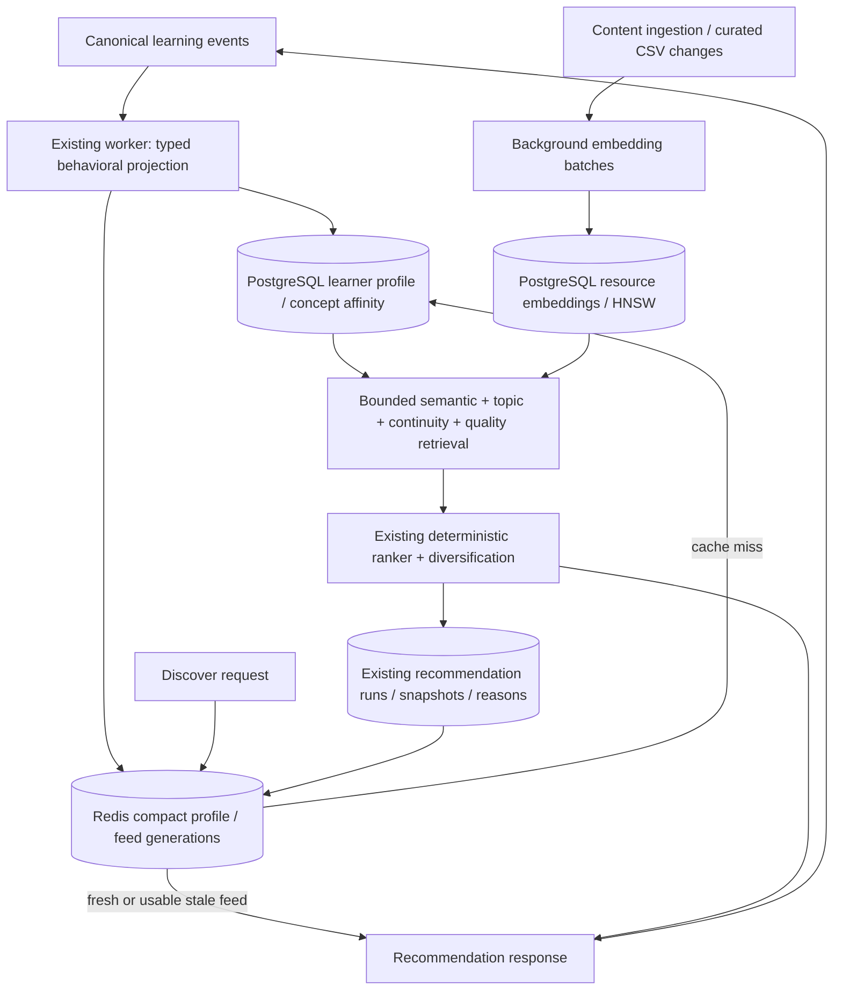

# LearnSpace semantic recommendations — implementation report

Implemented and verified locally on 3 October 2026. The recommendation engine extends the existing discovery pipeline, learner state, worker and PostgreSQL installation. Semantic generation is asynchronous; Discover performs no model inference.

**Deployment limitation:** the configured embedding provider returns HTTP 429. The live catalogue currently has no successfully generated resource embeddings. Real metadata/concept recommendations remain available. Semantic retrieval, vector updates, retries and failure recovery passed integration tests using deterministic vectors confined to test fixtures. Provider quota must be restored before the live semantic backfill can finish; production recommendation quality from those embeddings has not been measured.

## A. Existing architecture found

The repository already provided:

- Canonical onboarding concepts, learner persona, goals/intents, formats, duration and self-reported level.
- `apps/web/lib/discovery/service.ts` and `ranker.ts`, persistent recommendation runs/candidates, feature snapshots, reason codes, impressions and interactions.
- Persistent `userConceptAffinity`, mastery, active goals, StudySessions, resource progress, library state and measured study-consumption events.
- PostgreSQL 16 with pgvector 0.8.6 and existing 1,536-dimensional chunk embeddings/HNSW indexes.
- A background worker with discovery ingestion, durable jobs/outbox processing and a recurring maintenance loop.
- Home feed caching through the existing Redis REST integration. Discover had no early cache path and could inspect learner history during requests.
- A real editorial YouTube curriculum CSV, shared by curated category pages.

The architecture distinguishes the Code Observer, which diagnoses exercise attempts and controls hints, from behavioral projection into persistent learner state. Recommendation work preserves that distinction. No general-purpose recommendation memory was added to the Code Observer.

The review covered project context, system/recommendation architecture, onboarding schema, activity/progress projections, the database schema, discovery ranking/service, ingestion, caching and worker boundaries.

## B. Changes made

### Database

- Added nullable `discovery.resource_embeddings`, keyed by resource/model, with source hashes, retry state and a cosine HNSW index. Invalid dimensions/nonzero vectors are checked; resources remain usable without embeddings.
- Added `discovery.learner_profiles` for compact derived state and a meaningful-change revision.
- Added migrations `0021`–`0023`. Worker privileges use explicit per-operation policies, matching the repository's restriction against `FOR ALL` policies. Application access to learner profiles is restricted to the authenticated user.
- Curated reconciliation can delete only its own concept extraction evidence on global visible resources. It cannot delete another extractor's evidence or user-owned resources.
- Updated the migration/RLS verifier for the new tables and policies. Applied migrations to local development and isolated test databases; also validated the full migration chain on a fresh database.

### Redis

- Added a server-side `ioredis` connection for the existing Redis installation, retaining the existing REST option. One shared connecting promise prevents duplicate connection attempts; failures are bounded and return a database fallback.
- Scoped recommendation keys by version, user and optional topic. Profile keys include user identity, and cached envelopes validate their user/topic scope.
- Fresh feed lifetime: one hour. Usable stale lifetime: one day. Meaningful projection changes increment a user generation; catalogue changes increment a catalogue generation. Both invalidate cached feeds across all relevant scopes.
- Stale requests return immediately and schedule refresh through Next.js `after`. Process-local single-flight and database advisory locks limit duplicate generation. Background refresh checks for an already refreshed value after acquiring the lock.
- Docker web and worker use the existing Redis service. The local Redis port is bound to loopback for integration tests.

### Behavioral projection and worker

- Added a typed, incremental projector to the existing worker loop. It processes at most 20 users and 100 events per user per pass, recording idempotent projection markers.
- Persists durable/recent interests, two vectors, confidence/evidence, observed format/duration preferences and bounded snapshots of affinity, mastery, goals, sessions, progress, dismissals, graph relations, ignored impressions and enrollments.
- Uses the same affinity projection marker as the existing web projector, preventing duplicate affinity updates when both see an event.
- Opens are neutral. Measured watch milestones, completion, saves, sessions, questions, exercises and rewatches have distinct strengths. Immediate abandonment is weak; explicit dismissal is stronger. Playback ticks do not each trigger a recommendation update.
- Recent and durable state decay on seven-day and 90-day half-lives. Historical catch-up decays contributions without moving the state timestamp backward. Onboarding stays a weak prior as behavioral confidence increases.
- Added an embedding provider interface using the repository's existing small provider model and 1,536-dimensional storage convention. Inputs contain bounded title/description/concepts and available transcript excerpts, rather than full transcripts.
- Added batch backfill with source-hash idempotency, `SKIP LOCKED`, validation, retries, recorded errors, provider cooldown and progress logs. No catalogue embedding runs at application startup.
- Reused the real CSV parser/quality utilities by moving them to shared modules. The worker imports actual video entries, reconciles metadata and preserves category associations for videos appearing in several categories. It does not invent videos for playlists.
- The current development import contains 79 actual curated video resources. No synthetic recommendations are created in production.

### Recommendation engine

- Discover checks Redis before querying PostgreSQL or reading a profile.
- A miss loads a compact cached/persisted profile; if it is absent, only onboarding settings/concepts are needed. It does not scan complete watch history or call an embedding provider.
- Merges bounded semantic, topic/graph, quality and enrolled-collection continuation pools, deduplicating to at most 100 candidates. Semantic retrieval uses cosine HNSW, `ef_search=100` and iterative scanning; filtered queries retain metadata fallbacks.
- Continuation follows section/item order across collection sections and skips completed resources.
- Extends the existing deterministic ranker with semantic similarity, recent/durable interest, mastery/prerequisite fit, quality/available retention priors, level, format, duration, freshness, goals and continuity.
- Scoring weights and thresholds live in one shared server configuration. Missing semantic components are excluded and remaining weights normalized.
- Applies creator, playlist, concept/subtopic, level, format and duration diversification. Up to three of 24 slots can introduce qualified adjacent material. Selection and tie-breaking are deterministic.
- Suppresses dismissals and completed resources. A completed resource can return for an actual due mastery review after a minimum interval. Repeated unacted impressions create a modest penalty.
- Persists the original ranking provenance: run/version, candidate feature components, final rank and structured reasons. Explanations use templates; clicks remain diagnostic rather than the ranking objective.

### API and frontend

- Extended `GET /api/v1/discovery/explore?topic=<concept UUID>` under existing authentication/onboarding rules. Topics must belong to the learner's actual interests/emerging interests.
- Added latency logs and `Server-Timing` for Redis, profile, ANN, retrieval, ranking, persistence, serialization and total service time. Counts, cache hits and fallbacks are structured log fields.
- Added `/api/v1/discovery/debug` for authenticated development inspection; production returns 404. Normal responses contain no embeddings, weights or raw scores.
- Added the right arrow from the six-card Discover preview to `/app/discover/for-you`, which presents up to 24 recommendations from the same persisted order, plus actual interest/topic controls.
- Preserved the Discover shell and curated category sections. Bookmark remains disabled as requested.
- Reused existing cards, study actions and thumbnail components. Missing YouTube tiles now fall back through real thumbnail sources to a neutral play symbol, without the LearnSpace logo.
- Fixed a first-visit settings-row race uncovered by browser testing using an atomic, nonblocking claim.
- Production client chunks contain none of `ioredis`, embedding model/config markers or learner-vector state. No frontend inference dependency was added. An exact before/after bundle-byte comparison was not available for this already modified working tree.

## C. Final data flow



A missing provider/vector/Redis/profile follows metadata or onboarding/quality fallbacks. The Code Observer remains outside this flow.

HNSW fits the existing pgvector installation and incremental catalogue ingestion: no separate vector service or index training step was introduced. At small catalogue sizes PostgreSQL may reasonably choose an exact scan. The benchmark validates HNSW plans at larger sizes. See the [pgvector index documentation](https://github.com/pgvector/pgvector#hnsw) for its build-memory/search trade-offs.

## D. Measured performance

These are local measurements on shared development hardware, not a production latency guarantee.

| Measurement | Actual result |
|---|---:|
| Cached recommendation service, 20 sequential samples | 0.75 ms median |
| Cache-miss service, 49 candidates, including DB persistence | 83.33 ms |
| ANN retrieval in that cache miss | 7.70 ms |
| Deterministic ranking in that cache miss | 2.73 ms |
| Two initial profile projections | 59.30 ms total |
| One profile update processing 20 completion events | 180.74 ms |
| Cached authenticated HTTP endpoint, production build, 20 samples | 30.56 ms median / 56.18 ms p95 |
| Cache-miss authenticated HTTP endpoint, metadata fallback | 108.66 ms |
| HTTP miss recommendation-service portion | 76.71 ms |
| HTTP response serialization | 0.11 ms |

The HTTP test uses the real imported catalogue and no live resource embeddings, so its miss measures metadata fallback. Vector integration tests use deterministic fixture embeddings with the real database, Redis, projector and ranker. Auth, transport and browser request overhead explain the difference between service and HTTP timings.

The synthetic catalogue benchmark uses dense 1,536-dimensional vectors, 30 sequential queries per size, 50 concurrent requests through a ten-connection pool and 100 returned candidates. Concurrency numbers include connection-pool waiting.

| Catalogue | Retrieval median / p95 | 50 concurrent median / p95 | HNSW size |
|---|---:|---:|---:|
| 1,000 | 15.73 / 27.10 ms | 237.53 / 315.39 ms | 7.8 MiB |
| 10,000 | 18.27 / 37.58 ms | 317.21 / 421.45 ms | 78.1 MiB |
| 50,000 | 12.62 / 15.23 ms | 101.13 / 182.00 ms | 390.6 MiB |
| 100,000 | 12.21 / 28.13 ms | 71.25 / 138.48 ms | 781.3 MiB |

Ranking 100 candidates to 24 over 200 iterations: **3.96 ms median, 7.54 ms p95**. Benchmark-client RSS ranged from 87.8–96.6 MiB; this is not PostgreSQL memory consumption. Database buffer activity/plans are preserved in the artifacts. HNSW builds took 1.20 s, 41.92 s, 148.53 s and 317.28 s respectively with a 2 GiB maintenance-memory setting. Early measurements overlapped other local verification/index activity, so the size table is not a controlled scaling curve. Temporary benchmark tables were removed.

No 100,000-resource end-to-end HTTP load test or ANN recall study was performed. The scale test measures storage/retrieval and bounded ranking; the authenticated journey measures a small real catalogue.

## E. Tests and battle testing

| Suite/check | Result |
|---|---|
| Focused unit/UI/discovery/category/thumbnail regressions | 60 passed |
| Existing worker unit and real lifecycle integration | 12 passed |
| Hybrid integration, legacy adaptive integration and onboarding integration | 3 passed |
| Database isolation/provenance/worker/vector/outbox checks | 19 passed |
| Migration manifest/RLS verifier and Drizzle migration check | Passed |
| Web typecheck, shared/worker builds, production Next.js build | Passed |
| Development browser journey | Passed |
| Production-build browser journey | Passed |
| 1k/10k/50k/100k retrieval + ranking benchmark | Completed |

Behavior coverage includes onboarding without history, immediate requests before a profile exists, no interests, concept repetition, divergence from onboarding, accidental opens/abandonment, measured completion, rewatches, dismissals, adjacent exploration, creator diversity, completed suppression, gradual confidence/decay, truthful reasons and cache invalidation.

The real integration exercises the chain event → projection → affinity/profile → generation invalidation → candidate retrieval → persisted ranking → Redis. It also checks backfill replay, invalid provider output, invalid/zero vectors, missing vectors, unavailable vector tables, Redis failure, corrupt cache JSON, stale serving/refresh, user RLS, topic filtering, cross-section playlist continuation and scoped curated reconciliation. Twenty concurrent requests return the same run.

The browser journey signs up and completes onboarding, verifies preview/full-feed order, selects interests, introduces a new learning topic through trusted test activity, verifies the changed context, checks 1280/768/390-pixel layouts and confirms production excludes fixture resources and debug output. Completion activity is injected as canonical test events; the browser test does not claim to watch full external YouTube videos.

Earlier failures exposed and fixed connection-pipeline command casing, raw SQL array/date encoding, first-visit contention, exploration quota termination, worker reconciliation privileges and viewport-transition timing. The final suites above passed after those corrections. A mobile artifact is saved as `docs/benchmarks/recommendations-mobile.png`.

## F. Remaining limitations and rollout

- **Provider quota:** HTTP 429 prevents real semantic backfill. Restore the provider's available quota/credentials, then run bounded backfill. Recorded failures and cooldown prevent repeated synchronous work; Discover remains functional.
- Quality, topic extraction, difficulty and progression rules are deterministic heuristics. Existing metadata and mastery are respected, but incomplete catalogue descriptions/durations/transcripts limit precision. No fabricated quality or mastery measurements are supplied.
- Rich playlist progression requires existing collection enrollments/items. External curated playlist URLs with no ingested contents do not have an invented video-level sequence.
- Behavioral updates follow the worker cadence (normally about 30 seconds), with bounded catch-up batches. An established profile remains usable while the worker is delayed.
- Completed/dismissed eligibility is checked against persistent data; derived context snapshots are capped to keep requests lightweight. A future larger catalogue may justify additional compact aggregates or retrieval/index tuning.
- Learning utility is the ranking objective, but coefficients are configured heuristics. No real learning-gain improvement, provider-embedding semantic accuracy or production capacity claim has been established by these tests.
- Collaborative filtering and sequence models are deferred. The current engine does not train on click-through rate.

Operational commands use the existing database/worker environment:

```sh
pnpm --filter @learnspace/db db:migrate
pnpm --filter @learnspace/worker recommendations:backfill --batches=10
pnpm --filter @learnspace/web test:recommendations
```

Backfill requires `DATABASE_WORKER_URL` and a working `OPENAI_API_KEY`. Embeddings are nullable throughout rollout. Content metadata changes must update the resource timestamp, as existing ingestion does, so source-hash reconciliation can select changed resources.

`LEARNSPACE_SEMANTIC_DISCOVERY_ENABLED=false` selects the existing discovery fallback and disables semantic maintenance. Set it consistently for web and worker to roll back behavior without dropping tables or deleting learner evidence. The migration chain can be applied before backfill; old resources remain valid. Leave the additive tables in place for an operational rollback.

## G. Future evolution

**LearnSpace needs now:** provider quota restored, bounded backfill completed, observed fallback/cache/worker-backlog metrics, and real retention/exercise/completion outcomes to calibrate the current utility weights. Measure ANN recall and production percentile latency on actual embeddings before making capacity claims.

**After substantial real interaction data exists:** consider offline item-item or implicit collaborative signals, then a small asynchronous sequence encoder if history volume supports it. Their outputs should become additional compact retrieval/ranking features. Keep online serving as cached state → bounded retrieval → deterministic ranking; introducing another service or per-request model is unnecessary for this implementation.

## H. Resumed worker and recommendation work — 5 October 2026

The uncommitted work after `6c1e50a` covers semantic-learning-v2 hardening and
continuous AWS worker hosting. Onboarding now has its own vector rather than
becoming behavioral evidence. Removing an explicit preference preserves only
interests supported by learning activity. Emerging interests expire with recent
evidence; graph and ignored-impression changes revise the compact profile.

Embedding calls run outside resource/profile transactions. Resource claims use
bounded leases with timestamp claim tokens, reject changed content, and keep
the discovery queue moving while maintenance awaits a provider. The worker
publishes a heartbeat and closes Redis when stopped.

The resumed review fixed two remaining defects:

- A restored onboarding embedding was neither retried promptly nor considered
  a meaningful change. Provider-available maintenance now retries missing
  onboarding vectors, validates query output, and invalidates the cached feed
  when a vector arrives. Failed retries leave the recommendation revision alone.
- Production Docker builds copied stale `.tsbuildinfo` files while excluding
  `dist`, so the compiler reported success without emitting the worker runtime.
  Docker now excludes that metadata. CI builds and imports the packaged worker,
  checks its curriculum file, and checks that it runs without root.

Worker deployment verification also checks the active task's exact build SHA
and image digest, rejecting a stable older service. CI includes isolated tests
for preserving runtime secrets and rejecting mismatched releases.

The release review also made browser fixtures calendar-safe on Mondays and
seeded the real curriculum within the recommendation browser test. The full
feed assertion now checks the API's eligible result count and excludes synthetic
fixtures in production. The deployment policy now grants CloudFormation's
network parameter reads, security-group creation in the worker VPC, and ECS's
task-definition read required for exact-build verification.

Verification after these fixes:

- All five workspace typechecks and lint commands passed; lint retains existing
  non-null-assertion warnings in the recommendation tests.
- The complete workspace production build passed, including all 41 Next.js
  static pages and compiled shared/database/worker packages.
- 28 recommendation tests and 12 worker tests passed, including real
  PostgreSQL/Redis integration on an isolated database and slow-provider checks.
- A fresh database passed the full migration chain, schema/RLS verification,
  and development seed.
- Two worker deployment tests and ten discovery deployment tests passed. Worker
  Python lint and deployment shell syntax passed.
- The production worker image built, imported its compiled dependencies, ran
  with UID 1001 against the isolated database, wrote a fresh heartbeat, and
  shut down cleanly on SIGTERM.
- AWS accepted the worker CloudFormation template. Access Analyzer reported no
  findings for the checked-in deployment policy. The live GitHub deployment
  role already contains the worker permission statements.
- All 20 production browser tests passed in CI, including analytics controls,
  touch interaction, onboarding, topic filtering, and persistent learning shifts.

The cloud rollout completed through [CI run 37288416604](https://github.com/HARISUNDARRAJENDRAN/LearnSpace/actions/runs/37288416604).
The web app, discovery agent, and continuous worker serve tested build
`8c75cf22a55e7d263c6bbf3ea0a6cd81ddd63bb3`. The worker stack reached
`CREATE_COMPLETE`, with one healthy Fargate task and a completed ECS rollout.
Release verification confirmed image digest
`sha256:95f072a6c63ccf55dd1c22b0096c7fe607aff7449db6cf93fc77b9fe4369c38c`.
The hosted smoke processed a job through the deployed worker, made three live
provider calls, persisted ten resource-concept links, and verified that the
authenticated web feed ranked all ten candidates. It did not require those
candidates to displace stronger lessons in the visible preview.

Embedding provider quota remains a separate limitation: query-embedding requests
return HTTP 429. Live semantic backfill still requires available provider quota;
the successful discovery smoke establishes ingestion and ranking, not live
embedding quality.
