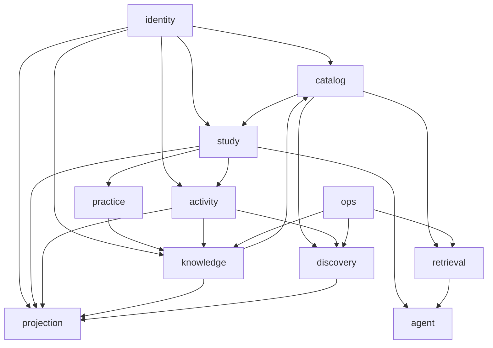
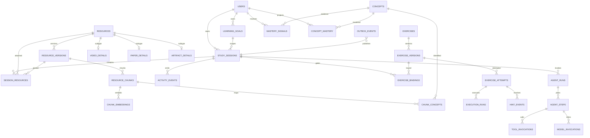
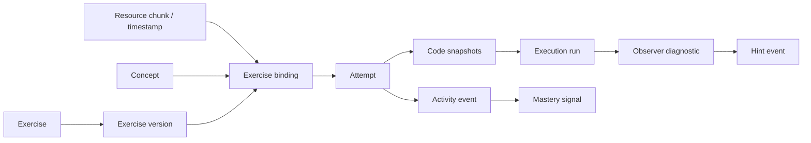

# LearnSpace — PostgreSQL and Drizzle ORM Schema Architecture

**Status:** Proposed production target  
**Repository baseline:** `HARISUNDARRAJENDRAN/LearnSpace@f6c615dcfef5bdac777c5652ca2259fa54d9b900`  
**Prepared:** 2026-08-29  
**Scope:** PostgreSQL physical design, Drizzle schema organization, transactional boundaries, retrieval storage, practice telemetry, mastery graph, agent audit, migrations, access control, performance, retention, and current-schema migration.

---

## 1. Architecture Decision Summary

LearnSpace should use **one primary PostgreSQL cluster** as the transactional system of record, extended with `pgvector` for semantic retrieval. The database should remain a **modular relational core**, not a collection of feature-specific JSON documents.

The central aggregate is `study.study_sessions`. Every learner action must be attributable, when applicable, to:

```text
user
-> learning_goal
-> study_session
-> resource + immutable resource_version
-> source anchor / resource_chunk
-> activity / exercise / tutor / research action
-> artifact / concept / mastery evidence
```

The target design uses these PostgreSQL namespaces:

```text
identity     account, authentication, user settings
catalog      resources, versions, media/paper metadata, collections, library
study        goals, sessions, context, progress, focus, tutor threads, schedule
activity     immutable learner-event stream
retrieval    chunks, embeddings, retrieval traces, citations, ingestion state
practice     exercises, attempts, sandbox execution, diagnostics, hints
knowledge    concepts, relations, artifacts, mastery, reviews, open questions
agent        agent runs, steps, tool/model invocations, generated outputs
discovery    recommendation runs, candidates, impressions, affinities, quality
ops          jobs, outbox, idempotency, audit, dead letters, backfills
projection   rebuildable read models for dashboard and analytics
```

Primary decisions:

1. Preserve UUID identifiers for aggregate entities.
2. Store source content as immutable `resource_versions`.
3. Store large binaries in S3-compatible object storage; PostgreSQL stores metadata and object keys.
4. Store semantic chunks and vectors in PostgreSQL/pgvector.
5. Keep append-only events separate from mutable projections.
6. Normalize agent, practice, and mastery evidence; do not bury operational state in unbounded JSONB.
7. Use Drizzle TypeScript schema as the DDL source of truth, but use reviewed custom SQL for extensions, generated columns, RLS, online indexes, partitioning, and complex backfills.
8. Apply migrations through a dedicated migration job; never mutate production with `drizzle-kit push`.
9. Migrate with `expand -> backfill -> dual-write -> verify -> cut over -> contract`.
10. Do not combine the schema rewrite with a PostgreSQL major-version upgrade.

---

## 2. Current Repository Assessment

### 2.1 Reusable foundations

The current repository already provides:

- PostgreSQL + Drizzle ORM.
- `postgres.js` connection driver.
- UUID keys generated with `gen_random_uuid()`.
- relational identity, OAuth, resources, papers, topics, playlists, activities, focus sessions, jobs, and agent runs.
- a PostgreSQL job queue using `FOR UPDATE SKIP LOCKED`.
- migration generation under `infra/migrations/drizzle`.
- baseline migration reconciliation.
- `pgcrypto`, `pg_trgm`, and PostGIS initialization.

### 2.2 Structural defects to correct

| Current structure | Defect | Target correction |
|---|---|---|
| `videos` + `resources` + `video_resources` | duplicated canonical identity and metadata | one `catalog.resources` row plus `catalog.video_details` subtype |
| `papers` | no immutable version, parsed structure, or citation graph | `resource_versions`, `paper_details`, authors, references, chunks |
| `activities.video_id` | event model is YouTube-specific | resource-, session-, chunk-, and concept-aware event envelope |
| `user_focus_sessions.video_id` | focus cannot represent papers, code, or review | bind focus to `study_session_id` and optional `resource_id` |
| `notebook_pages` | detached from sessions, resources, concepts, and provenance | note becomes versioned artifact resource with typed links |
| `agent_runs` JSON arrays | poor queryability, replay, cost attribution, and diagnostics | normalized run/step/tool/model tables |
| `user_genre_affinity` | string taxonomy diverges from knowledge model | concept-backed affinity table |
| `user_topic_signals` | one row per user/topic loses evidence history | append-only mastery/affinity signals plus projection |
| `library_items.progress` JSONB | progress semantics cannot be constrained or indexed | dedicated `study.user_resource_progress` |
| one large `schema.ts` | ownership and migration diffs become difficult to review | schema modules per bounded context with one export barrel |
| PostGIS image, no vector extension | unused geospatial surface; no semantic index | remove PostGIS if unused, add `vector` extension |
| one baseline migration | future evolution lacks small reviewed increments | sequential generated/custom migrations |
| hard-coded pool `max: 10` | deployment topology cannot tune connection pressure | environment-driven pool configuration |

### 2.3 Contract drift requiring immediate correction

The database enum currently includes:

```text
free | pro | lifetime | learner
```

The shared Zod contract currently accepts:

```text
free | pro | lifetime
```

This must be reconciled before further schema work. Database and API contracts must derive from one reviewed domain definition or be validated by a CI drift test.

---

## 3. Non-Negotiable Data Invariants

1. `StudySession` is the orchestration boundary, not a video page.
2. YouTube and arXiv identifiers are provider identifiers, never primary domain identifiers.
3. AI answers reference a specific `resource_version` and stable source anchors.
4. Resource versions are immutable after they become `ready`.
5. Embeddings are derived data and can be rebuilt.
6. Every mastery mutation references evidence.
7. `concept_mastery` is a projection, not a direct LLM write.
8. Hidden tests are inaccessible to the web and AI application roles.
9. Code execution records the exact source hash, runtime image digest, test-bundle hash, resource limits, and result.
10. User-authored notes, code, and diagrams are versioned resources, not anonymous text blobs.
11. Domain mutations and outbox events commit atomically.
12. All externally retried mutations require an idempotency key.
13. JSONB may hold sparse metadata; it must not replace queryable relationships or lifecycle columns.
14. Derived projections must be rebuildable from canonical rows and events.
15. Deletes must not silently destroy shared public resources or provenance needed by retained learner records.

---

## 4. PostgreSQL Platform Design

### 4.1 Version strategy

The current development image is PostgreSQL 16 with PostGIS. Keep PostgreSQL 16 during the first domain migration. Validate the completed schema against the currently supported production major in CI, then perform the major-version upgrade as an independent change with its own backup, restore, extension, and query-plan validation.

### 4.2 Required extensions

```sql
CREATE EXTENSION IF NOT EXISTS pgcrypto;
CREATE EXTENSION IF NOT EXISTS pg_trgm;
CREATE EXTENSION IF NOT EXISTS vector;
```

Optional:

```sql
CREATE EXTENSION IF NOT EXISTS unaccent;
```

Operational, usually provider-managed:

```text
pg_stat_statements
```

PostGIS should be removed from the development image after confirming no external migration or downstream system depends on it. No repository usage currently justifies the extension.

### 4.3 Storage responsibilities

| Storage | Responsibility |
|---|---|
| PostgreSQL | identities, resources, versions, chunks, relationships, events, exercises, mastery, agent metadata, jobs, outbox |
| pgvector | vectors attached to versioned chunks and optional concepts |
| Object storage | raw PDFs, normalized documents, transcript snapshots, figures, audio, code bundles, generated diagrams, hidden test bundles |
| Redis | caches, leases, rate limits, ephemeral realtime state, SSE fan-out |

PostgreSQL must not store large PDFs, audio streams, screen captures, container images, or multi-megabyte model payloads directly in ordinary rows.

### 4.4 Connection roles

```text
learnspace_migrator   DDL and controlled data migrations only
learnspace_app        web/core transactional reads and writes
learnspace_ai         scoped session/retrieval reads; agent audit writes
learnspace_worker     ingestion, embeddings, projections, outbox/jobs
learnspace_runner     execution tables and hidden-test metadata only
learnspace_readonly   support/analytics with PII restrictions
```

No runtime service should connect as database owner or superuser.

### 4.5 Connection-pool policy

Current `postgres(env.DATABASE_URL, { max: 10 })` should become environment-driven:

```text
DB_POOL_MAX
DB_CONNECT_TIMEOUT_SECONDS
DB_IDLE_TIMEOUT_SECONDS
DB_MAX_LIFETIME_SECONDS
DB_PREPARED_STATEMENTS
DB_STATEMENT_TIMEOUT_MS
DB_LOCK_TIMEOUT_MS
```

Rules:

- one pool per process;
- calculate total connections across replicas and workers;
- reserve capacity for migrations, operators, and autovacuum;
- disable prepared statements when using a transaction-mode pooler that does not support them;
- use a direct, non-pooled connection for migrations and `CREATE INDEX CONCURRENTLY`;
- set `application_name` per deployable where supported.

---

## 5. Namespace and Ownership Model



Ownership rule:

- the schema named above owns its tables and write invariants;
- cross-schema consumers may read through repositories or views;
- only the owning module writes canonical rows;
- foreign keys enforce identity and provenance even when application modules are separate.

During migration, existing `public.*` tables may remain in place. New tables should use target schemas immediately. Moving existing tables between PostgreSQL schemas is optional and must not be mixed with behavioral cutover.

---

## 6. Data-Type and Naming Standards

### 6.1 Naming

- PostgreSQL: `snake_case`.
- TypeScript properties: `camelCase`.
- Explicit database column names in Drizzle.
- Index and constraint names are explicit, stable, and below PostgreSQL's identifier limit.
- Prefix names by table rather than relying on generated names.

Examples:

```text
study_sessions_user_status_idx
resources_provider_external_global_uq
exercise_attempts_score_chk
session_resources_version_fkey
```

### 6.2 Identifiers

| Entity class | Key |
|---|---|
| aggregates and externally referenced records | UUID |
| associative tables | composite primary key where relationship identity is sufficient |
| high-volume internal logs | UUID initially; bigint identity may be introduced after measured need |
| external provider identifiers | text columns with provider-scoped unique indexes |

Do not expose sequential internal keys through public APIs.

### 6.3 Time

- Use `timestamptz` for absolute time.
- Use integer milliseconds for media anchors and execution duration.
- Use `date` for publication dates with no meaningful time component.
- Store all server timestamps in UTC.
- Every mutable aggregate has `created_at` and `updated_at`.
- Use `deleted_at` only on roots requiring recoverable deletion; do not soft-delete every child table.

### 6.4 Numeric values

- probabilities, confidence, utility, and mastery: `real` with `CHECK value BETWEEN 0 AND 1`;
- bounded progress percentage: `real` with `CHECK value BETWEEN 0 AND 100`;
- monetary model cost: `numeric(18,8)`;
- provider counters: `bigint`;
- token counts and durations: `integer` unless the domain can exceed its range.

### 6.5 JSONB

Valid JSONB uses:

- provider payload fragments;
- parser-specific metadata;
- bounded context snapshots;
- model/tool structured input/output summaries;
- sparse feature vectors and reason codes.

Invalid JSONB uses:

- statuses;
- ownership;
- resource/session/concept relationships;
- progress;
- test results needed for queries;
- token/cost/latency metrics;
- current-version pointers;
- permissions.

### 6.6 Arrays

Arrays are allowed only for small, bounded, non-relational values. Authors, concepts, citations, collection items, aliases, and mastery evidence require normalized tables.

### 6.7 Enums

Use PostgreSQL enums only for low-churn lifecycle states. Use text plus a lookup table or versioned contract for expanding vocabularies such as agent tools, event types, concept relations, providers, and artifact semantics.

Recommended stable enums:

```text
identity.user_status
catalog.resource_type
catalog.resource_status
catalog.resource_visibility
study.goal_status
study.session_mode
study.session_status
practice.exercise_kind
practice.attempt_status
practice.execution_status
agent.run_status
agent.step_status
ops.job_status
ops.outbox_status
```

---

## 7. High-Level Entity Model



---

## 8. `identity` Schema

### 8.1 `identity.users`

Canonical account record.

```text
id                    uuid PK default gen_random_uuid()
email                 text NOT NULL
email_verified        boolean NOT NULL default false
password_hash         text NULL
status                user_status NOT NULL default active
display_name          text NULL
avatar_url             text NULL
locale                text NOT NULL default 'en'
timezone              text NOT NULL default 'UTC'
subscription_tier     subscription_tier NOT NULL default free
created_at            timestamptz NOT NULL default now()
updated_at            timestamptz NOT NULL default now()
deleted_at            timestamptz NULL
```

Constraints and indexes:

```text
UNIQUE INDEX lower(email)
CHECK deleted_at IS NULL OR status IN ('deletion_pending', 'deleted')
INDEX (status, created_at)
```

The API must normalize email before insert. The database unique index on `lower(email)` remains the final guard.

### 8.2 `identity.auth_accounts`

OAuth/provider linkage.

```text
id                    uuid PK
user_id               uuid FK identity.users ON DELETE CASCADE
provider              text NOT NULL
provider_account_id   text NOT NULL
provider_email        text NULL
email_verified        boolean NOT NULL default false
profile               jsonb NOT NULL default '{}'
created_at            timestamptz NOT NULL
updated_at            timestamptz NOT NULL
UNIQUE (provider, provider_account_id)
INDEX (user_id)
```

### 8.3 `identity.auth_sessions`

Rotating refresh-session state.

```text
id                    uuid PK
user_id               uuid FK identity.users ON DELETE CASCADE
rotation_family_id    uuid NOT NULL
refresh_token_hash    text NOT NULL
rotated_from_id       uuid NULL FK identity.auth_sessions ON DELETE SET NULL
user_agent            text NULL
ip_hash               text NULL
last_seen_at          timestamptz NULL
expires_at            timestamptz NOT NULL
revoked_at            timestamptz NULL
revocation_reason     text NULL
created_at            timestamptz NOT NULL
```

Indexes:

```text
(user_id, created_at DESC)
(rotation_family_id)
partial (user_id, expires_at) WHERE revoked_at IS NULL
```

Never persist plaintext refresh tokens or raw long-term IP addresses.

### 8.4 `identity.user_settings`

Low-frequency preferences that do not belong on `users`.

```text
user_id               uuid PK FK identity.users ON DELETE CASCADE
learning_preferences  jsonb NOT NULL default '{}'
notification_settings jsonb NOT NULL default '{}'
privacy_settings      jsonb NOT NULL default '{}'
accessibility         jsonb NOT NULL default '{}'
updated_at            timestamptz NOT NULL
```

Frequently filtered settings must be promoted to typed columns.

---

## 9. `knowledge` Taxonomy Core

The existing `topics` and string `genres` should converge into one concept taxonomy. A broad topic is represented as a concept with `kind = 'topic'`; a granular skill such as `Python generator send()` is `kind = 'skill'`.

### 9.1 `knowledge.concepts`

```text
id                    uuid PK
slug                  text NOT NULL UNIQUE
name                  text NOT NULL
kind                  text NOT NULL       # domain, topic, concept, skill, method
summary               text NULL
status                text NOT NULL default active
canonical_parent_id   uuid NULL FK concepts ON DELETE SET NULL
metadata              jsonb NOT NULL default '{}'
created_at            timestamptz NOT NULL
updated_at            timestamptz NOT NULL
```

Indexes:

```text
(kind, status)
(canonical_parent_id)
GIN generated search_tsv(name, summary)
trigram index on name when fuzzy lookup is required
```

### 9.2 `knowledge.concept_aliases`

```text
concept_id            uuid FK concepts ON DELETE CASCADE
alias                 text NOT NULL
normalized_alias      text NOT NULL
locale                text NOT NULL default 'en'
source                text NOT NULL
created_at            timestamptz NOT NULL
PRIMARY KEY (concept_id, normalized_alias, locale)
INDEX (normalized_alias)
```

### 9.3 `knowledge.concept_relations`

Canonical domain graph.

```text
id                    uuid PK
source_concept_id     uuid FK concepts ON DELETE CASCADE
target_concept_id     uuid FK concepts ON DELETE CASCADE
relation_type         text NOT NULL       # prerequisite, part_of, related_to, applies_to
weight                real NOT NULL default 1
confidence            real NOT NULL default 1
status                text NOT NULL default accepted
created_by            text NOT NULL       # curator, importer, model, system
extractor_version     text NULL
created_at            timestamptz NOT NULL
updated_at            timestamptz NOT NULL
UNIQUE (source_concept_id, target_concept_id, relation_type)
CHECK source_concept_id <> target_concept_id
CHECK weight BETWEEN 0 AND 1
CHECK confidence BETWEEN 0 AND 1
```

### 9.4 `knowledge.user_knowledge_edges`

Evidence-backed personal Second Brain relationships.

```text
id                    uuid PK
user_id               uuid FK identity.users ON DELETE CASCADE
source_concept_id     uuid FK concepts ON DELETE CASCADE
target_concept_id     uuid FK concepts ON DELETE CASCADE
relation_type         text NOT NULL
weight                real NOT NULL
confidence            real NOT NULL
status                text NOT NULL default active
last_evidence_at      timestamptz NOT NULL
projector_version     text NOT NULL
created_at            timestamptz NOT NULL
updated_at            timestamptz NOT NULL
UNIQUE (user_id, source_concept_id, target_concept_id, relation_type)
```

Evidence is stored separately; the edge row is a projection.

---

## 10. `catalog` Schema — Resource Core

### 10.1 `catalog.resources`

Canonical identity for external sources and user-created artifacts.

```text
id                    uuid PK
owner_user_id         uuid NULL FK identity.users ON DELETE CASCADE
type                  resource_type NOT NULL
provider              text NOT NULL
external_id           text NULL
canonical_url         text NULL
title                 text NOT NULL
description           text NULL
language              text NULL
visibility            resource_visibility NOT NULL
status                resource_status NOT NULL
current_version_id    uuid NULL
quality_score         real NULL
thumbnail_object_key  text NULL
metadata              jsonb NOT NULL default '{}'
created_at            timestamptz NOT NULL
updated_at            timestamptz NOT NULL
deleted_at            timestamptz NULL
```

Uniqueness:

```text
UNIQUE (provider, external_id)
  WHERE owner_user_id IS NULL AND external_id IS NOT NULL

UNIQUE (owner_user_id, provider, external_id)
  WHERE owner_user_id IS NOT NULL AND external_id IS NOT NULL
```

Indexes:

```text
(owner_user_id, updated_at DESC)
(type, status, quality_score DESC)
(visibility, status)
GIN generated search_tsv(title, description)
trigram index on title
```

Rules:

- `owner_user_id IS NULL` denotes shared/global catalog content.
- private uploads and user-authored resources require an owner.
- `canonical_url` is normalized before persistence.
- `quality_score` is a projection; component features are stored in discovery tables.

### 10.2 `catalog.resource_versions`

Immutable source snapshot and processing boundary.

```text
id                    uuid PK
resource_id           uuid FK resources ON DELETE CASCADE
version_no            integer NOT NULL
source_sha256         char(64) NOT NULL
content_sha256        char(64) NULL
source_etag           text NULL
source_last_modified  timestamptz NULL
raw_object_key        text NOT NULL
normalized_object_key text NULL
mime_type             text NOT NULL
byte_size             bigint NULL
parser_name           text NULL
parser_version        text NULL
extraction_version    integer NOT NULL default 1
processing_status     text NOT NULL
failure_code          text NULL
failure_detail        text NULL
fetched_at            timestamptz NULL
ready_at              timestamptz NULL
created_at            timestamptz NOT NULL
UNIQUE (resource_id, version_no)
UNIQUE (resource_id, source_sha256)
UNIQUE (resource_id, id)
```

`resources.current_version_id` should be protected by a composite foreign key:

```text
(resources.id, resources.current_version_id)
-> resource_versions(resource_id, id)
```

Because this creates a circular DDL dependency, add it through a reviewed custom migration after both tables exist.

### 10.3 `catalog.resource_assets`

Derived or extracted binary assets.

```text
id                    uuid PK
resource_version_id   uuid FK resource_versions ON DELETE CASCADE
asset_type            text NOT NULL       # page_image, figure, table, audio, thumbnail
ordinal               integer NOT NULL
object_key            text NOT NULL
sha256                char(64) NOT NULL
mime_type             text NOT NULL
byte_size             bigint NULL
anchor                 jsonb NOT NULL default '{}'
metadata              jsonb NOT NULL default '{}'
created_at            timestamptz NOT NULL
UNIQUE (resource_version_id, asset_type, ordinal)
UNIQUE (object_key)
```

### 10.4 `catalog.video_details`

```text
resource_id             uuid PK FK resources ON DELETE CASCADE
youtube_id              text NOT NULL UNIQUE
channel_id              text NULL
channel_title           text NULL
duration_ms             integer NULL
published_at            timestamptz NULL
default_audio_language  text NULL
caption_status          text NULL
latest_view_count       bigint NULL
latest_like_count       bigint NULL
latest_comment_count    bigint NULL
metrics_captured_at     timestamptz NULL
fetched_at              timestamptz NULL
```

The existing standalone `videos` row is migrated into `resources + video_details` and then retired.

### 10.5 `catalog.video_metric_snapshots`

```text
resource_id            uuid FK video_details ON DELETE CASCADE
captured_at            timestamptz NOT NULL
view_count             bigint NULL
like_count             bigint NULL
comment_count          bigint NULL
PRIMARY KEY (resource_id, captured_at)
```

Use snapshots to compute engagement velocity and avoid overwriting historical ranking inputs.

### 10.6 `catalog.paper_details`

```text
resource_id            uuid PK FK resources ON DELETE CASCADE
arxiv_id               text NULL UNIQUE
doi                    text NULL UNIQUE
abstract               text NULL
venue                  text NULL
publication_date       date NULL
submitted_at           timestamptz NULL
primary_category       text NULL
license                text NULL
pdf_source_url         text NULL
citation_count         integer NULL
metadata               jsonb NOT NULL default '{}'
```

### 10.7 `catalog.authors`

```text
id                    uuid PK
normalized_name       text NOT NULL
preferred_name        text NOT NULL
orcid                 text NULL UNIQUE
semantic_scholar_id   text NULL UNIQUE
metadata              jsonb NOT NULL default '{}'
created_at            timestamptz NOT NULL
updated_at            timestamptz NOT NULL
INDEX (normalized_name)
```

### 10.8 `catalog.paper_authors`

```text
paper_resource_id     uuid FK paper_details ON DELETE CASCADE
author_id             uuid FK authors ON DELETE RESTRICT
ordinal               integer NOT NULL
affiliation           text NULL
PRIMARY KEY (paper_resource_id, author_id)
UNIQUE (paper_resource_id, ordinal)
```

### 10.9 `catalog.paper_references`

```text
id                    uuid PK
paper_resource_id     uuid FK paper_details ON DELETE CASCADE
ordinal               integer NOT NULL
raw_reference         text NOT NULL
cited_resource_id     uuid NULL FK resources ON DELETE SET NULL
cited_doi              text NULL
cited_arxiv_id         text NULL
resolution_status     text NOT NULL default unresolved
confidence            real NULL
metadata              jsonb NOT NULL default '{}'
UNIQUE (paper_resource_id, ordinal)
INDEX (cited_resource_id)
INDEX (cited_doi)
```

### 10.10 `catalog.resource_concepts`

```text
resource_id           uuid FK resources ON DELETE CASCADE
concept_id            uuid FK knowledge.concepts ON DELETE CASCADE
source                text NOT NULL       # provider, classifier, curator, user
relevance             real NOT NULL
is_primary            boolean NOT NULL default false
extractor_version     text NULL
created_at            timestamptz NOT NULL
PRIMARY KEY (resource_id, concept_id, source)
CHECK relevance BETWEEN 0 AND 1
INDEX (concept_id, relevance DESC)
```

This replaces `resource_topics` and the `genres` array as the canonical resource taxonomy.

---

## 11. `catalog` Schema — Collections and Library

### 11.1 `catalog.collections`

Resource-agnostic replacement for playlists and curated courses.

```text
id                    uuid PK
owner_user_id         uuid NULL FK identity.users ON DELETE CASCADE
kind                  text NOT NULL       # manual, curated, learning_path, generated
slug                  text NULL
visibility            resource_visibility NOT NULL
title                 text NOT NULL
description           text NULL
cover_object_key      text NULL
published_at          timestamptz NULL
metadata              jsonb NOT NULL default '{}'
created_at            timestamptz NOT NULL
updated_at            timestamptz NOT NULL
UNIQUE (slug) WHERE slug IS NOT NULL
INDEX (owner_user_id, updated_at DESC)
INDEX (kind, visibility, published_at DESC)
```

### 11.2 `catalog.collection_sections`

Every collection has at least one section. A migrated playlist receives a generated default section.

```text
id                    uuid PK
collection_id         uuid FK collections ON DELETE CASCADE
title                 text NOT NULL
description           text NULL
position              integer NOT NULL
created_at            timestamptz NOT NULL
UNIQUE (collection_id, position)
```

### 11.3 `catalog.collection_items`

```text
id                    uuid PK
section_id            uuid FK collection_sections ON DELETE CASCADE
resource_id           uuid FK resources ON DELETE RESTRICT
position              integer NOT NULL
required              boolean NOT NULL default true
note                  text NULL
metadata              jsonb NOT NULL default '{}'
created_at            timestamptz NOT NULL
UNIQUE (section_id, position)
UNIQUE (section_id, resource_id)
INDEX (resource_id)
```

### 11.4 `catalog.collection_enrollments`

```text
user_id               uuid FK identity.users ON DELETE CASCADE
collection_id         uuid FK collections ON DELETE CASCADE
status                text NOT NULL default active
current_item_id       uuid NULL FK collection_items ON DELETE SET NULL
progress_pct          real NOT NULL default 0
started_at            timestamptz NOT NULL
completed_at          timestamptz NULL
updated_at            timestamptz NOT NULL
PRIMARY KEY (user_id, collection_id)
CHECK progress_pct BETWEEN 0 AND 100
INDEX (user_id, updated_at DESC)
```

### 11.5 `catalog.library_items`

Saved-resource relationship only. Resume/progress state belongs in `study.user_resource_progress`.

```text
user_id               uuid FK identity.users ON DELETE CASCADE
resource_id           uuid FK resources ON DELETE CASCADE
status                text NOT NULL default saved
source                text NOT NULL default user
added_at              timestamptz NOT NULL
last_opened_at        timestamptz NULL
updated_at            timestamptz NOT NULL
PRIMARY KEY (user_id, resource_id)
INDEX (user_id, updated_at DESC)
```

---

## 12. `study` Schema — Goals and Sessions

### 12.1 `study.learning_goals`

```text
id                    uuid PK
user_id               uuid FK identity.users ON DELETE CASCADE
primary_concept_id    uuid NULL FK knowledge.concepts ON DELETE SET NULL
title                 text NOT NULL
intent                text NULL
status                goal_status NOT NULL default active
starting_level        text NULL
target_level          text NULL
target_at             timestamptz NULL
completed_at          timestamptz NULL
metadata              jsonb NOT NULL default '{}'
created_at            timestamptz NOT NULL
updated_at            timestamptz NOT NULL
INDEX (user_id, status, updated_at DESC)
```

### 12.2 `study.study_sessions`

Canonical active-learning aggregate.

```text
id                    uuid PK
user_id               uuid FK identity.users ON DELETE CASCADE
learning_goal_id      uuid NULL FK learning_goals ON DELETE SET NULL
title                 text NULL
mode                  session_mode NOT NULL
status                session_status NOT NULL default active
active_resource_id    uuid NULL FK catalog.resources ON DELETE SET NULL
active_version_id     uuid NULL FK catalog.resource_versions ON DELETE SET NULL
active_chunk_id       uuid NULL
active_anchor         jsonb NULL
context_version       integer NOT NULL default 0
lock_version          integer NOT NULL default 0
started_at            timestamptz NOT NULL
last_active_at        timestamptz NOT NULL
ended_at              timestamptz NULL
summary               text NULL
metadata              jsonb NOT NULL default '{}'
created_at            timestamptz NOT NULL
updated_at            timestamptz NOT NULL
```

Constraints and indexes:

```text
CHECK ended_at IS NULL OR ended_at >= started_at
CHECK context_version >= 0
CHECK lock_version >= 0
INDEX (user_id, status, last_active_at DESC)
INDEX (learning_goal_id, last_active_at DESC)
partial INDEX (user_id, last_active_at DESC) WHERE status = 'active'
```

`lock_version` supports compare-and-swap updates. A state transition must update with:

```sql
WHERE id = $session_id AND lock_version = $expected_version
```

and increment the version atomically.

### 12.3 `study.session_resources`

A session pins the exact resource version used for learning.

```text
study_session_id      uuid FK study_sessions ON DELETE CASCADE
resource_id           uuid FK catalog.resources ON DELETE RESTRICT
resource_version_id   uuid NULL FK catalog.resource_versions ON DELETE RESTRICT
binding_status        text NOT NULL default ready # preparing, ready
role                  text NOT NULL       # primary, prerequisite, related, evidence, implementation
position              integer NOT NULL default 0
added_by              text NOT NULL
last_anchor           jsonb NULL
state                 jsonb NOT NULL default '{}'
added_at              timestamptz NOT NULL
last_opened_at        timestamptz NULL
PRIMARY KEY (study_session_id, resource_id)
UNIQUE (study_session_id, position)
```

A composite FK enforces that `resource_version_id` belongs to `resource_id`.

`binding_status = preparing` is the explicit provisional state for a valid catalogue resource whose immutable source version has not been ingested yet; it requires a null `resource_version_id`. Once a real ready version exists, the session resource is pinned to it transactionally and becomes `ready`. The database never treats catalogue metadata as an ingested source snapshot.

### 12.4 `study.session_context_snapshots`

Append-only handoff and recovery snapshot.

```text
id                    uuid PK
study_session_id      uuid FK study_sessions ON DELETE CASCADE
version               integer NOT NULL
source_event_id       uuid NULL
context               jsonb NOT NULL
content_sha256        char(64) NOT NULL
created_at            timestamptz NOT NULL
UNIQUE (study_session_id, version)
```

Bound `context` size at the service layer. Large artifacts remain in object storage or their canonical tables.

### 12.5 `study.session_checkpoints`

```text
id                    uuid PK
study_session_id      uuid FK study_sessions ON DELETE CASCADE
kind                  text NOT NULL       # resume, concept_complete, exercise_gate, research_thread
resource_id           uuid NULL FK catalog.resources ON DELETE SET NULL
resource_version_id   uuid NULL FK catalog.resource_versions ON DELETE SET NULL
resource_chunk_id     uuid NULL
anchor                jsonb NULL
label                 text NULL
state                 jsonb NOT NULL default '{}'
created_at            timestamptz NOT NULL
INDEX (study_session_id, created_at DESC)
```

### 12.6 `study.user_resource_progress`

Mutable resume projection across sessions.

```text
user_id               uuid FK identity.users ON DELETE CASCADE
resource_id           uuid FK catalog.resources ON DELETE CASCADE
last_session_id       uuid NULL FK study_sessions ON DELETE SET NULL
status                text NOT NULL       # not_started, active, completed, abandoned
progress_pct          real NULL
last_anchor           jsonb NULL
last_chunk_id         uuid NULL
first_started_at      timestamptz NULL
last_opened_at        timestamptz NULL
completed_at          timestamptz NULL
updated_at            timestamptz NOT NULL
PRIMARY KEY (user_id, resource_id)
CHECK progress_pct IS NULL OR progress_pct BETWEEN 0 AND 100
INDEX (user_id, status, updated_at DESC)
```

This projection is updated from canonical events and session mutations; it is not the event source.

### 12.7 `study.focus_sessions`

```text
id                    uuid PK
user_id               uuid FK identity.users ON DELETE CASCADE
study_session_id      uuid NULL FK study_sessions ON DELETE SET NULL
resource_id           uuid NULL FK catalog.resources ON DELETE SET NULL
mode                  text NOT NULL
planned_duration_sec  integer NULL
started_at            timestamptz NOT NULL
ended_at              timestamptz NULL
duration_sec          integer NULL
completed             boolean NOT NULL default false
interruption_count    integer NOT NULL default 0
metadata              jsonb NOT NULL default '{}'
created_at            timestamptz NOT NULL
CHECK ended_at IS NULL OR ended_at >= started_at
CHECK duration_sec IS NULL OR duration_sec >= 0
INDEX (user_id, started_at DESC)
INDEX (study_session_id, started_at DESC)
```

### 12.8 `study.schedule_items`

Replacement for generic calendar rows.

```text
id                    uuid PK
user_id               uuid FK identity.users ON DELETE CASCADE
learning_goal_id      uuid NULL FK learning_goals ON DELETE SET NULL
study_session_id      uuid NULL FK study_sessions ON DELETE SET NULL
concept_id            uuid NULL FK knowledge.concepts ON DELETE SET NULL
kind                  text NOT NULL       # study, review, deadline, task
status                text NOT NULL default planned
title                 text NOT NULL
description           text NULL
starts_at             timestamptz NOT NULL
ends_at               timestamptz NULL
all_day               boolean NOT NULL default false
completed_at          timestamptz NULL
created_at            timestamptz NOT NULL
updated_at            timestamptz NOT NULL
CHECK ends_at IS NULL OR ends_at >= starts_at
INDEX (user_id, starts_at)
INDEX (user_id, status, starts_at)
```

### 12.9 `study.tutor_threads`

```text
id                    uuid PK
user_id               uuid FK identity.users ON DELETE CASCADE
study_session_id      uuid FK study_sessions ON DELETE CASCADE
mode                  text NOT NULL       # text, voice, spatial
status                text NOT NULL default active
started_at            timestamptz NOT NULL
ended_at              timestamptz NULL
metadata              jsonb NOT NULL default '{}'
created_at            timestamptz NOT NULL
updated_at            timestamptz NOT NULL
INDEX (study_session_id, updated_at DESC)
```

### 12.10 `study.tutor_messages`

```text
id                    uuid PK
thread_id             uuid FK tutor_threads ON DELETE CASCADE
actor_type            text NOT NULL       # user, tutor, system, tool
agent_run_id          uuid NULL
content_text          text NULL
content               jsonb NOT NULL default '{}'
audio_object_key      text NULL
source_message_id     uuid NULL FK tutor_messages ON DELETE SET NULL
created_at            timestamptz NOT NULL
INDEX (thread_id, created_at)
```

Messages saved as durable notes or explanations are promoted into artifact resources; conversation rows themselves are not automatically Second Brain content.

---

## 13. `activity` Schema

### 13.1 `activity.activity_events`

Immutable learner-event envelope.

```text
id                    uuid PK
schema_version        smallint NOT NULL
user_id               uuid FK identity.users ON DELETE CASCADE
study_session_id      uuid NULL FK study.study_sessions ON DELETE SET NULL
resource_id           uuid NULL FK catalog.resources ON DELETE SET NULL
resource_version_id   uuid NULL FK catalog.resource_versions ON DELETE SET NULL
resource_chunk_id     uuid NULL
concept_id            uuid NULL FK knowledge.concepts ON DELETE SET NULL
event_type            text NOT NULL
actor_type            text NOT NULL
source                text NOT NULL       # web, worker, tutor, agent, runner
client_event_id       text NULL
idempotency_key       text NULL
occurred_at           timestamptz NOT NULL
received_at           timestamptz NOT NULL default now()
trace_id              text NULL
correlation_id        uuid NULL
causation_id          uuid NULL
payload               jsonb NOT NULL default '{}'
```

Indexes:

```text
(user_id, occurred_at DESC)
(study_session_id, occurred_at)
(resource_id, event_type, occurred_at DESC)
(concept_id, event_type, occurred_at DESC)
BRIN (occurred_at)
UNIQUE (user_id, idempotency_key) WHERE idempotency_key IS NOT NULL
UNIQUE (source, client_event_id) WHERE client_event_id IS NOT NULL
```

Rules:

- events are never updated;
- schema changes increment `schema_version`;
- event-type payloads are discriminated unions in `@learnspace/shared`;
- large client telemetry is sampled or aggregated before persistence;
- sensitive screen/cursor content is never stored in generic payloads.

### 13.2 Initial event taxonomy

```text
resource.opened
resource.progressed
resource.completed
resource.saved
resource.unsaved
video.played
video.paused
video.seeked
paper.section_opened
question.asked
answer.received
note.created
artifact.saved
focus.started
focus.ended
exercise.presented
exercise.started
exercise.run
exercise.submitted
exercise.completed
hint.requested
hint.presented
research.started
research.completed
session.started
session.paused
session.completed
tutor.started
tutor.message
concept.encountered
review.completed
```

Event names are versioned contracts, not PostgreSQL enums.

---

## 14. `retrieval` Schema — Ingestion and Chunks

### 14.1 `retrieval.ingestion_runs`

```text
id                    uuid PK
resource_id           uuid FK catalog.resources ON DELETE CASCADE
resource_version_id   uuid FK catalog.resource_versions ON DELETE CASCADE
pipeline_version      text NOT NULL
status                text NOT NULL
requested_by          text NOT NULL
started_at            timestamptz NULL
completed_at          timestamptz NULL
failure_code          text NULL
failure_detail        text NULL
trace_id              text NULL
metrics               jsonb NOT NULL default '{}'
created_at            timestamptz NOT NULL
UNIQUE (resource_version_id, pipeline_version)
INDEX (status, created_at)
```

### 14.2 `retrieval.resource_chunks`

```text
id                    uuid PK
resource_version_id   uuid FK catalog.resource_versions ON DELETE CASCADE
parent_chunk_id       uuid NULL FK resource_chunks ON DELETE CASCADE
ordinal               integer NOT NULL
chunk_type            text NOT NULL
heading_path          text[] NOT NULL default '{}'
content               text NOT NULL
content_sha256        char(64) NOT NULL
token_count           integer NOT NULL
language              text NULL
start_ms              integer NULL
end_ms                integer NULL
page_from             integer NULL
page_to               integer NULL
paragraph_from        integer NULL
paragraph_to          integer NULL
anchor                jsonb NOT NULL default '{}'
metadata              jsonb NOT NULL default '{}'
created_at            timestamptz NOT NULL
UNIQUE (resource_version_id, ordinal)
UNIQUE (resource_version_id, content_sha256, ordinal)
```

Checks:

```text
start_ms IS NULL OR start_ms >= 0
end_ms IS NULL OR end_ms >= start_ms
page_from IS NULL OR page_from >= 1
page_to IS NULL OR page_to >= page_from
token_count > 0
```

Indexes:

```text
(resource_version_id, ordinal)
(resource_version_id, start_ms) WHERE start_ms IS NOT NULL
(resource_version_id, page_from) WHERE page_from IS NOT NULL
(parent_chunk_id)
GIN generated search_tsv(content)
```

Anchor examples:

```json
{"kind":"video","startMs":191000,"endMs":247000}
```

```json
{"kind":"paper","page":4,"paragraph":2,"bbox":[0.11,0.19,0.86,0.34],"section":"3.2"}
```

### 14.3 `retrieval.embedding_profiles`

Metadata for the active embedding pipeline.

```text
id                    text PK
provider              text NOT NULL
model_name            text NOT NULL
dimensions            integer NOT NULL
distance_metric       text NOT NULL default cosine
normalization         text NULL
status                text NOT NULL       # building, active, retired
created_at            timestamptz NOT NULL
activated_at          timestamptz NULL
retired_at            timestamptz NULL
UNIQUE (provider, model_name, dimensions)
```

### 14.4 `retrieval.chunk_embeddings`

Use one fixed vector dimension per physical table.

```text
chunk_id              uuid FK resource_chunks ON DELETE CASCADE
embedding_profile_id  text FK embedding_profiles ON DELETE RESTRICT
embedding             vector(ACTIVE_DIMENSIONS) NOT NULL
created_at            timestamptz NOT NULL
PRIMARY KEY (chunk_id, embedding_profile_id)
```

Index:

```sql
CREATE INDEX chunk_embeddings_cosine_hnsw_idx
ON retrieval.chunk_embeddings
USING hnsw (embedding vector_cosine_ops);
```

Do not store mixed vector dimensions in one indexed column. When the embedding dimension changes:

1. create `chunk_embeddings_v2` with the new dimension;
2. backfill asynchronously;
3. evaluate recall and latency;
4. switch the active retrieval profile;
5. retain the previous table for rollback;
6. retire it after the rollback window.

### 14.5 `retrieval.chunk_concepts`

```text
chunk_id              uuid FK resource_chunks ON DELETE CASCADE
concept_id            uuid FK knowledge.concepts ON DELETE CASCADE
relation_type         text NOT NULL       # explains, mentions, requires, implements
confidence            real NOT NULL
source                text NOT NULL
extractor_version     text NULL
created_at            timestamptz NOT NULL
PRIMARY KEY (chunk_id, concept_id, relation_type, source)
CHECK confidence BETWEEN 0 AND 1
INDEX (concept_id, confidence DESC)
```

---

## 15. `retrieval` Schema — Query Audit and Citations

### 15.1 `retrieval.retrieval_runs`

```text
id                    uuid PK
user_id               uuid FK identity.users ON DELETE CASCADE
study_session_id      uuid NULL FK study.study_sessions ON DELETE SET NULL
agent_run_id          uuid NULL
query_text            text NOT NULL
query_sha256          char(64) NOT NULL
embedding_profile_id  text NULL FK embedding_profiles ON DELETE SET NULL
scope                  jsonb NOT NULL
strategy_version      text NOT NULL
status                text NOT NULL
candidate_count       integer NOT NULL default 0
selected_count        integer NOT NULL default 0
latency_ms            integer NULL
trace_id              text NULL
created_at            timestamptz NOT NULL
completed_at          timestamptz NULL
INDEX (study_session_id, created_at DESC)
INDEX (user_id, created_at DESC)
```

### 15.2 `retrieval.retrieved_chunks`

```text
retrieval_run_id      uuid FK retrieval_runs ON DELETE CASCADE
chunk_id              uuid FK resource_chunks ON DELETE CASCADE
candidate_rank        integer NOT NULL
final_rank            integer NULL
lexical_score         real NULL
vector_score          real NULL
rerank_score          real NULL
selected              boolean NOT NULL default false
reason_codes          jsonb NOT NULL default '[]'
PRIMARY KEY (retrieval_run_id, chunk_id)
UNIQUE (retrieval_run_id, candidate_rank)
```

### 15.3 `retrieval.citations`

Stable citation emitted by tutor/agent output.

```text
id                    uuid PK
retrieval_run_id      uuid FK retrieval_runs ON DELETE CASCADE
chunk_id              uuid FK resource_chunks ON DELETE RESTRICT
resource_version_id   uuid FK catalog.resource_versions ON DELETE RESTRICT
agent_run_id          uuid NULL
message_id            uuid NULL
ordinal               integer NOT NULL
anchor_snapshot       jsonb NOT NULL
quote_sha256          char(64) NULL
quote_start           integer NULL
quote_end             integer NULL
created_at            timestamptz NOT NULL
UNIQUE (retrieval_run_id, ordinal)
INDEX (agent_run_id)
INDEX (message_id)
```

The citation stores an anchor snapshot so a later parser revision cannot silently change the original answer provenance.

---

## 16. `practice` Schema

### 16.1 Practice relationship model



### 16.2 `practice.exercises`

Stable identity independent of generated revisions.

```text
id                    uuid PK
kind                  exercise_kind NOT NULL
canonical_concept_id  uuid NULL FK knowledge.concepts ON DELETE SET NULL
title                 text NOT NULL
status                text NOT NULL default active
created_by            text NOT NULL       # curator, generator, import
owner_user_id         uuid NULL FK identity.users ON DELETE CASCADE
metadata              jsonb NOT NULL default '{}'
created_at            timestamptz NOT NULL
updated_at            timestamptz NOT NULL
INDEX (canonical_concept_id, status)
```

### 16.3 `practice.exercise_versions`

Immutable prompt and evaluator definition.

```text
id                    uuid PK
exercise_id           uuid FK exercises ON DELETE CASCADE
version_no            integer NOT NULL
language              text NULL
runtime_family        text NULL
difficulty            text NULL
prompt_md             text NOT NULL
starter_code          text NULL
function_signature    text NULL
constraints           jsonb NOT NULL default '{}'
solution_outline      text NULL
content_sha256        char(64) NOT NULL
generator_model       text NULL
generator_version     text NULL
validation_status     text NOT NULL
created_at            timestamptz NOT NULL
UNIQUE (exercise_id, version_no)
UNIQUE (exercise_id, content_sha256)
```

`solution_outline` is unavailable to learner-facing roles.

### 16.4 `practice.exercise_bindings`

Connects a specific exercise revision to learning context.

```text
id                    uuid PK
exercise_version_id   uuid FK exercise_versions ON DELETE RESTRICT
study_session_id      uuid NULL FK study.study_sessions ON DELETE CASCADE
resource_id           uuid NULL FK catalog.resources ON DELETE CASCADE
resource_version_id   uuid NULL FK catalog.resource_versions ON DELETE CASCADE
resource_chunk_id     uuid NULL FK retrieval.resource_chunks ON DELETE SET NULL
concept_id            uuid NULL FK knowledge.concepts ON DELETE SET NULL
start_ms              integer NULL
end_ms                integer NULL
gate_position         integer NULL
required              boolean NOT NULL default true
trigger_reason        text NULL
confidence            real NULL
created_at            timestamptz NOT NULL
CHECK confidence IS NULL OR confidence BETWEEN 0 AND 1
CHECK end_ms IS NULL OR end_ms >= start_ms
INDEX (study_session_id, gate_position)
INDEX (resource_id, start_ms)
INDEX (concept_id)
```

At least one of `study_session_id`, `resource_id`, `resource_chunk_id`, or `concept_id` must be non-null. Add this as a table check.

### 16.5 `practice.exercise_examples`

Visible examples returned to the learner.

```text
id                    uuid PK
exercise_version_id   uuid FK exercise_versions ON DELETE CASCADE
ordinal               integer NOT NULL
input_text            text NULL
expected_output_text  text NULL
explanation           text NULL
created_at            timestamptz NOT NULL
UNIQUE (exercise_version_id, ordinal)
```

### 16.6 `practice.test_bundles`

Evaluator bundles used by the isolated runner.

```text
id                    uuid PK
exercise_version_id   uuid FK exercise_versions ON DELETE CASCADE
kind                  text NOT NULL       # sample, hidden, performance
object_key            text NOT NULL
sha256                char(64) NOT NULL
case_count            integer NOT NULL
runtime_image_digest  text NOT NULL
harness_version       text NOT NULL
resource_limits       jsonb NOT NULL
key_reference         text NULL
created_at            timestamptz NOT NULL
UNIQUE (exercise_version_id, kind, sha256)
UNIQUE (object_key)
CHECK case_count > 0
```

Permissions:

- `learnspace_runner`: `SELECT`.
- `learnspace_worker`: create/validate.
- `learnspace_app`: no direct access.
- `learnspace_ai`: no direct access.

Hidden bundle content is encrypted in object storage. Database metadata alone must not expose expected outputs.

### 16.7 `practice.exercise_attempts`

```text
id                    uuid PK
user_id               uuid FK identity.users ON DELETE CASCADE
study_session_id      uuid FK study.study_sessions ON DELETE CASCADE
exercise_binding_id   uuid FK exercise_bindings ON DELETE RESTRICT
exercise_version_id   uuid FK exercise_versions ON DELETE RESTRICT
status                attempt_status NOT NULL default started
language              text NULL
started_at            timestamptz NOT NULL
first_run_at          timestamptz NULL
submitted_at          timestamptz NULL
completed_at          timestamptz NULL
score                 real NULL
passed_case_count     integer NULL
total_case_count      integer NULL
hint_count            integer NOT NULL default 0
submission_count      integer NOT NULL default 0
idempotency_key       text NULL
metadata              jsonb NOT NULL default '{}'
created_at            timestamptz NOT NULL
updated_at            timestamptz NOT NULL
CHECK score IS NULL OR score BETWEEN 0 AND 1
CHECK passed_case_count IS NULL OR passed_case_count >= 0
CHECK total_case_count IS NULL OR total_case_count >= 0
UNIQUE (user_id, idempotency_key) WHERE idempotency_key IS NOT NULL
INDEX (user_id, created_at DESC)
INDEX (study_session_id, created_at)
INDEX (exercise_version_id, status)
```

### 16.8 `practice.code_snapshots`

Persist on run, submit, significant checkpoint, and final completion—not every keystroke.

```text
id                    uuid PK
attempt_id            uuid FK exercise_attempts ON DELETE CASCADE
sequence_no           integer NOT NULL
kind                  text NOT NULL       # autosave, run, submit, final
source_code           text NOT NULL
source_sha256         char(64) NOT NULL
parent_snapshot_id    uuid NULL FK code_snapshots ON DELETE SET NULL
created_at            timestamptz NOT NULL
UNIQUE (attempt_id, sequence_no)
INDEX (attempt_id, created_at DESC)
```

Editor-diff telemetry, when retained, belongs in sampled activity events and must have strict size/retention limits.

### 16.9 `practice.execution_runs`

```text
id                    uuid PK
attempt_id            uuid FK exercise_attempts ON DELETE CASCADE
code_snapshot_id      uuid FK code_snapshots ON DELETE RESTRICT
test_bundle_id        uuid FK test_bundles ON DELETE RESTRICT
request_id            uuid NOT NULL UNIQUE
status                execution_status NOT NULL
runner_pool           text NOT NULL
runtime_image_digest  text NOT NULL
source_sha256         char(64) NOT NULL
test_bundle_sha256    char(64) NOT NULL
cpu_limit_ms          integer NOT NULL
wall_limit_ms         integer NOT NULL
memory_limit_bytes    bigint NOT NULL
exit_code             integer NULL
signal                 text NULL
cpu_time_ms           integer NULL
wall_time_ms          integer NULL
peak_memory_bytes     bigint NULL
passed_case_count     integer NULL
total_case_count      integer NULL
stdout_excerpt        text NULL
stderr_excerpt        text NULL
result                 jsonb NOT NULL default '{}'
started_at            timestamptz NULL
completed_at          timestamptz NULL
created_at            timestamptz NOT NULL
CHECK wall_limit_ms > 0
CHECK cpu_limit_ms > 0
CHECK memory_limit_bytes > 0
INDEX (attempt_id, created_at DESC)
INDEX (status, created_at)
```

Stdout/stderr are bounded excerpts. Full logs, when retained, use object storage with expiration.

### 16.10 `practice.observer_diagnostics`

```text
id                    uuid PK
attempt_id            uuid FK exercise_attempts ON DELETE CASCADE
execution_run_id      uuid NULL FK execution_runs ON DELETE SET NULL
code_snapshot_id      uuid FK code_snapshots ON DELETE RESTRICT
concept_id            uuid NULL FK knowledge.concepts ON DELETE SET NULL
category              text NOT NULL       # syntax, state, boundary, complexity, misconception
severity              text NOT NULL
confidence            real NOT NULL
evidence              jsonb NOT NULL
diagnostic_text       text NOT NULL
model_invocation_id   uuid NULL
policy_version        text NOT NULL
created_at            timestamptz NOT NULL
CHECK confidence BETWEEN 0 AND 1
INDEX (attempt_id, created_at DESC)
```

### 16.11 `practice.hint_events`

```text
id                    uuid PK
attempt_id            uuid FK exercise_attempts ON DELETE CASCADE
diagnostic_id         uuid NULL FK observer_diagnostics ON DELETE SET NULL
hint_level            smallint NOT NULL
trigger_type          text NOT NULL       # explicit, inactivity, repeated_failure, edge_case
user_requested        boolean NOT NULL
content               text NOT NULL
policy_version        text NOT NULL
model_invocation_id   uuid NULL
presented_at          timestamptz NOT NULL
acknowledged_at       timestamptz NULL
CHECK hint_level BETWEEN 1 AND 5
INDEX (attempt_id, presented_at)
```

The next hint level is a deterministic policy decision based on prior attempts, elapsed work, diagnostics, and hint history. An LLM may generate wording only after policy selects the allowed information boundary.

---

## 17. `knowledge` Schema — Artifacts and Mastery

### 17.1 Artifact modeling

A note, diagram, summary, saved explanation, research result, or final implementation is a `catalog.resources` row with immutable `resource_versions`. `knowledge.artifact_details` adds learning provenance rather than creating a second content-version system.

### 17.2 `knowledge.artifact_details`

```text
resource_id           uuid PK FK catalog.resources ON DELETE CASCADE
user_id               uuid FK identity.users ON DELETE CASCADE
study_session_id      uuid NULL FK study.study_sessions ON DELETE SET NULL
artifact_type         text NOT NULL       # note, code, diagram, summary, highlight, research_result
status                text NOT NULL default active
created_by            text NOT NULL       # user, tutor, agent, system
source_agent_run_id   uuid NULL
created_at            timestamptz NOT NULL
updated_at            timestamptz NOT NULL
INDEX (user_id, updated_at DESC)
INDEX (study_session_id, created_at)
```

### 17.3 `knowledge.artifact_sources`

Typed provenance from an artifact to source evidence.

```text
artifact_resource_id  uuid FK artifact_details ON DELETE CASCADE
source_resource_id    uuid FK catalog.resources ON DELETE RESTRICT
source_version_id     uuid FK catalog.resource_versions ON DELETE RESTRICT
source_chunk_id       uuid NULL FK retrieval.resource_chunks ON DELETE SET NULL
relation_type         text NOT NULL       # derived_from, summarizes, implements, answers
anchor                 jsonb NULL
confidence            real NOT NULL default 1
created_at            timestamptz NOT NULL
PRIMARY KEY (artifact_resource_id, source_version_id, source_chunk_id, relation_type)
CHECK confidence BETWEEN 0 AND 1
```

For nullable `source_chunk_id`, implement uniqueness with a surrogate key plus a normalized unique index if PostgreSQL null semantics become ambiguous.

### 17.4 `knowledge.artifact_concepts`

```text
artifact_resource_id  uuid FK artifact_details ON DELETE CASCADE
concept_id            uuid FK concepts ON DELETE CASCADE
relation_type         text NOT NULL       # explains, implements, questions, demonstrates
confidence            real NOT NULL
source                text NOT NULL
created_at            timestamptz NOT NULL
PRIMARY KEY (artifact_resource_id, concept_id, relation_type, source)
CHECK confidence BETWEEN 0 AND 1
INDEX (concept_id, confidence DESC)
```

### 17.5 `knowledge.mastery_signals`

Append-only evidence normalized from activity, practice, tutor, and review flows.

```text
id                    uuid PK
user_id               uuid FK identity.users ON DELETE CASCADE
concept_id            uuid FK concepts ON DELETE CASCADE
study_session_id      uuid NULL FK study.study_sessions ON DELETE SET NULL
source_event_id       uuid FK activity.activity_events ON DELETE RESTRICT
signal_type           text NOT NULL       # exposure, recall, correctness, hint_dependence, application
value                 real NOT NULL
reliability           real NOT NULL
weight                real NOT NULL default 1
observed_at           timestamptz NOT NULL
projector_version     text NOT NULL
metadata              jsonb NOT NULL default '{}'
created_at            timestamptz NOT NULL
UNIQUE (user_id, concept_id, source_event_id, signal_type)
CHECK value BETWEEN -1 AND 1
CHECK reliability BETWEEN 0 AND 1
CHECK weight BETWEEN 0 AND 1
INDEX (user_id, concept_id, observed_at DESC)
INDEX (source_event_id)
```

Every mastery signal references an immutable activity event. Exercise attempts, hints, and tutor interactions emit those events; no polymorphic unverified source identifier is needed.

### 17.6 `knowledge.concept_mastery`

Current learner-state projection.

```text
user_id               uuid FK identity.users ON DELETE CASCADE
concept_id            uuid FK concepts ON DELETE CASCADE
score                 real NOT NULL
uncertainty           real NOT NULL
stage                 text NOT NULL       # unseen, seen, understood, practiced, applied, mastered
evidence_count        integer NOT NULL
positive_evidence     real NOT NULL
negative_evidence     real NOT NULL
last_evidence_at      timestamptz NULL
last_reviewed_at      timestamptz NULL
next_review_at        timestamptz NULL
decay_rate            real NULL
projector_version     text NOT NULL
projection_version    integer NOT NULL default 1
updated_at            timestamptz NOT NULL
PRIMARY KEY (user_id, concept_id)
CHECK score BETWEEN 0 AND 1
CHECK uncertainty BETWEEN 0 AND 1
INDEX (user_id, next_review_at) WHERE next_review_at IS NOT NULL
INDEX (user_id, score, uncertainty)
```

The projector updates this row transactionally from ordered signals. Reprocessing must be deterministic for a fixed projector version.

### 17.7 `knowledge.review_schedules`

```text
user_id               uuid FK identity.users ON DELETE CASCADE
concept_id            uuid FK concepts ON DELETE CASCADE
algorithm             text NOT NULL
algorithm_version     text NOT NULL
state                 jsonb NOT NULL
next_review_at        timestamptz NOT NULL
last_result           text NULL
updated_at            timestamptz NOT NULL
PRIMARY KEY (user_id, concept_id)
INDEX (user_id, next_review_at)
```

### 17.8 `knowledge.unresolved_questions`

```text
id                    uuid PK
user_id               uuid FK identity.users ON DELETE CASCADE
study_session_id      uuid FK study.study_sessions ON DELETE CASCADE
resource_id           uuid NULL FK catalog.resources ON DELETE SET NULL
resource_chunk_id     uuid NULL FK retrieval.resource_chunks ON DELETE SET NULL
concept_id            uuid NULL FK concepts ON DELETE SET NULL
question              text NOT NULL
status                text NOT NULL default open
priority              smallint NOT NULL default 0
resolved_by_artifact  uuid NULL FK catalog.resources ON DELETE SET NULL
resolved_at           timestamptz NULL
created_at            timestamptz NOT NULL
updated_at            timestamptz NOT NULL
INDEX (user_id, status, updated_at DESC)
INDEX (study_session_id, status)
```

---

## 18. `agent` Schema

### 18.1 Design rule

`agent_runs` is an audit envelope. Plans, steps, tool calls, model calls, citations, and generated artifacts are normalized. JSONB is retained only for bounded inputs and outputs that are inherently tool-specific.

### 18.2 `agent.agent_runs`

```text
id                    uuid PK
user_id               uuid FK identity.users ON DELETE CASCADE
study_session_id      uuid NULL FK study.study_sessions ON DELETE SET NULL
tutor_thread_id       uuid NULL FK study.tutor_threads ON DELETE SET NULL
purpose               text NOT NULL
status                run_status NOT NULL
goal                  text NOT NULL
planner_version       text NULL
policy_version        text NOT NULL
max_iterations        integer NOT NULL
max_tool_calls        integer NOT NULL
max_tokens            integer NOT NULL
trace_id              text NULL
correlation_id        uuid NULL
started_at            timestamptz NULL
completed_at          timestamptz NULL
failure_code          text NULL
failure_detail        text NULL
final_answer          text NULL
created_at            timestamptz NOT NULL
INDEX (user_id, created_at DESC)
INDEX (study_session_id, created_at DESC)
INDEX (status, created_at)
```

### 18.3 `agent.agent_steps`

```text
id                    uuid PK
agent_run_id          uuid FK agent_runs ON DELETE CASCADE
parent_step_id        uuid NULL FK agent_steps ON DELETE SET NULL
step_key              text NOT NULL
sequence_no           integer NOT NULL
kind                  text NOT NULL       # retrieve, tool, reason, synthesize, validate
status                step_status NOT NULL
depends_on            text[] NOT NULL default '{}'
input                  jsonb NOT NULL default '{}'
output_summary        text NULL
started_at            timestamptz NULL
completed_at          timestamptz NULL
failure_code          text NULL
failure_detail        text NULL
UNIQUE (agent_run_id, step_key)
UNIQUE (agent_run_id, sequence_no)
INDEX (agent_run_id, status)
```

### 18.4 `agent.tool_invocations`

```text
id                    uuid PK
agent_run_id          uuid FK agent_runs ON DELETE CASCADE
agent_step_id         uuid FK agent_steps ON DELETE CASCADE
tool_name             text NOT NULL
tool_version          text NULL
status                text NOT NULL
attempt_no            integer NOT NULL default 1
input                  jsonb NOT NULL
output                 jsonb NULL
output_object_key     text NULL
latency_ms            integer NULL
started_at            timestamptz NULL
completed_at          timestamptz NULL
failure_code          text NULL
failure_detail        text NULL
created_at            timestamptz NOT NULL
INDEX (agent_run_id, created_at)
INDEX (tool_name, status, created_at)
```

### 18.5 `agent.model_invocations`

```text
id                    uuid PK
agent_run_id          uuid FK agent_runs ON DELETE CASCADE
agent_step_id         uuid NULL FK agent_steps ON DELETE SET NULL
provider              text NOT NULL
model_name            text NOT NULL
purpose               text NOT NULL
prompt_template_id    text NULL
prompt_template_ver   text NULL
input_sha256          char(64) NULL
output_sha256         char(64) NULL
input_tokens          integer NULL
output_tokens         integer NULL
cached_tokens         integer NULL
latency_ms            integer NULL
estimated_cost_usd    numeric(18,8) NULL
cache_status          text NULL
safety_status         text NULL
raw_input_object_key  text NULL
raw_output_object_key text NULL
started_at            timestamptz NULL
completed_at          timestamptz NULL
created_at            timestamptz NOT NULL
INDEX (agent_run_id, created_at)
INDEX (provider, model_name, created_at)
```

Raw prompt and output retention is opt-in, redacted, encrypted, and time-limited. Hashes and metrics may be retained longer.

### 18.6 `agent.agent_artifacts`

Generated outputs are promoted to catalog resources.

```text
agent_run_id          uuid FK agent_runs ON DELETE CASCADE
resource_id           uuid FK catalog.resources ON DELETE CASCADE
role                  text NOT NULL       # result, diagram, code, report, citation_bundle
created_at            timestamptz NOT NULL
PRIMARY KEY (agent_run_id, resource_id, role)
```

---

## 19. `discovery` Schema

### 19.1 Separation of concerns

- `activity.activity_events` records learner behavior.
- `discovery.*` records recommendation generation, exposure, ranking features, and model evaluation.
- A click or save may create both a discovery interaction and a domain activity event using one correlation ID.

### 19.2 `discovery.recommendation_runs`

```text
id                    uuid PK
user_id               uuid FK identity.users ON DELETE CASCADE
study_session_id      uuid NULL FK study.study_sessions ON DELETE SET NULL
surface               text NOT NULL       # discover, home, paper_related, next_action
query_text            text NULL
strategy_version      text NOT NULL
feature_version       text NOT NULL
context_snapshot      jsonb NOT NULL
status                text NOT NULL
latency_ms            integer NULL
created_at            timestamptz NOT NULL
completed_at          timestamptz NULL
INDEX (user_id, created_at DESC)
INDEX (surface, created_at DESC)
```

### 19.3 `discovery.recommendation_candidates`

```text
recommendation_run_id uuid FK recommendation_runs ON DELETE CASCADE
resource_id           uuid FK catalog.resources ON DELETE CASCADE
candidate_rank        integer NOT NULL
final_rank            integer NULL
score                 real NOT NULL
semantic_relevance    real NULL
quality_score         real NULL
learner_affinity      real NULL
mastery_fit           real NULL
coverage_score        real NULL
freshness_score       real NULL
diversity_penalty     real NULL
reason_codes          jsonb NOT NULL default '[]'
selected              boolean NOT NULL default false
PRIMARY KEY (recommendation_run_id, resource_id)
UNIQUE (recommendation_run_id, candidate_rank)
UNIQUE (recommendation_run_id, final_rank) WHERE final_rank IS NOT NULL
```

### 19.4 `discovery.recommendation_impressions`

```text
id                    uuid PK
recommendation_run_id uuid FK recommendation_runs ON DELETE CASCADE
user_id               uuid FK identity.users ON DELETE CASCADE
resource_id           uuid FK catalog.resources ON DELETE CASCADE
position              integer NOT NULL
surface               text NOT NULL
shown_at              timestamptz NOT NULL
visible_duration_ms   integer NULL
trace_id              text NULL
UNIQUE (recommendation_run_id, resource_id, position)
INDEX (user_id, shown_at DESC)
```

### 19.5 `discovery.discovery_interactions`

```text
id                    uuid PK
impression_id         uuid NULL FK recommendation_impressions ON DELETE SET NULL
user_id               uuid FK identity.users ON DELETE CASCADE
resource_id           uuid FK catalog.resources ON DELETE CASCADE
action                text NOT NULL       # open, save, dismiss, start_session, complete
occurred_at           timestamptz NOT NULL
correlation_id        uuid NULL
metadata              jsonb NOT NULL default '{}'
INDEX (user_id, occurred_at DESC)
INDEX (resource_id, action, occurred_at DESC)
```

### 19.6 `discovery.user_concept_affinity`

```text
user_id               uuid FK identity.users ON DELETE CASCADE
concept_id            uuid FK knowledge.concepts ON DELETE CASCADE
score                 real NOT NULL
confidence            real NOT NULL
positive_weight       real NOT NULL default 0
negative_weight       real NOT NULL default 0
feature_version       text NOT NULL
last_event_at         timestamptz NULL
updated_at            timestamptz NOT NULL
PRIMARY KEY (user_id, concept_id)
CHECK score BETWEEN -1 AND 1
CHECK confidence BETWEEN 0 AND 1
INDEX (user_id, score DESC)
```

This replaces `user_genre_affinity` and the preference-like use of `user_topic_signals`.

### 19.7 `discovery.resource_quality_snapshots`

```text
resource_id             uuid FK catalog.resources ON DELETE CASCADE
feature_version         text NOT NULL
captured_at             timestamptz NOT NULL
bayesian_engagement     real NULL
comment_quality         real NULL
completion_rate         real NULL
retention_rate          real NULL
freshness_prior         real NULL
content_coverage        real NULL
source_authority        real NULL
final_quality_score     real NOT NULL
features                jsonb NOT NULL default '{}'
PRIMARY KEY (resource_id, feature_version, captured_at)
CHECK final_quality_score BETWEEN 0 AND 1
INDEX (feature_version, final_quality_score DESC, captured_at DESC)
```

`catalog.resources.quality_score` caches the currently active score for fast ranking.

---

## 20. `ops` Schema

### 20.1 `ops.jobs`

Evolution of the existing PostgreSQL queue.

```text
id                    uuid PK
queue                 text NOT NULL
job_type              text NOT NULL
payload               jsonb NOT NULL
status                job_status NOT NULL default pending
priority              integer NOT NULL default 0
dedup_key             text NULL
idempotency_key       text NULL
correlation_id        uuid NULL
trace_id              text NULL
attempts              integer NOT NULL default 0
max_attempts          integer NOT NULL default 5
available_at          timestamptz NOT NULL default now()
lease_owner           text NULL
lease_expires_at      timestamptz NULL
heartbeat_at          timestamptz NULL
started_at            timestamptz NULL
finished_at           timestamptz NULL
cancel_requested_at   timestamptz NULL
last_error_code       text NULL
last_error_detail     text NULL
result                jsonb NULL
created_at            timestamptz NOT NULL
updated_at            timestamptz NOT NULL
```

Claim index:

```sql
CREATE INDEX jobs_claim_idx
ON ops.jobs (queue, priority DESC, available_at, created_at)
WHERE status = 'pending';
```

Additional constraints:

```text
UNIQUE (queue, dedup_key) WHERE dedup_key IS NOT NULL AND status IN ('pending','running')
INDEX (status, lease_expires_at) WHERE status = 'running'
INDEX (correlation_id)
```

Long-running workers renew leases; stale-job recovery uses `lease_expires_at`, not a fixed global timeout.

### 20.2 `ops.outbox_events`

```text
id                    uuid PK
aggregate_type        text NOT NULL
aggregate_id          uuid NOT NULL
aggregate_version     integer NULL
event_type            text NOT NULL
schema_version        smallint NOT NULL
user_id               uuid NULL
study_session_id      uuid NULL
payload               jsonb NOT NULL
status                outbox_status NOT NULL default pending
attempts              integer NOT NULL default 0
available_at          timestamptz NOT NULL default now()
locked_by             text NULL
locked_at             timestamptz NULL
published_at          timestamptz NULL
last_error            text NULL
trace_id              text NULL
correlation_id        uuid NULL
causation_id          uuid NULL
created_at            timestamptz NOT NULL
INDEX (available_at, created_at) WHERE status = 'pending'
INDEX (aggregate_type, aggregate_id, created_at)
INDEX (correlation_id)
```

State mutation and outbox insert occur in the same database transaction.

### 20.3 `ops.dead_letter_events`

```text
id                    uuid PK
source_type           text NOT NULL       # job, outbox, consumer
source_id             uuid NOT NULL
failure_code          text NOT NULL
failure_detail        text NOT NULL
payload               jsonb NOT NULL
first_failed_at       timestamptz NOT NULL
last_failed_at        timestamptz NOT NULL
attempt_count         integer NOT NULL
resolved_at           timestamptz NULL
resolution_note       text NULL
INDEX (resolved_at, last_failed_at DESC)
```

### 20.4 `ops.idempotency_records`

```text
scope                 text NOT NULL
idempotency_key       text NOT NULL
user_id               uuid NULL FK identity.users ON DELETE CASCADE
request_sha256        char(64) NOT NULL
status                text NOT NULL
response_status       integer NULL
response_body         jsonb NULL
resource_id           uuid NULL
created_at            timestamptz NOT NULL
expires_at            timestamptz NOT NULL
PRIMARY KEY (scope, idempotency_key)
INDEX (expires_at)
```

A reused key with a different request hash is rejected.

### 20.5 `ops.audit_log`

```text
id                    uuid PK
actor_type            text NOT NULL       # user, service, operator
actor_id               text NULL
action                text NOT NULL
entity_type            text NOT NULL
entity_id              text NOT NULL
user_id               uuid NULL
before                 jsonb NULL
after                  jsonb NULL
trace_id               text NULL
ip_hash               text NULL
created_at             timestamptz NOT NULL
INDEX (entity_type, entity_id, created_at DESC)
INDEX (user_id, created_at DESC)
BRIN (created_at)
```

Never write secrets, access tokens, hidden tests, or unrestricted prompt content into audit rows.

### 20.6 `ops.backfill_checkpoints`

```text
backfill_name         text NOT NULL
partition_key         text NOT NULL
cursor_value          text NULL
rows_processed        bigint NOT NULL default 0
status                text NOT NULL
last_error            text NULL
started_at            timestamptz NULL
updated_at            timestamptz NOT NULL
completed_at          timestamptz NULL
PRIMARY KEY (backfill_name, partition_key)
```

Backfills are resumable, observable, rate-limited jobs—not ad hoc SQL executed from a developer terminal.

---

## 21. `projection` Schema

Projection rows are rebuildable and may be dropped/recomputed without losing canonical learner history.

### 21.1 `projection.dashboard_state`

```text
user_id               uuid PK FK identity.users ON DELETE CASCADE
active_session_id     uuid NULL
continue_learning     jsonb NOT NULL default '[]'
next_actions          jsonb NOT NULL default '[]'
active_research       jsonb NOT NULL default '[]'
mastery_summary       jsonb NOT NULL default '{}'
focus_summary         jsonb NOT NULL default '{}'
projection_version    text NOT NULL
source_event_at       timestamptz NULL
updated_at            timestamptz NOT NULL
```

### 21.2 `projection.user_learning_daily`

```text
user_id               uuid FK identity.users ON DELETE CASCADE
day                   date NOT NULL
focused_seconds       integer NOT NULL default 0
resources_opened      integer NOT NULL default 0
resources_completed   integer NOT NULL default 0
questions_asked       integer NOT NULL default 0
exercises_attempted   integer NOT NULL default 0
exercises_completed   integer NOT NULL default 0
concepts_encountered  integer NOT NULL default 0
reviews_completed     integer NOT NULL default 0
updated_at            timestamptz NOT NULL
PRIMARY KEY (user_id, day)
```

### 21.3 `projection.session_summary`

```text
study_session_id      uuid PK FK study.study_sessions ON DELETE CASCADE
user_id               uuid FK identity.users ON DELETE CASCADE
resource_count        integer NOT NULL
question_count        integer NOT NULL
exercise_count        integer NOT NULL
artifact_count        integer NOT NULL
focus_seconds         integer NOT NULL
concept_ids           uuid[] NOT NULL default '{}'
open_question_count   integer NOT NULL
last_activity_at      timestamptz NULL
projection_version    text NOT NULL
updated_at            timestamptz NOT NULL
INDEX (user_id, last_activity_at DESC)
```

### 21.4 Projection write model

Projectors consume outbox/domain events with at-least-once delivery. Each projector must:

- record the last applied event or event version;
- be idempotent;
- reject incompatible event schema versions;
- support full rebuild into shadow tables;
- switch shadow/live tables only after row-count and semantic verification.

---

## 22. Foreign-Key and Deletion Policy

### 22.1 Default rules

| Relationship | Delete behavior |
|---|---|
| user -> private sessions/settings/auth | `CASCADE` |
| user -> shared/global resources | no ownership FK or `SET NULL` |
| resource -> versions/chunks | `CASCADE`, but root resources are archived before physical purge |
| session -> session-local context/messages/bindings | `CASCADE` |
| session -> activity/mastery provenance | `SET NULL` or `RESTRICT` according to retention contract |
| concept -> mastery/links | generally `RESTRICT` or soft-retire concept; avoid destructive deletes |
| exercise version -> attempts/executions | `RESTRICT` |
| source version -> citation | `RESTRICT` while citation-bearing output is retained |
| agent run -> invocation audit | `CASCADE` under agent retention policy |
| projection -> canonical source | `CASCADE` because projection is rebuildable |

### 22.2 Soft deletion

Use `deleted_at` on:

- users;
- resources;
- collections, if recovery is required.

Do not add `deleted_at` to every version, chunk, event, join row, or projection. Root deletion workflows control child purge.

### 22.3 User-erasure workflow

```text
mark user deletion_pending
-> revoke sessions
-> block new writes
-> enumerate private object keys
-> delete/private-anonymize dependent rows in bounded batches
-> delete objects
-> remove or anonymize retained operational logs
-> mark deleted / physically purge account
-> emit deletion-completed audit event
```

Shared public resources imported by the user remain if they are not user-owned. User-specific library, session, activity, mastery, artifact, recommendation, and agent data are deleted.

---

## 23. Index Architecture

### 23.1 General rules

1. Index actual query predicates, join keys, sort keys, and uniqueness constraints.
2. Index foreign keys used for parent deletion or frequent joins.
3. Prefer partial indexes for active/pending states.
4. Use GIN only for concrete JSONB/array/tsvector query patterns.
5. Use BRIN for append-heavy time series with natural physical ordering.
6. Use keyset pagination; do not use deep `OFFSET` pagination.
7. Keep index count low on high-write event tables.
8. Create large production indexes concurrently through an operational migration.
9. Validate every important query with `EXPLAIN (ANALYZE, BUFFERS)` on production-scale synthetic data.
10. Remove redundant indexes: a unique B-tree already supports equality lookup on its leading columns.

### 23.2 Keyset examples

Recent sessions:

```sql
WHERE user_id = $1
  AND (last_active_at, id) < ($cursor_time, $cursor_id)
ORDER BY last_active_at DESC, id DESC
LIMIT 30;
```

Recent activity:

```sql
WHERE user_id = $1
  AND (occurred_at, id) < ($cursor_time, $cursor_id)
ORDER BY occurred_at DESC, id DESC
LIMIT 100;
```

### 23.3 Index review cadence

Track:

- `pg_stat_user_indexes` scans;
- index size relative to table size;
- write amplification;
- duplicate indexes;
- unused indexes across a representative observation window;
- HNSW memory footprint and recall;
- bloat and autovacuum lag.

---

## 24. Hybrid Retrieval Design

### 24.1 Retrieval sequence

```text
authorization scope
-> exact resource/session filters
-> lexical candidates from tsvector
-> vector candidates from pgvector
-> merge and normalize scores
-> optional concept/prerequisite expansion
-> reranker
-> diversity and coverage selection
-> citation-ready chunks
```

Authorization is resolved before content reaches a model. Private resources must never rely on post-generation filtering.

### 24.2 Lexical query

```sql
SELECT id,
       ts_rank_cd(search_tsv, websearch_to_tsquery('simple', $1)) AS lexical_score
FROM retrieval.resource_chunks
WHERE resource_version_id = ANY($allowed_versions)
  AND search_tsv @@ websearch_to_tsquery('simple', $1)
ORDER BY lexical_score DESC
LIMIT $lexical_limit;
```

### 24.3 Vector query

```sql
SELECT e.chunk_id,
       1 - (e.embedding <=> $query_embedding) AS vector_score
FROM retrieval.chunk_embeddings e
JOIN retrieval.resource_chunks c ON c.id = e.chunk_id
WHERE e.embedding_profile_id = $profile
  AND c.resource_version_id = ANY($allowed_versions)
ORDER BY e.embedding <=> $query_embedding
LIMIT $vector_limit;
```

### 24.4 Private-corpus rule

Approximate indexes apply filters after candidate traversal. For small private corpora, prefer exact vector search within the authorized version set. Introduce tenant/workspace partitioning only after measured corpus size and recall justify it.

### 24.5 HNSW lifecycle

- use exact search before corpus size requires ANN;
- build HNSW after bulk backfill;
- create indexes concurrently;
- benchmark recall against exact search;
- tune `hnsw.ef_search` per request class;
- monitor filtered-query recall;
- retain the ability to force exact retrieval for evaluation and high-stakes queries.

---

## 25. Transaction and Concurrency Model

### 25.1 Isolation levels

Default: PostgreSQL `READ COMMITTED`.

Use explicit locks or stronger isolation for:

- refresh-token rotation;
- session state transition;
- attempt finalization;
- job/outbox claim;
- current-resource-version activation;
- mastery projection when multiple consumers can process the same concept/user pair;
- collection item reordering.

Do not globally use `SERIALIZABLE`; apply it only to bounded critical transactions with retry handling.

### 25.2 Optimistic locking

Mutable aggregates include `lock_version` or `projection_version`.

```sql
UPDATE study.study_sessions
SET active_resource_id = $resource,
    active_anchor = $anchor,
    lock_version = lock_version + 1,
    updated_at = now()
WHERE id = $id
  AND lock_version = $expected;
```

Zero updated rows return a conflict; the caller reloads current state.

### 25.3 Idempotent mutations

Required for:

- video/paper import;
- session creation from client retries;
- event ingestion;
- exercise submission;
- execution request;
- agent-run creation;
- artifact promotion;
- webhook processing.

The idempotency record and domain mutation must be committed atomically.

### 25.4 Transactional outbox pattern

```text
BEGIN
  mutate aggregate
  append activity/domain record
  insert ops.outbox_events
COMMIT
```

Never write PostgreSQL state and publish to Redis/external queues as two independent non-transactional steps.

### 25.5 Reordering

Collection and module reordering should use integer positions with a single transaction and uniqueness protection. For highly interactive drag/drop at scale, migrate to sparse rank strings or large-gap integers; do not prematurely add fractional floating-point positions.

---

## 26. Row-Level Security and Database Authorization

### 26.1 Recommended posture

The application remains server-mediated; browsers do not connect directly to PostgreSQL. Application authorization is mandatory. RLS is defense-in-depth for user-owned tables and service-boundary errors.

RLS candidates:

```text
identity.user_settings
catalog.library_items
private catalog.resources
study.* user-owned aggregates
activity.activity_events
practice.exercise_attempts and code_snapshots
knowledge.user_knowledge_edges
knowledge.mastery_signals
knowledge.concept_mastery
knowledge.unresolved_questions
agent.agent_runs and child audit
projection user rows
```

Global catalog, concepts, public resources, and provider metadata use explicit visibility filters rather than per-user RLS.

### 26.2 User context

Set transaction-local context:

```sql
SELECT set_config('app.user_id', $user_id, true);
```

Example policy:

```sql
ALTER TABLE study.study_sessions ENABLE ROW LEVEL SECURITY;

CREATE POLICY study_sessions_owner_policy
ON study.study_sessions
USING (user_id = current_setting('app.user_id', true)::uuid)
WITH CHECK (user_id = current_setting('app.user_id', true)::uuid);
```

Every RLS-scoped request must execute in a transaction so `SET LOCAL` context cannot leak across pooled connections.

### 26.3 Service permissions

- `learnspace_ai` receives no direct write permission on mastery or session aggregates.
- agent-proposed mutations pass through core application commands.
- `learnspace_runner` cannot read user emails, tutor messages, papers, or agent prompts.
- `learnspace_app` cannot read hidden test object keys or solution outlines.
- `learnspace_readonly` uses redacted views for support access.
- migration credentials are unavailable to application containers.

### 26.4 Security views

Expose narrow views when a service needs only a subset:

```text
retrieval.authorized_chunk_metadata
practice.runner_execution_payload
identity.support_user_summary
agent.cost_metrics_redacted
```

Grant access to views rather than broad base-table permissions where practical.

---

## 27. Retention, Partitioning, and Data Lifecycle

### 27.1 Initial partitioning policy

Do not partition every append-only table initially. Begin with ordinary tables plus correct indexes. Partition only after measured evidence such as:

- event/audit tables reaching tens of millions of rows;
- retention deletes causing unacceptable vacuum load;
- index size exceeding the hot working set;
- time-bounded queries dominating access;
- per-tenant vector recall requiring physical separation.

Primary partition candidates:

```text
activity.activity_events          monthly RANGE occurred_at
agent.model_invocations           monthly RANGE created_at
ops.audit_log                     monthly RANGE created_at
discovery.recommendation_impressions monthly RANGE shown_at
```

### 27.2 Partition constraints

PostgreSQL unique constraints on partitioned tables must include the partition key. If global event-id uniqueness is required, maintain it in an unpartitioned idempotency table or include the partition key in the unique key.

### 27.3 Retention classes

| Data | Default policy |
|---|---|
| identity/auth | account lifetime; revoked sessions purged after security window |
| source resources/versions | until user deletes/private source expires; shared source per catalog policy |
| chunks/embeddings | tied to resource version; old embedding generations retired after rollback window |
| activity events | long-lived learner evidence, subject to user deletion and payload minimization |
| raw cursor/editor telemetry | short-lived or not stored |
| execution stdout/stderr | bounded excerpts; full logs short-lived object storage |
| model raw prompts/outputs | off by default or short-lived encrypted retention |
| model metrics/hashes | longer-lived for cost and quality analysis |
| recommendation impressions | limited analytics window; aggregate before purge |
| audit logs | policy-defined security/compliance window |
| projections | rebuildable; retain only current state and required aggregates |

### 27.4 Object deletion

Object rows use a two-phase deletion marker. The object is deleted asynchronously, then the database row is finalized. Failed object deletion is visible in operations tooling.

---

## 28. Drizzle ORM Schema Organization

### 28.1 Target repository layout

Replace the single large `apps/web/src/db/schema.ts` with bounded modules:

```text
apps/web/src/db/
├── client.ts
├── transaction.ts
├── schema/
│   ├── namespaces.ts
│   ├── domain-values.ts
│   ├── identity/
│   │   ├── users.ts
│   │   ├── auth.ts
│   │   ├── settings.ts
│   │   └── index.ts
│   ├── knowledge/
│   │   ├── concepts.ts
│   │   ├── artifacts.ts
│   │   ├── mastery.ts
│   │   └── index.ts
│   ├── catalog/
│   │   ├── resources.ts
│   │   ├── media.ts
│   │   ├── papers.ts
│   │   ├── collections.ts
│   │   ├── library.ts
│   │   └── index.ts
│   ├── study/
│   │   ├── goals.ts
│   │   ├── sessions.ts
│   │   ├── progress.ts
│   │   ├── tutor.ts
│   │   └── index.ts
│   ├── activity/
│   │   ├── events.ts
│   │   └── index.ts
│   ├── retrieval/
│   │   ├── ingestion.ts
│   │   ├── chunks.ts
│   │   ├── embeddings.ts
│   │   ├── runs.ts
│   │   └── index.ts
│   ├── practice/
│   │   ├── exercises.ts
│   │   ├── attempts.ts
│   │   ├── execution.ts
│   │   ├── hints.ts
│   │   └── index.ts
│   ├── agent/
│   │   ├── runs.ts
│   │   ├── invocations.ts
│   │   └── index.ts
│   ├── discovery/
│   │   ├── recommendations.ts
│   │   ├── affinity.ts
│   │   └── index.ts
│   ├── ops/
│   │   ├── jobs.ts
│   │   ├── outbox.ts
│   │   ├── audit.ts
│   │   └── index.ts
│   ├── projection/
│   │   ├── dashboard.ts
│   │   └── index.ts
│   ├── relations.ts
│   └── index.ts
├── repositories/
│   ├── resources.repository.ts
│   ├── sessions.repository.ts
│   ├── retrieval.repository.ts
│   ├── practice.repository.ts
│   └── ...
├── queries/
│   ├── dashboard.queries.ts
│   ├── discovery.queries.ts
│   └── ...
└── migrations/
    ├── verify.ts
    └── backfills/
```

`schema/index.ts` exports every table, enum, view, and relation imported by Drizzle Kit. Drizzle Kit can read a schema directory recursively, but the export barrel gives application code one stable import.

### 28.2 Module rules

- One bounded context per directory.
- A table is defined exactly once.
- Cross-context writes occur through service commands, not arbitrary imports into route handlers.
- Foreign keys remain in table definitions even when repository boundaries exist.
- Relation metadata is query convenience; it never replaces database foreign keys.
- Do not create generic base-table abstractions that hide column names or constraints.
- Small helpers for timestamps and typed JSON are allowed when generated SQL remains obvious.

### 28.3 Domain constants

Move duplicated literal sets into a shared constants module:

```ts
export const SUBSCRIPTION_TIERS = ["free", "pro", "lifetime"] as const;
export const RESOURCE_TYPES = [
  "video",
  "paper",
  "pdf",
  "webpage",
  "note",
  "code",
  "diagram",
  "canvas",
  "research_result",
] as const;
```

Use the same tuples for:

- Drizzle `pgEnum` definitions;
- Zod schemas in `@learnspace/shared`;
- test fixtures;
- API OpenAPI generation where applicable.

CI must verify that database enums, shared contracts, and seed values do not drift.

---

## 29. Drizzle Namespace and Enum Skeleton

```ts
// apps/web/src/db/schema/namespaces.ts
import { pgSchema } from "drizzle-orm/pg-core";

export const identitySchema = pgSchema("identity");
export const catalogSchema = pgSchema("catalog");
export const studySchema = pgSchema("study");
export const activitySchema = pgSchema("activity");
export const retrievalSchema = pgSchema("retrieval");
export const practiceSchema = pgSchema("practice");
export const knowledgeSchema = pgSchema("knowledge");
export const agentSchema = pgSchema("agent");
export const discoverySchema = pgSchema("discovery");
export const opsSchema = pgSchema("ops");
export const projectionSchema = pgSchema("projection");
```

```ts
// apps/web/src/db/schema/domain-values.ts
import { identitySchema, catalogSchema, studySchema, practiceSchema, agentSchema, opsSchema } from "./namespaces";
import {
  SUBSCRIPTION_TIERS,
  RESOURCE_TYPES,
} from "@learnspace/shared/domain-values";

export const subscriptionTier = identitySchema.enum(
  "subscription_tier",
  SUBSCRIPTION_TIERS,
);

export const userStatus = identitySchema.enum("user_status", [
  "active",
  "suspended",
  "deletion_pending",
  "deleted",
]);

export const resourceType = catalogSchema.enum("resource_type", RESOURCE_TYPES);
export const resourceStatus = catalogSchema.enum("resource_status", [
  "pending",
  "processing",
  "ready",
  "failed",
  "archived",
]);
export const resourceVisibility = catalogSchema.enum("resource_visibility", [
  "private",
  "unlisted",
  "public",
]);

export const goalStatus = studySchema.enum("goal_status", [
  "active",
  "paused",
  "completed",
  "abandoned",
]);
export const sessionMode = studySchema.enum("session_mode", [
  "guided_learning",
  "research",
  "practice",
  "review",
  "focus",
]);
export const sessionStatus = studySchema.enum("session_status", [
  "active",
  "paused",
  "completed",
  "abandoned",
]);

export const exerciseKind = practiceSchema.enum("exercise_kind", [
  "code",
  "quiz",
  "free_response",
]);
export const attemptStatus = practiceSchema.enum("attempt_status", [
  "started",
  "running",
  "submitted",
  "passed",
  "failed",
  "abandoned",
]);
export const executionStatus = practiceSchema.enum("execution_status", [
  "queued",
  "running",
  "succeeded",
  "failed",
  "timed_out",
  "cancelled",
]);

export const agentRunStatus = agentSchema.enum("run_status", [
  "planning",
  "executing",
  "synthesizing",
  "done",
  "failed",
  "cancelled",
]);
export const agentStepStatus = agentSchema.enum("step_status", [
  "pending",
  "running",
  "done",
  "failed",
  "skipped",
  "cancelled",
]);

export const jobStatus = opsSchema.enum("job_status", [
  "pending",
  "running",
  "done",
  "failed",
  "dead",
  "cancelled",
]);
export const outboxStatus = opsSchema.enum("outbox_status", [
  "pending",
  "publishing",
  "published",
  "dead",
]);
```

PostgreSQL enum changes remain migrations. Sharing the tuple prevents accidental application-level divergence; it does not remove the need to review enum DDL.

---

## 30. Representative Drizzle Table Definitions

The following code is a reference skeleton for the critical tables. It intentionally omits some ancillary columns shown in the canonical table catalog above.

### 30.1 Identity

```ts
import { sql } from "drizzle-orm";
import {
  boolean,
  check,
  index,
  jsonb,
  text,
  timestamp,
  uniqueIndex,
  uuid,
} from "drizzle-orm/pg-core";
import { identitySchema } from "../namespaces";
import { subscriptionTier, userStatus } from "../domain-values";

export const users = identitySchema.table(
  "users",
  {
    id: uuid("id").defaultRandom().primaryKey(),
    email: text("email").notNull(),
    emailVerified: boolean("email_verified").notNull().default(false),
    passwordHash: text("password_hash"),
    status: userStatus("status").notNull().default("active"),
    displayName: text("display_name"),
    avatarUrl: text("avatar_url"),
    locale: text("locale").notNull().default("en"),
    timezone: text("timezone").notNull().default("UTC"),
    tier: subscriptionTier("subscription_tier").notNull().default("free"),
    createdAt: timestamp("created_at", { withTimezone: true }).notNull().defaultNow(),
    updatedAt: timestamp("updated_at", { withTimezone: true }).notNull().defaultNow(),
    deletedAt: timestamp("deleted_at", { withTimezone: true }),
  },
  (table) => [
    uniqueIndex("users_email_normalized_uq").on(sql`lower(${table.email})`),
    index("users_status_created_idx").on(table.status, table.createdAt),
    check(
      "users_deleted_state_chk",
      sql`${table.deletedAt} IS NULL OR ${table.status} IN ('deletion_pending', 'deleted')`,
    ),
  ],
);
```

### 30.2 Resources and immutable versions

```ts
import { sql } from "drizzle-orm";
import {
  bigint,
  char,
  check,
  index,
  integer,
  jsonb,
  real,
  text,
  timestamp,
  uniqueIndex,
  uuid,
} from "drizzle-orm/pg-core";
import { catalogSchema } from "../namespaces";
import { users } from "../identity/users";
import { resourceStatus, resourceType, resourceVisibility } from "../domain-values";

export const resources = catalogSchema.table(
  "resources",
  {
    id: uuid("id").defaultRandom().primaryKey(),
    ownerUserId: uuid("owner_user_id").references(() => users.id, {
      onDelete: "cascade",
    }),
    type: resourceType("type").notNull(),
    provider: text("provider").notNull(),
    externalId: text("external_id"),
    canonicalUrl: text("canonical_url"),
    title: text("title").notNull(),
    description: text("description"),
    language: text("language"),
    visibility: resourceVisibility("visibility").notNull().default("private"),
    status: resourceStatus("status").notNull().default("pending"),
    currentVersionId: uuid("current_version_id"),
    qualityScore: real("quality_score"),
    metadata: jsonb("metadata").$type<Record<string, unknown>>().notNull().default(sql`'{}'::jsonb`),
    createdAt: timestamp("created_at", { withTimezone: true }).notNull().defaultNow(),
    updatedAt: timestamp("updated_at", { withTimezone: true }).notNull().defaultNow(),
    deletedAt: timestamp("deleted_at", { withTimezone: true }),
  },
  (table) => [
    uniqueIndex("resources_provider_external_global_uq")
      .on(table.provider, table.externalId)
      .where(sql`${table.ownerUserId} IS NULL AND ${table.externalId} IS NOT NULL`),
    uniqueIndex("resources_owner_provider_external_uq")
      .on(table.ownerUserId, table.provider, table.externalId)
      .where(sql`${table.ownerUserId} IS NOT NULL AND ${table.externalId} IS NOT NULL`),
    index("resources_owner_updated_idx").on(table.ownerUserId, table.updatedAt.desc()),
    index("resources_type_status_quality_idx").on(
      table.type,
      table.status,
      table.qualityScore.desc(),
    ),
    check(
      "resources_quality_score_chk",
      sql`${table.qualityScore} IS NULL OR (${table.qualityScore} >= 0 AND ${table.qualityScore} <= 1)`,
    ),
  ],
);

export const resourceVersions = catalogSchema.table(
  "resource_versions",
  {
    id: uuid("id").defaultRandom().primaryKey(),
    resourceId: uuid("resource_id")
      .notNull()
      .references(() => resources.id, { onDelete: "cascade" }),
    versionNo: integer("version_no").notNull(),
    sourceSha256: char("source_sha256", { length: 64 }).notNull(),
    contentSha256: char("content_sha256", { length: 64 }),
    rawObjectKey: text("raw_object_key").notNull(),
    normalizedObjectKey: text("normalized_object_key"),
    mimeType: text("mime_type").notNull(),
    byteSize: bigint("byte_size", { mode: "bigint" }),
    parserName: text("parser_name"),
    parserVersion: text("parser_version"),
    processingStatus: text("processing_status").notNull(),
    createdAt: timestamp("created_at", { withTimezone: true }).notNull().defaultNow(),
  },
  (table) => [
    uniqueIndex("resource_versions_resource_version_uq").on(
      table.resourceId,
      table.versionNo,
    ),
    uniqueIndex("resource_versions_resource_source_hash_uq").on(
      table.resourceId,
      table.sourceSha256,
    ),
    uniqueIndex("resource_versions_resource_id_id_uq").on(
      table.resourceId,
      table.id,
    ),
  ],
);
```

Add the circular current-version FK through custom SQL after table creation.

### 30.3 Study Session and pinned resources

```ts
import { sql } from "drizzle-orm";
import {
  check,
  foreignKey,
  index,
  integer,
  jsonb,
  primaryKey,
  text,
  timestamp,
  uniqueIndex,
  uuid,
} from "drizzle-orm/pg-core";
import { studySchema } from "../namespaces";
import { sessionMode, sessionStatus } from "../domain-values";
import { users } from "../identity/users";
import { resources, resourceVersions } from "../catalog/resources";

export const studySessions = studySchema.table(
  "study_sessions",
  {
    id: uuid("id").defaultRandom().primaryKey(),
    userId: uuid("user_id")
      .notNull()
      .references(() => users.id, { onDelete: "cascade" }),
    learningGoalId: uuid("learning_goal_id"),
    title: text("title"),
    mode: sessionMode("mode").notNull(),
    status: sessionStatus("status").notNull().default("active"),
    activeResourceId: uuid("active_resource_id").references(() => resources.id, {
      onDelete: "set null",
    }),
    activeVersionId: uuid("active_version_id").references(() => resourceVersions.id, {
      onDelete: "set null",
    }),
    activeChunkId: uuid("active_chunk_id"),
    activeAnchor: jsonb("active_anchor").$type<Record<string, unknown>>(),
    contextVersion: integer("context_version").notNull().default(0),
    lockVersion: integer("lock_version").notNull().default(0),
    startedAt: timestamp("started_at", { withTimezone: true }).notNull().defaultNow(),
    lastActiveAt: timestamp("last_active_at", { withTimezone: true }).notNull().defaultNow(),
    endedAt: timestamp("ended_at", { withTimezone: true }),
    summary: text("summary"),
    metadata: jsonb("metadata").$type<Record<string, unknown>>().notNull().default(sql`'{}'::jsonb`),
    createdAt: timestamp("created_at", { withTimezone: true }).notNull().defaultNow(),
    updatedAt: timestamp("updated_at", { withTimezone: true }).notNull().defaultNow(),
  },
  (table) => [
    index("study_sessions_user_status_active_idx").on(
      table.userId,
      table.status,
      table.lastActiveAt.desc(),
    ),
    check(
      "study_sessions_end_after_start_chk",
      sql`${table.endedAt} IS NULL OR ${table.endedAt} >= ${table.startedAt}`,
    ),
  ],
);

export const sessionResources = studySchema.table(
  "session_resources",
  {
    studySessionId: uuid("study_session_id")
      .notNull()
      .references(() => studySessions.id, { onDelete: "cascade" }),
    resourceId: uuid("resource_id")
      .notNull()
      .references(() => resources.id, { onDelete: "restrict" }),
    resourceVersionId: uuid("resource_version_id")
      .notNull()
      .references(() => resourceVersions.id, { onDelete: "restrict" }),
    role: text("role").notNull(),
    position: integer("position").notNull().default(0),
    addedBy: text("added_by").notNull(),
    lastAnchor: jsonb("last_anchor").$type<Record<string, unknown>>(),
    state: jsonb("state").$type<Record<string, unknown>>().notNull().default(sql`'{}'::jsonb`),
    addedAt: timestamp("added_at", { withTimezone: true }).notNull().defaultNow(),
  },
  (table) => [
    primaryKey({ columns: [table.studySessionId, table.resourceId] }),
    uniqueIndex("session_resources_session_position_uq").on(
      table.studySessionId,
      table.position,
    ),
    foreignKey({
      name: "session_resources_resource_version_fkey",
      columns: [table.resourceId, table.resourceVersionId],
      foreignColumns: [resourceVersions.resourceId, resourceVersions.id],
    }).onDelete("restrict"),
  ],
);
```

### 30.4 Chunks and vectors

```ts
import { sql } from "drizzle-orm";
import {
  char,
  check,
  index,
  integer,
  jsonb,
  primaryKey,
  text,
  timestamp,
  uniqueIndex,
  uuid,
  vector,
} from "drizzle-orm/pg-core";
import { retrievalSchema } from "../namespaces";
import { resourceVersions } from "../catalog/resources";

export const ACTIVE_EMBEDDING_DIMENSIONS = 1536;

export const resourceChunks = retrievalSchema.table(
  "resource_chunks",
  {
    id: uuid("id").defaultRandom().primaryKey(),
    resourceVersionId: uuid("resource_version_id")
      .notNull()
      .references(() => resourceVersions.id, { onDelete: "cascade" }),
    parentChunkId: uuid("parent_chunk_id"),
    ordinal: integer("ordinal").notNull(),
    chunkType: text("chunk_type").notNull(),
    headingPath: text("heading_path").array().notNull().default(sql`'{}'::text[]`),
    content: text("content").notNull(),
    contentSha256: char("content_sha256", { length: 64 }).notNull(),
    tokenCount: integer("token_count").notNull(),
    startMs: integer("start_ms"),
    endMs: integer("end_ms"),
    pageFrom: integer("page_from"),
    pageTo: integer("page_to"),
    anchor: jsonb("anchor").$type<Record<string, unknown>>().notNull().default(sql`'{}'::jsonb`),
    metadata: jsonb("metadata").$type<Record<string, unknown>>().notNull().default(sql`'{}'::jsonb`),
    createdAt: timestamp("created_at", { withTimezone: true }).notNull().defaultNow(),
  },
  (table) => [
    uniqueIndex("resource_chunks_version_ordinal_uq").on(
      table.resourceVersionId,
      table.ordinal,
    ),
    index("resource_chunks_version_start_idx")
      .on(table.resourceVersionId, table.startMs)
      .where(sql`${table.startMs} IS NOT NULL`),
    index("resource_chunks_version_page_idx")
      .on(table.resourceVersionId, table.pageFrom)
      .where(sql`${table.pageFrom} IS NOT NULL`),
    check("resource_chunks_token_count_chk", sql`${table.tokenCount} > 0`),
    check(
      "resource_chunks_time_span_chk",
      sql`${table.endMs} IS NULL OR (${table.startMs} IS NOT NULL AND ${table.endMs} >= ${table.startMs})`,
    ),
  ],
);

export const chunkEmbeddings = retrievalSchema.table(
  "chunk_embeddings",
  {
    chunkId: uuid("chunk_id")
      .notNull()
      .references(() => resourceChunks.id, { onDelete: "cascade" }),
    embeddingProfileId: text("embedding_profile_id").notNull(),
    embedding: vector("embedding", {
      dimensions: ACTIVE_EMBEDDING_DIMENSIONS,
    }).notNull(),
    createdAt: timestamp("created_at", { withTimezone: true }).notNull().defaultNow(),
  },
  (table) => [
    primaryKey({ columns: [table.chunkId, table.embeddingProfileId] }),
    index("chunk_embeddings_cosine_hnsw_idx").using(
      "hnsw",
      table.embedding.op("vector_cosine_ops"),
    ),
  ],
);
```

The `vector` extension must exist before Drizzle applies tables containing vector types. For large production data sets, generate the table first and create the HNSW index through a separate online-index migration.

### 30.5 Immutable activity events

```ts
import { sql } from "drizzle-orm";
import {
  index,
  jsonb,
  smallint,
  text,
  timestamp,
  uniqueIndex,
  uuid,
} from "drizzle-orm/pg-core";
import { activitySchema } from "../namespaces";
import { users } from "../identity/users";
import { studySessions } from "../study/sessions";
import { resources, resourceVersions } from "../catalog/resources";

export const activityEvents = activitySchema.table(
  "activity_events",
  {
    id: uuid("id").defaultRandom().primaryKey(),
    schemaVersion: smallint("schema_version").notNull(),
    userId: uuid("user_id")
      .notNull()
      .references(() => users.id, { onDelete: "cascade" }),
    studySessionId: uuid("study_session_id").references(() => studySessions.id, {
      onDelete: "set null",
    }),
    resourceId: uuid("resource_id").references(() => resources.id, {
      onDelete: "set null",
    }),
    resourceVersionId: uuid("resource_version_id").references(() => resourceVersions.id, {
      onDelete: "set null",
    }),
    resourceChunkId: uuid("resource_chunk_id"),
    conceptId: uuid("concept_id"),
    eventType: text("event_type").notNull(),
    actorType: text("actor_type").notNull(),
    source: text("source").notNull(),
    clientEventId: text("client_event_id"),
    idempotencyKey: text("idempotency_key"),
    occurredAt: timestamp("occurred_at", { withTimezone: true }).notNull(),
    receivedAt: timestamp("received_at", { withTimezone: true }).notNull().defaultNow(),
    traceId: text("trace_id"),
    correlationId: uuid("correlation_id"),
    causationId: uuid("causation_id"),
    payload: jsonb("payload").$type<Record<string, unknown>>().notNull().default(sql`'{}'::jsonb`),
  },
  (table) => [
    index("activity_events_user_time_idx").on(table.userId, table.occurredAt.desc()),
    index("activity_events_session_time_idx").on(table.studySessionId, table.occurredAt),
    uniqueIndex("activity_events_user_idempotency_uq")
      .on(table.userId, table.idempotencyKey)
      .where(sql`${table.idempotencyKey} IS NOT NULL`),
    uniqueIndex("activity_events_source_client_event_uq")
      .on(table.source, table.clientEventId)
      .where(sql`${table.clientEventId} IS NOT NULL`),
  ],
);
```

BRIN indexes and partitioning are better expressed through custom SQL once data volume requires them.

### 30.6 Jobs and outbox

```ts
import { sql } from "drizzle-orm";
import {
  index,
  integer,
  jsonb,
  text,
  timestamp,
  uniqueIndex,
  uuid,
} from "drizzle-orm/pg-core";
import { opsSchema } from "../namespaces";
import { jobStatus, outboxStatus } from "../domain-values";

export const jobs = opsSchema.table(
  "jobs",
  {
    id: uuid("id").defaultRandom().primaryKey(),
    queue: text("queue").notNull(),
    jobType: text("job_type").notNull(),
    payload: jsonb("payload").$type<Record<string, unknown>>().notNull(),
    status: jobStatus("status").notNull().default("pending"),
    priority: integer("priority").notNull().default(0),
    dedupKey: text("dedup_key"),
    attempts: integer("attempts").notNull().default(0),
    maxAttempts: integer("max_attempts").notNull().default(5),
    availableAt: timestamp("available_at", { withTimezone: true }).notNull().defaultNow(),
    leaseOwner: text("lease_owner"),
    leaseExpiresAt: timestamp("lease_expires_at", { withTimezone: true }),
    heartbeatAt: timestamp("heartbeat_at", { withTimezone: true }),
    lastErrorCode: text("last_error_code"),
    lastErrorDetail: text("last_error_detail"),
    createdAt: timestamp("created_at", { withTimezone: true }).notNull().defaultNow(),
    updatedAt: timestamp("updated_at", { withTimezone: true }).notNull().defaultNow(),
  },
  (table) => [
    index("jobs_claim_idx")
      .on(table.queue, table.priority.desc(), table.availableAt, table.createdAt)
      .where(sql`${table.status} = 'pending'`),
    uniqueIndex("jobs_active_dedup_uq")
      .on(table.queue, table.dedupKey)
      .where(sql`${table.dedupKey} IS NOT NULL AND ${table.status} IN ('pending', 'running')`),
  ],
);

export const outboxEvents = opsSchema.table(
  "outbox_events",
  {
    id: uuid("id").defaultRandom().primaryKey(),
    aggregateType: text("aggregate_type").notNull(),
    aggregateId: uuid("aggregate_id").notNull(),
    eventType: text("event_type").notNull(),
    schemaVersion: integer("schema_version").notNull(),
    payload: jsonb("payload").$type<Record<string, unknown>>().notNull(),
    status: outboxStatus("status").notNull().default("pending"),
    attempts: integer("attempts").notNull().default(0),
    availableAt: timestamp("available_at", { withTimezone: true }).notNull().defaultNow(),
    publishedAt: timestamp("published_at", { withTimezone: true }),
    traceId: text("trace_id"),
    correlationId: uuid("correlation_id"),
    createdAt: timestamp("created_at", { withTimezone: true }).notNull().defaultNow(),
  },
  (table) => [
    index("outbox_events_publish_idx")
      .on(table.availableAt, table.createdAt)
      .where(sql`${table.status} = 'pending'`),
    index("outbox_events_aggregate_idx").on(
      table.aggregateType,
      table.aggregateId,
      table.createdAt,
    ),
  ],
);
```

---

## 31. Generated Columns and Custom SQL

Drizzle should define ordinary columns, constraints, and indexes. Use custom SQL migrations for PostgreSQL-specific DDL that requires careful review.

### 31.1 Full-text vectors

```sql
ALTER TABLE catalog.resources
ADD COLUMN search_tsv tsvector
GENERATED ALWAYS AS (
  to_tsvector(
    'simple',
    coalesce(title, '') || ' ' || coalesce(description, '')
  )
) STORED;

CREATE INDEX CONCURRENTLY resources_search_tsv_gin_idx
ON catalog.resources USING gin (search_tsv);
```

```sql
ALTER TABLE retrieval.resource_chunks
ADD COLUMN search_tsv tsvector
GENERATED ALWAYS AS (
  to_tsvector('simple', content)
) STORED;

CREATE INDEX CONCURRENTLY resource_chunks_search_tsv_gin_idx
ON retrieval.resource_chunks USING gin (search_tsv);
```

### 31.2 Current-version ownership constraint

```sql
ALTER TABLE catalog.resources
ADD CONSTRAINT resources_current_version_fkey
FOREIGN KEY (id, current_version_id)
REFERENCES catalog.resource_versions (resource_id, id)
DEFERRABLE INITIALLY IMMEDIATE;
```

### 31.3 BRIN index

```sql
CREATE INDEX CONCURRENTLY activity_events_occurred_brin_idx
ON activity.activity_events USING brin (occurred_at)
WITH (pages_per_range = 128);
```

### 31.4 Constraint validation for large tables

```sql
ALTER TABLE activity.activity_events
ADD CONSTRAINT activity_events_schema_version_chk
CHECK (schema_version > 0) NOT VALID;

ALTER TABLE activity.activity_events
VALIDATE CONSTRAINT activity_events_schema_version_chk;
```

Add first, backfill/verify, then validate without holding a long table-rewrite lock.

---

## 32. Drizzle Relations and Query Boundaries

### 32.1 Relations

Keep relation declarations in one or a few context files to avoid import cycles. Example:

```ts
import { relations } from "drizzle-orm";
import { resources, resourceVersions } from "./catalog/resources";
import { studySessions, sessionResources } from "./study/sessions";

export const resourceRelations = relations(resources, ({ many }) => ({
  versions: many(resourceVersions),
  sessionBindings: many(sessionResources),
}));

export const studySessionRelations = relations(studySessions, ({ many }) => ({
  resources: many(sessionResources),
}));
```

Use stable Drizzle relation APIs available in the pinned release. Do not adopt release-candidate-only relation APIs in the production branch without a migration and query-regression plan.

### 32.2 Repository rules

- Route handlers and React components never import tables directly.
- Repositories expose query operations; domain services enforce state transitions.
- Write methods accept an explicit transaction handle.
- Query functions return purpose-specific DTOs, not arbitrary table rows.
- Cross-context joins used for read models live in dedicated query modules.
- Every list query defines deterministic ordering and cursor semantics.
- Use explicit column projection; avoid `SELECT *` across broad joins.

### 32.3 Example transaction type

```ts
import type { db } from "./client";

export type Database = typeof db;
export type Transaction = Parameters<Parameters<Database["transaction"]>[0]>[0];
export type Executor = Database | Transaction;
```

Repository signatures:

```ts
export async function attachResourceToSession(
  tx: Transaction,
  input: AttachSessionResourceInput,
): Promise<void> {
  // insert session resource, checkpoint, event, and outbox atomically
}
```

---

## 33. Database Client and Request Transactions

### 33.1 Production client

```ts
// apps/web/src/db/client.ts
import { drizzle } from "drizzle-orm/postgres-js";
import postgres from "postgres";
import { env } from "@/env";
import * as schema from "./schema";

const sqlClient = postgres(env.DATABASE_URL, {
  max: env.DB_POOL_MAX,
  connect_timeout: env.DB_CONNECT_TIMEOUT_SECONDS,
  idle_timeout: env.DB_IDLE_TIMEOUT_SECONDS,
  max_lifetime: env.DB_MAX_LIFETIME_SECONDS,
  prepare: env.DB_PREPARED_STATEMENTS,
  transform: {
    undefined: null,
  },
});

export const db = drizzle(sqlClient, {
  schema,
  logger: env.DB_QUERY_LOGGING,
});

export async function closeDb(): Promise<void> {
  await sqlClient.end({ timeout: 5 });
}
```

Do not enable verbose SQL logging in production when queries may contain source text, notes, code, or prompts.

### 33.2 User-scoped transaction for RLS

```ts
import { sql } from "drizzle-orm";
import { db } from "./client";

export async function withUserTransaction<T>(
  userId: string,
  operation: (tx: Parameters<Parameters<typeof db.transaction>[0]>[0]) => Promise<T>,
): Promise<T> {
  return db.transaction(async (tx) => {
    await tx.execute(
      sql`select set_config('app.user_id', ${userId}, true)`,
    );
    return operation(tx);
  });
}
```

### 33.3 Timeouts

Set request-class-specific timeouts transactionally:

```sql
SET LOCAL statement_timeout = '3s';
SET LOCAL lock_timeout = '500ms';
SET LOCAL idle_in_transaction_session_timeout = '5s';
```

Long ingestion/backfill operations use worker-specific budgets and never inherit interactive request limits.

---

## 34. Drizzle Kit Configuration

```ts
// apps/web/drizzle.config.ts
import "dotenv/config";
import { defineConfig } from "drizzle-kit";

if (!process.env.DATABASE_URL) {
  throw new Error("DATABASE_URL is required for Drizzle Kit");
}

export default defineConfig({
  schema: "./src/db/schema",
  out: "../../infra/migrations/drizzle",
  dialect: "postgresql",
  dbCredentials: {
    url: process.env.DATABASE_URL,
  },
  migrations: {
    schema: "drizzle",
    table: "__drizzle_migrations",
  },
  strict: true,
  verbose: true,
});
```

Recommended scripts:

```json
{
  "scripts": {
    "db:generate": "drizzle-kit generate",
    "db:check": "drizzle-kit check",
    "db:migrate": "tsx src/db/migrations/run.ts",
    "db:verify": "tsx src/db/migrations/verify.ts",
    "db:seed:dev": "tsx src/db/seeds/dev.ts",
    "db:reset:local": "tsx src/db/scripts/reset-local.ts",
    "db:studio": "drizzle-kit studio"
  }
}
```

Rules:

- no default localhost credential inside the production Drizzle config;
- separate dev/test configuration files are allowed;
- production migrations require an explicit production secret injection path;
- `db:reset:local` must refuse non-local hosts;
- migration generation occurs only from a clean working tree and reviewed schema change.

---

## 35. Migration Execution Architecture

### 35.1 Production workflow

```text
schema change
-> drizzle-kit generate
-> inspect generated SQL
-> add custom SQL where required
-> drizzle-kit check
-> apply to fresh database
-> apply to current-baseline fixture
-> run invariant/integration tests
-> estimate locks and backfill cost
-> deploy expand-compatible application
-> run dedicated migration job
-> verify
-> start backfill jobs
-> enable dual-write/read flag
-> compare old/new data
-> cut over
-> remove legacy path in later release
```

### 35.2 Dedicated migration job

The migration process should:

1. connect with `learnspace_migrator`;
2. acquire a PostgreSQL advisory lock;
3. set a short `lock_timeout`;
4. log migration identity and application release;
5. apply pending SQL once;
6. run post-migration verification queries;
7. release the lock;
8. fail deployment before application promotion when verification fails.

Migrations do not run independently in every web replica.

### 35.3 Advisory lock

```sql
SELECT pg_advisory_lock(hashtext('learnspace:database-migrations'));
```

Release in `finally` or rely on connection close.

### 35.4 `drizzle-kit push`

Allowed only for disposable local databases. It is prohibited in staging and production because production requires versioned, reviewed, reproducible SQL history.

### 35.5 Current baseline reconciler

The existing baseline-reconciliation logic is useful while adopting the first Drizzle migration. After all deployed databases have a valid `drizzle.__drizzle_migrations` baseline:

- remove automatic inference from table presence;
- require an explicit one-time baseline command for exceptional environments;
- fail closed on unknown partial schemas;
- retain a backup of the baseline manifest and verification query.

Runtime migration code must not silently record a baseline simply because expected table names exist.

### 35.6 Online DDL rules

For large tables:

- add nullable columns without defaults;
- deploy code tolerant of null;
- backfill in bounded batches;
- add default for new writes;
- add `CHECK ... NOT VALID`;
- validate constraint;
- set `NOT NULL` after validation;
- create indexes concurrently;
- avoid table rewrites during peak traffic;
- monitor replication/WAL and lock queues.

`CREATE INDEX CONCURRENTLY` cannot execute inside an ordinary transaction block. Use a migration runner mode that supports non-transactional operational migrations.

---

## 36. Current-to-Target Table Mapping

| Current table | Target | Migration action |
|---|---|---|
| `users` | `identity.users` | preserve IDs; reconcile tier values; optionally move schema later |
| `user_auth_accounts` | `identity.auth_accounts` | rename columns; preserve provider uniqueness |
| `auth_sessions` | `identity.auth_sessions` | add rotation family, last-seen, revocation metadata |
| `resources` | `catalog.resources` | preserve IDs; add owner, visibility, current version, typed status |
| `videos` | `catalog.video_details` | map each video through `video_resources`; eliminate duplicate title/metadata source |
| `video_resources` | removed | use only during backfill and dual-read transition |
| `papers` | `catalog.paper_details` | preserve resource IDs; normalize authors later |
| `topics` | `knowledge.concepts` | migrate as `kind='topic'` |
| `resource_topics` | `catalog.resource_concepts` | map topic IDs to concept IDs and add source/confidence |
| `playlists` | `catalog.collections` | `kind='manual'`; create default section |
| `playlist_videos` | `catalog.collection_items` | map video -> resource ID; preserve position |
| `curated_courses` | `catalog.collections` | `kind='learning_path'` |
| `curated_course_modules` | `catalog.collection_sections` | preserve order |
| `curated_course_items` | `catalog.collection_items` | preserve resource, required flag, note |
| `course_enrollments` | `catalog.collection_enrollments` | map course IDs to collection IDs |
| `library_items` | `catalog.library_items` + `study.user_resource_progress` | split saved state from progress JSON |
| `activities` | `activity.activity_events` | transform event envelope; map video -> resource |
| `user_focus_sessions` | `study.focus_sessions` | map video -> resource; attach inferred/new session where reliable |
| `calendar_events` | `study.schedule_items` | map task/status semantics |
| `notebook_pages` | resource type `note` + version + `knowledge.artifact_details` | preserve Markdown and timestamps |
| `agent_runs` | normalized `agent.*` | dual-write child rows; retain old JSON during rollback window |
| `user_genre_affinity` | `discovery.user_concept_affinity` | map genre strings to concept taxonomy |
| `user_topic_signals` | affinity bootstrap and/or mastery signals | do not collapse historical semantics into one target blindly |
| `discovery_events` | impressions/interactions plus activity events | classify by action and surface |
| `jobs` | `ops.jobs` | add job type, leases, heartbeats, correlation, structured errors |

---

## 37. Phased Migration Plan

### Phase 0 — Correct contract and migration foundations

1. Reconcile `subscription_tier` between DB and shared Zod contracts.
2. Pin reviewed Drizzle/PostgreSQL driver versions; stop relying on `latest` ranges.
3. Add `db:check`, migration verification, and empty/baseline migration tests.
4. Make pool configuration environment-driven.
5. Establish explicit production migration credentials and advisory lock.

Exit criteria:

- current application passes CI;
- all deployed databases have one verified migration baseline;
- no enum drift remains.

### Phase 1 — Modularize Drizzle without behavior change

1. Split `schema.ts` into context modules while retaining current physical table names.
2. Export one schema barrel.
3. Keep generated SQL diff empty.
4. Add repository boundaries around existing services.

Exit criteria:

- `drizzle-kit generate` produces no unintended DDL;
- application behavior is unchanged.

### Phase 2 — Namespaces, vector extension, and core taxonomy

1. Create target PostgreSQL schemas.
2. Install `vector` through custom migration.
3. Add `knowledge.concepts`, aliases, and relations.
4. Backfill current topics and genre mappings.
5. Add concept-affinity projection while retaining legacy affinity reads.

Exit criteria:

- concept mapping coverage is measured;
- unmapped genres remain explicit, not silently discarded.

### Phase 3 — Study Session foundation

1. Create learning goals, study sessions, session resources, snapshots, checkpoints, progress, focus, schedule, and tutor tables.
2. Add nullable `study_session_id` and `resource_id` to legacy activity/focus pathways where needed for dual-write.
3. Create sessions for all new learning flows.
4. Backfill historical sessions only when grouping confidence is high.

Exit criteria:

- every new learner flow owns a session ID;
- resume state is read from the new projection behind a feature flag.

### Phase 4 — Resource versioning and unified media

1. Add resource versions and assets.
2. Create one initial version for every current resource.
3. Import raw/normalized object keys where available.
4. Create `video_details`; copy video subtype data.
5. Dual-read old video table and new subtype.
6. Cut write ownership to `resources + video_details`.
7. Retire `video_resources` after verification.

Verification:

```text
all videos have one resource
all video resources have video_details
provider/youtube uniqueness matches old table
metadata/title/duration mismatch count = 0 or reviewed exceptions
```

### Phase 5 — Retrieval storage

1. Add ingestion runs, chunks, embedding profile, embeddings, concept mapping, retrieval runs, and citations.
2. Generate initial chunks from pinned resource versions.
3. Build lexical indexes.
4. Embed in batches with deduplication by content hash.
5. Benchmark exact vector search.
6. Build HNSW online after corpus size warrants it.
7. Enable grounded RAG for videos first, then papers.

Exit criteria:

- citation anchors resolve to the exact displayed source;
- retrieval authorization tests pass;
- recall/latency evaluation meets the defined budget.

### Phase 6 — Collections and library normalization

1. Create collections, sections, items, and enrollments.
2. Migrate playlists and curated courses.
3. Split library saved state from progress.
4. Dual-write current endpoints.
5. Cut clients to resource-agnostic collection APIs.

### Phase 7 — Activity stream and projections

1. Create immutable activity events and outbox.
2. Emit events from all new workflows.
3. Transform legacy activities in batches.
4. Build user-resource progress and dashboard projections.
5. Compare dashboard outputs with current queries.
6. Cut read path to projections.

### Phase 8 — Practice and sandbox evidence

1. Add exercise identity/version/binding tables.
2. Add attempts, snapshots, test bundles, executions, diagnostics, and hints.
3. Restrict hidden-test grants.
4. Integrate runner control plane.
5. Emit attempt and hint events.
6. Generate mastery signals through projector, not inline LLM writes.

### Phase 9 — Artifacts and mastery graph

1. Promote notebook pages into artifact resources.
2. Add provenance and concept links.
3. Add mastery signals, mastery projection, review schedule, and open questions.
4. Backfill only evidence-supported links.
5. Build rebuild/replay tooling.

### Phase 10 — Agent normalization

1. Add session linkage to agent runs.
2. Add step/tool/model tables.
3. Dual-write normalized rows and legacy JSON.
4. Validate token/cost totals.
5. Remove nested operational arrays after rollback window.

### Phase 11 — Contract legacy tables

Drop or archive only after:

- all readers use target tables;
- dual-write comparison has been clean for an observation period;
- rollback window has expired;
- backup restore is verified;
- delete migration has explicit approval.

---

## 38. Backfill Architecture

### 38.1 Batch pattern

```sql
SELECT id
FROM public.activities
WHERE id > $cursor
ORDER BY id
LIMIT $batch_size;
```

Transform and write in bounded transactions. Persist the cursor in `ops.backfill_checkpoints`.

For UUID-v4 tables without useful ordering, partition by deterministic hash:

```sql
WHERE mod(abs(hashtext(id::text)), $partition_count) = $partition_no
```

and checkpoint each partition.

### 38.2 Backfill requirements

Every backfill defines:

- source and target rows;
- deterministic transform version;
- idempotency/upsert behavior;
- batch size;
- transaction timeout;
- throttle;
- checkpoint;
- expected row counts;
- semantic consistency queries;
- retry classification;
- rollback/cleanup path.

### 38.3 No invented provenance

Historical rows lacking a reliable session, chunk, concept, or source version remain nullable or are marked `migration_confidence`. Do not create false precision merely to fill foreign keys.

### 38.4 Dual-write verification

For each dual-write path, record comparison metrics:

```text
old_write_count
new_write_count
missing_target_count
field_mismatch_count
latency_delta
error_rate
```

Sample individual mismatches with redacted payloads and trace IDs.

---

## 39. Migration Verification Queries

### 39.1 Resource/video integrity

```sql
SELECT count(*)
FROM catalog.video_details vd
LEFT JOIN catalog.resources r ON r.id = vd.resource_id
WHERE r.id IS NULL OR r.type <> 'video';
```

Expected: `0`.

### 39.2 Current-version integrity

```sql
SELECT count(*)
FROM catalog.resources r
LEFT JOIN catalog.resource_versions rv
  ON rv.id = r.current_version_id
 AND rv.resource_id = r.id
WHERE r.current_version_id IS NOT NULL
  AND rv.id IS NULL;
```

Expected: `0`.

### 39.3 Session version pinning

```sql
SELECT count(*)
FROM study.session_resources sr
JOIN catalog.resource_versions rv ON rv.id = sr.resource_version_id
WHERE rv.resource_id <> sr.resource_id;
```

Expected: `0`.

### 39.4 Orphan chunks

```sql
SELECT count(*)
FROM retrieval.resource_chunks c
LEFT JOIN catalog.resource_versions rv ON rv.id = c.resource_version_id
WHERE rv.id IS NULL;
```

Expected: `0`.

### 39.5 Mastery evidence

```sql
SELECT count(*)
FROM knowledge.mastery_signals ms
LEFT JOIN activity.activity_events ae ON ae.id = ms.source_event_id
WHERE ae.id IS NULL;
```

Expected: `0`.

### 39.6 Projection freshness

```sql
SELECT count(*)
FROM projection.dashboard_state
WHERE updated_at < now() - interval '15 minutes'
  AND source_event_at > updated_at;
```

Expected within defined lag budget.

---

## 40. Database Testing Strategy

### 40.1 Required suites

| Suite | Purpose |
|---|---|
| schema compile | TypeScript/Drizzle definitions load without cycles or type errors |
| migration generation | expected SQL only; no unintended drops/recreates |
| empty database | full migration chain succeeds from zero |
| current baseline | migration chain succeeds from current production-like schema |
| constraints | invalid states are rejected by PostgreSQL |
| repository integration | real PostgreSQL queries and transactions |
| RLS/role tests | cross-user and cross-service access is denied |
| concurrency | token rotation, session updates, attempts, claims, reordering |
| idempotency | repeated requests do not duplicate state |
| backfill replay | rerun produces identical target state |
| retrieval | authorization, lexical/vector recall, citation anchors |
| query plan | critical queries use expected indexes under representative cardinality |
| restore | backup can be restored and migrations reapplied |

### 40.2 CI database matrix

At minimum:

```text
PostgreSQL current repository major (16 during migration)
PostgreSQL target supported major in compatibility CI
vector extension version used in production
```

### 40.3 CI sequence

```text
pnpm install --frozen-lockfile
pnpm --filter @learnspace/web typecheck
pnpm --filter @learnspace/web lint
pnpm --filter @learnspace/web db:check
start ephemeral PostgreSQL + vector
apply migrations from empty
run schema/repository tests
restore current-baseline fixture
apply pending migrations
run migration verification
run RLS tests with runtime roles
run critical EXPLAIN assertions
build application
```

### 40.4 Destructive migration gate

Fail CI when generated SQL contains unapproved operations such as:

```text
DROP TABLE
DROP COLUMN
TRUNCATE
ALTER COLUMN TYPE
SET NOT NULL on unverified large tables
non-concurrent large index creation
CASCADE
```

Approval requires an architecture note and mitigation plan.

---

## 41. Query and Performance Budgets

Define query budgets by operation class:

| Query class | Target |
|---|---:|
| auth/session lookup | p95 < 20 ms DB time |
| dashboard projection read | p95 < 30 ms |
| session resume | p95 < 30 ms |
| library/discovery page DB phase | p95 < 50 ms |
| lexical candidate retrieval | p95 < 60 ms |
| vector candidate retrieval | p95 < 100 ms at target recall |
| attempt/execution persistence | p95 < 30 ms excluding sandbox |
| job claim | p95 < 20 ms |
| outbox claim | p95 < 20 ms |

These are database-time objectives, not end-to-end model or network latency.

### 41.1 N+1 prevention

- load session resources in one query;
- batch concept and mastery lookup by IDs;
- batch chunk citation metadata;
- use lateral joins or window functions for per-resource latest rows;
- aggregate projections asynchronously rather than joining all event tables per dashboard request.

### 41.2 JSONB indexing

Do not add blanket GIN indexes to metadata columns. Add an expression or path index only when a stable query exists:

```sql
CREATE INDEX resources_metadata_freshness_idx
ON catalog.resources ((metadata->>'freshness_boost'))
WHERE metadata ? 'freshness_boost';
```

Prefer promotion to a typed column when the value becomes core ranking state.

---

## 42. Database Observability

### 42.1 Required metrics

```text
connection pool active/idle/waiting
query latency by normalized statement
statement timeout count
lock wait and deadlock count
transaction duration
idle-in-transaction sessions
cache hit ratio
WAL generation
replication lag
checkpoint duration
vacuum/analyze age
table/index bloat
row growth by high-volume table
job queue depth and oldest age
outbox pending count and oldest age
backfill throughput and lag
HNSW index size/build progress
retrieval exact-vs-ANN recall
```

### 42.2 Tracing

Propagate `trace_id` and `correlation_id` through:

```text
HTTP request
-> transaction
-> activity/outbox
-> job
-> agent/retrieval/execution
-> projection
```

Use database `application_name` to distinguish web, AI, worker, runner, migration, and operator connections.

### 42.3 Slow-query handling

1. capture normalized statement and plan;
2. reproduce with production-scale statistics;
3. inspect `EXPLAIN (ANALYZE, BUFFERS, WAL)` where safe;
4. correct query shape before adding indexes blindly;
5. validate improved plan under realistic parameters;
6. monitor regression after deployment.

---

## 43. Seed and Fixture Architecture

### 43.1 Production seeds

Allowed:

- stable concept taxonomy bootstrap;
- system collection metadata;
- feature-independent lookup values;
- required service configuration rows.

Not allowed:

- test users;
- demo activity;
- fabricated mastery;
- mutable recommendation scores;
- environment secrets.

### 43.2 Development fixtures

Place deterministic fixtures outside migrations:

```text
apps/web/src/db/seeds/dev/
apps/web/src/db/seeds/test/
```

Fixtures must use public domain/service APIs or repositories so they remain compatible with invariants.

### 43.3 Curated content imports

Curated course manifests should import into `collections/sections/items` through an idempotent importer with a manifest version and source checksum. Do not encode mutable catalog content directly in schema migrations.

---

## 44. Implementation Priority Matrix

| Priority | Database component | Reason |
|---|---|---|
| P0 | contract reconciliation | current DB/API tier mismatch can produce invalid runtime data |
| P0 | modular Drizzle schema | required for safe ownership and review |
| P0 | migration CI and dedicated runner | prevents destructive production drift |
| P0 | `knowledge.concepts` | unifies topics, genres, recommendations, chunks, and mastery |
| P0 | `study.study_sessions` | canonical learning context |
| P0 | resource versions | reproducible RAG and provenance |
| P0 | chunks + vector extension | grounded video/paper retrieval |
| P0 | activity events + outbox | durable cross-feature evidence and projections |
| P1 | user-resource progress | resume and dashboard continuity |
| P1 | collections normalization | removes video-only playlist model |
| P1 | practice tables | Monaco gate, runner, observer, hints |
| P1 | artifacts + mastery | Second Brain and adaptive learning |
| P1 | normalized agent audit | replay, cost, citations, diagnostics |
| P1 | jobs v2 | reliable ingestion and projection work |
| P2 | paper authors/references | citation chasing and research graph |
| P2 | recommendation audit | explainable ranking and offline evaluation |
| P2 | RLS rollout | defense in depth after service transaction context is ready |
| P2 | projection rebuild framework | scale dashboard/analytics |
| P3 | partitioning | only after measured row volume/retention pressure |
| P3 | read replicas | only for measured stale-tolerant read load |

---

## 45. Immediate Engineering Sequence

Execute in this order:

1. Fix the subscription-tier contract drift.
2. Pin Drizzle ORM, Drizzle Kit, `postgres`, and PostgreSQL image versions.
3. Add `vector` to the local database image; remove PostGIS if confirmed unused.
4. Split the current Drizzle schema into modules with zero generated DDL.
5. Replace hard-coded pool size with validated environment settings.
6. Add `db:check`, empty migration, current-baseline migration, and destructive-DDL CI gates.
7. Freeze the current baseline migration state and remove silent production baseline inference.
8. Create namespaces and `knowledge.concepts`.
9. Add Study Session foundation and dual-write from current flows.
10. Add resource versions and create one version per current resource.
11. Consolidate `videos` into `resources + video_details`.
12. Add chunks, lexical vectors, embedding profile, and chunk embeddings.
13. Ship grounded video RAG with timestamp citations.
14. Add immutable activity events and transactional outbox.
15. Add practice/execution/hint schema before Monaco gating logic.
16. Add artifacts/mastery projection.
17. Normalize agent runs.
18. Contract legacy tables only after verified cutover.

---

## 46. Production Readiness Checklist

### Schema

- [ ] All aggregates have explicit ownership and lifecycle state.
- [ ] Resource versions are immutable and content-addressed.
- [ ] Session resources pin exact source versions.
- [ ] Core relationships use foreign keys, not polymorphic JSON identifiers.
- [ ] Scores and progress have check constraints.
- [ ] Every list query has deterministic ordering and cursor support.
- [ ] Hidden evaluator data is permission-isolated.
- [ ] Agent/model/tool audit is normalized.
- [ ] Mastery rows reference immutable evidence.
- [ ] Projections are marked and implemented as rebuildable.

### Drizzle

- [ ] Schema is split by bounded context and fully exported.
- [ ] Domain tuples are shared with Zod contracts.
- [ ] Generated migration SQL is reviewed.
- [ ] Custom SQL owns extension, generated-column, RLS, online-index, and partition DDL.
- [ ] `drizzle-kit push` is blocked outside local development.
- [ ] Drizzle package versions are pinned.
- [ ] Relation metadata does not replace FKs.

### Migrations

- [ ] Migration job has advisory locking.
- [ ] Empty and baseline migration paths pass CI.
- [ ] Large changes follow expand/backfill/contract.
- [ ] Backfills are resumable and idempotent.
- [ ] Large indexes are created concurrently.
- [ ] Lock duration is rehearsed.
- [ ] Verification queries and rollback mitigation exist.
- [ ] Backup restoration is tested before destructive contraction.

### Security

- [ ] Runtime services use separate least-privilege roles.
- [ ] RLS-scoped requests set transaction-local user context.
- [ ] No browser has direct database credentials.
- [ ] Hidden tests, solutions, raw prompts, and screen captures have narrow grants and retention.
- [ ] Signed object URLs require application authorization.
- [ ] Audit records exclude secrets and unrestricted source content.

### Reliability

- [ ] Domain mutation and outbox commit atomically.
- [ ] Retried mutations use idempotency records.
- [ ] Jobs use leases and heartbeats.
- [ ] Dead letters are inspectable and replayable.
- [ ] Projection consumers are idempotent.
- [ ] Queue/outbox age is monitored.

### Performance

- [ ] Critical queries have production-scale plan tests.
- [ ] Pool capacity is calculated across replicas.
- [ ] Vector recall is measured against exact search.
- [ ] JSONB indexes exist only for verified predicates.
- [ ] Event/log partitioning is deferred until measured need.
- [ ] Autovacuum, bloat, locks, WAL, and replication lag are observable.

---

## 47. Final Target State

The final database should express the LearnSpace product directly:

```text
A user pursues a learning goal through a Study Session.
The session pins immutable versions of heterogeneous resources.
Those versions are parsed into addressable chunks and embeddings.
Every question, focus interval, exercise, hint, research action, and artifact
produces typed evidence with source provenance.
Evidence updates concept affinity, mastery, review scheduling, and the
user's Second Brain through deterministic projections.
Agents and workers operate through auditable runs, durable jobs, and a
transactional outbox rather than hidden memory or untracked JSON blobs.
```

This architecture converts the current video-oriented schema into a production-grade learning-state model without discarding the reusable repository foundation.

---

## 48. Official Technical References

- Drizzle schema declarations and multi-file schema organization: `https://orm.drizzle.team/docs/sql-schema-declaration`
- Drizzle PostgreSQL schemas: `https://orm.drizzle.team/docs/schemas`
- Drizzle migrations: `https://orm.drizzle.team/docs/migrations`
- Drizzle Kit migrate: `https://orm.drizzle.team/docs/drizzle-kit-migrate`
- Drizzle custom migrations: `https://orm.drizzle.team/docs/kit-custom-migrations`
- Drizzle indexes and constraints: `https://orm.drizzle.team/docs/indexes-constraints`
- Drizzle PostgreSQL RLS: `https://orm.drizzle.team/docs/rls`
- Drizzle PostgreSQL extensions: `https://orm.drizzle.team/docs/extensions`
- Drizzle vector similarity search: `https://orm.drizzle.team/docs/guides/vector-similarity-search`
- pgvector: `https://github.com/pgvector/pgvector`
- PostgreSQL documentation: `https://www.postgresql.org/docs/current/`

## 49. v1 Study and Application Clarification

`study.study_sessions` is the single canonical learning-context aggregate. `study.session_resources` may contain multiple resource types, while the active resource selects the focused application presentation: Video Study or Paper Study today, with Practice/Code Study later. Related-resource activation preserves the same session, stores the prior anchor/checkpoint, and changes the route rather than creating a second learning-state system.

`catalog.library_items` remains the individual saved-resource relationship. `catalog.collections`, sections, items, and enrollments provide intentional ordering for playlists, curated collections, learning paths, and real generated collections; collections may mix resource types. Research is scholarly discovery/search/organization, not the paper reader.

The v1 service boundary is HTTP/API → application service/domain rules → Drizzle transaction → PostgreSQL. Study events are immutable evidence and feed the existing Discovery affinity projection at meaningful progress milestones; play, pause, and seek are not strong learning signals. Resource-grounded transcript and question answers remain unavailable until real chunks and retrieval exist.

`study.session_resources.resource_version_id` is nullable while `binding_status` is `preparing`; it becomes pinned only to a real ready resource version. Related bindings additionally preserve `introduced_by_resource_id`, an optional typed source anchor, and a small reason code. This relational provenance supports same-session Paper ↔ Video switching and direct return to the source material without inferring relationships from resource type or position.

Library save and Discovery dismissal are separate semantics: unsave removes the `library_items` row, while dismissal retains a Discovery suppression record. Initial Study reads bound the active chunk window; transcript/page pagination and search remain a later ingestion milestone.
