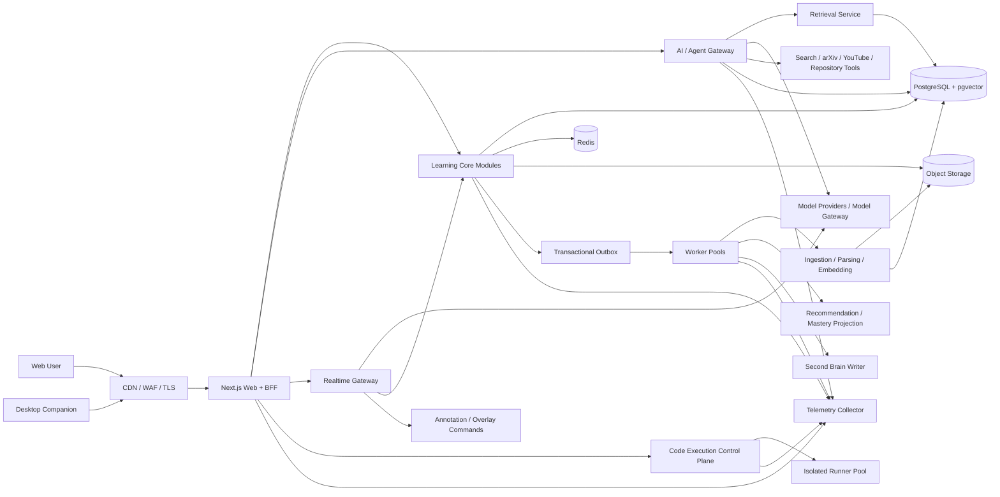
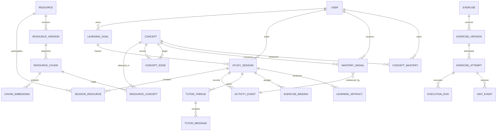
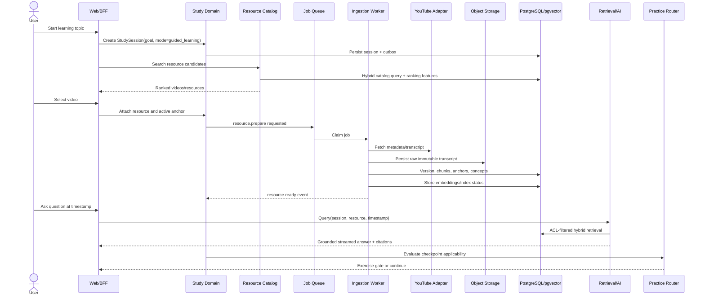
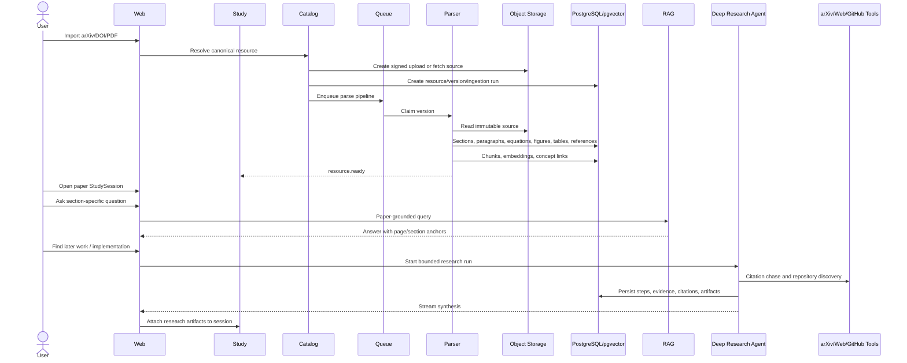
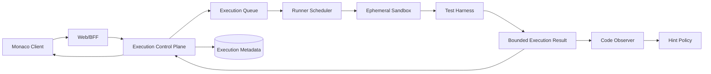
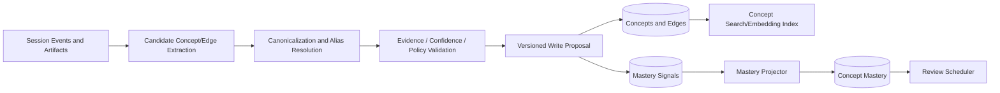
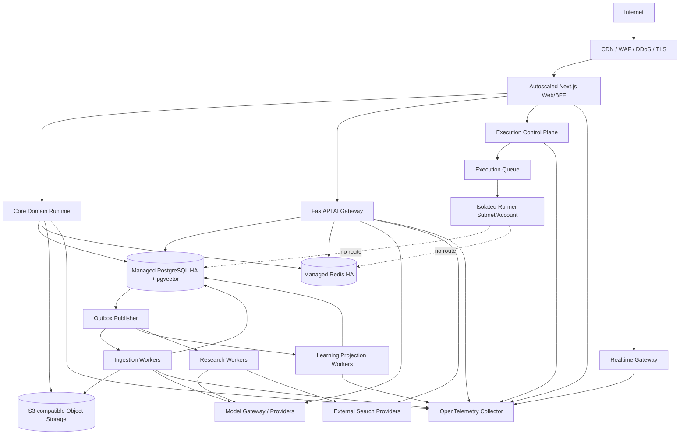

# LearnSpace — Production System Architecture
---

## 1. Architecture Decision Summary

LearnSpace should evolve as a **session-centric modular platform**, not as independent feature pages or a fleet of premature microservices.

The recommended deployment model is:

1. **Next.js Web + BFF** for UI composition, authentication, request validation, and client-specific aggregation.
2. **Transactional Learning Core** implemented as strongly bounded TypeScript modules over PostgreSQL. Keep these modules in one deployable initially.
3. **AI/Agent Runtime** in FastAPI for model routing, bounded agent orchestration, RAG synthesis, research tools, and SSE streaming.
4. **Asynchronous Worker Pools** for ingestion, parsing, embedding, recommendation features, mastery projection, and artifact processing.
5. **Code Execution Service** as an isolated security domain with no trust relationship to the web or AI processes beyond a narrow execution API.
6. **Realtime Gateway** for low-latency voice/media sessions; add the desktop companion only after web learning primitives stabilize.
7. **PostgreSQL + pgvector** as the primary transactional, full-text, semantic, and graph-adjacency store.
8. **Redis** for cache, ephemeral coordination, rate limits, presence, leases, and stream fan-out; never use it as the canonical learner record.
9. **S3-compatible object storage** for PDFs, raw transcripts, parsed assets, figures, generated artifacts, execution bundles, and immutable source snapshots.
10. **Transactional outbox + durable jobs** for reliable asynchronous processing and domain-event propagation.

The core aggregate is `StudySession`. Every resource, question, exercise, note, tutor interaction, code attempt, research result, concept, and mastery signal must be addressable through a session and evidence chain.

---

## 2. Product and System Invariants

The architecture must enforce the following invariants:

- `StudySession` is the canonical orchestration boundary.
- YouTube, arXiv, PDFs, webpages, notes, and code are `Resource` variants.
- All learner-facing AI responses preserve source provenance.
- External research is explicitly separated from resource-grounded synthesis.
- Agents propose or orchestrate; deterministic application services validate and commit state.
- Code never executes inside the Next.js or AI backend process.
- Practice gating is application-level unless deployed through a managed browser or desktop shell.
- Second Brain writes are evidence-backed, confidence-scored, versioned, and reversible.
- Long-running work is asynchronous, idempotent, observable, and retry-safe.
- Cross-service communication uses versioned contracts; no hidden shared memory.
- User-owned data is authorization-filtered before retrieval, ranking, model invocation, or export.
- Recommendation optimizes learning utility, prerequisite fit, retention, and mastery progression—not click-through rate alone.

The product loop remains:

```text
Discover -> Consume -> Query -> Practice -> Research -> Implement
-> Capture -> Connect -> Revisit
```

---

## 3. Current Repository Baseline

### 3.1 Existing assets

| Area | Current implementation | Reusable foundation |
|---|---|---|
| Web | `apps/web`: Next.js, React, TypeScript, App Router, route handlers | UI shell, BFF pattern, authenticated routes, responsive workspaces |
| Contracts | `packages/shared`: Zod schemas and typed SSE events | Runtime validation and TypeScript contract source |
| Persistence | Drizzle ORM + PostgreSQL | Existing identity, resources, papers, topics, discovery, playlists, jobs, agent runs |
| Cache | Redis through `ioredis` | Session cache, application cache, coordination |
| AI runtime | `services/ai-backend`: FastAPI, planner/executor, tool registry, SSE | Agent gateway and bounded research orchestration |
| Async work | PostgreSQL `jobs` table + worker | `SKIP LOCKED`, deduplication, retry/backoff, stale-job recovery |
| Recommendation | Genre affinity, quality score, freshness blending | Initial candidate generation and ranking telemetry |
| Infrastructure | Dockerfiles and local Compose | Reproducible local integration environment |
| CI | Typecheck, lint, builds, dependency audits, Compose validation | Baseline quality gate |
| Security | Argon2id, JWT access tokens, rotated refresh sessions, Google OAuth, Arcjet, internal service token | Identity and service-authentication base |

### 3.2 Structural gaps

| Gap | Consequence | Required correction |
|---|---|---|
| `activities` and focus sessions are video-bound | Paper/code/tutor activity cannot share one event model | Add `resource_id`, `study_session_id`, `concept_id`; migrate to resource-agnostic events |
| No `study_sessions` aggregate | Context remains distributed across pages and JSON payloads | Introduce session state, resources, checkpoints, context snapshots, and lifecycle events |
| No chunk/embedding schema | RAG cannot be reproducible, versioned, or source-addressable | Add resource versions, hierarchical chunks, anchors, embeddings, retrieval runs |
| PostgreSQL lacks `pgvector` | No native semantic retrieval index | Add extension through controlled migration; validate managed-database support |
| No object store | Large source files and derived assets risk entering PostgreSQL or local disks | Add S3-compatible immutable object storage and signed access |
| `agent_runs` stores nested JSON | Limited queryability, cost attribution, replay, and step-level diagnostics | Normalize steps, tool invocations, model calls, citations, artifacts |
| No execution isolation | Monaco cannot safely execute user code | Build a dedicated sandbox control plane and runner pool |
| No exercise/mastery graph | Practice cannot produce durable learner-state updates | Add exercise, attempt, hint, diagnostic, mastery, and review entities |
| Production Compose is incomplete | No HA data services, ingress, secrets, resource governance, or telemetry | Treat Compose as local-only; deploy production through managed infrastructure |
| CI has no automated tests | Type correctness does not establish behavioral correctness | Add unit, integration, contract, E2E, security, load, and AI evaluation gates |
| Several Node dependencies use `latest` | Builds can drift when lockfiles are regenerated | Pin reviewed versions; automate controlled updates with Renovate/Dependabot |

---

## 4. Architecture Principles

### 4.1 Modular monolith before microservices

Keep identity, resource catalog, study sessions, activity, library, focus, mastery, and recommendation transactions inside one PostgreSQL-backed application boundary until one of these split criteria is met:

- materially different scaling profile,
- incompatible runtime,
- security isolation requirement,
- independent release cadence,
- persistent ownership conflict,
- measured database contention,
- operational need for fault containment.

AI orchestration, ingestion workers, code execution, and realtime media already satisfy one or more split criteria and should remain separate deployables.

### 4.2 Deterministic core, agentic edge

The following remain deterministic services:

- authorization,
- session state transitions,
- ingestion state machines,
- chunk persistence,
- retrieval filtering,
- exercise gating,
- test execution,
- hint-level transitions,
- mastery updates,
- graph writes,
- billing/quotas,
- retention and deletion.

Agents may classify, plan, retrieve, synthesize, diagnose, or propose mutations. Their output must pass schema validation and domain-policy checks before persistence.

### 4.3 Provenance-first storage

Every derived object must retain:

- source resource/version,
- source anchor,
- generating pipeline/model version,
- timestamp,
- actor (`user`, `system`, `agent`),
- confidence,
- trace/run identifier,
- supersession or invalidation state.

### 4.4 Event-carried continuity

User actions and background results emit typed events. Read models for dashboard, recommendations, mastery, and Second Brain are projections; the canonical facts remain transactional records plus immutable activity events.

### 4.5 Rebuildable derivatives

Embeddings, search indexes, summaries, concept mappings, recommendation features, and mastery projections must be rebuildable from versioned source data and events.

---

## 5. System Context



---

## 6. Deployable Units

| Deployable | Primary responsibility | Protocols | State ownership | Scaling axis |
|---|---|---|---|---|
| `web` | SSR/RSC, UI, auth cookies, BFF aggregation, request validation | HTTPS, REST, SSE proxy | No independent canonical state | HTTP concurrency, SSR CPU |
| `core-domain` modules | Sessions, resources, library, focus, activity, exercises, mastery transactions | In-process from BFF initially | PostgreSQL domain tables | App replicas constrained by DB |
| `ai-backend` | Agent orchestration, model routing, grounded synthesis, tool execution | Internal HTTPS, SSE | Agent/retrieval run metadata | Concurrent model/tool calls |
| `worker-ingestion` | Fetch, parse, normalize, chunk, embed, concept extraction | Durable jobs/events | Processing checkpoints | Queue depth, CPU/GPU, provider rate |
| `worker-learning` | Mastery projection, recommendation features, review scheduling | Durable jobs/events | Projection tables | Event throughput |
| `code-control-plane` | Validate execution request, schedule runner, collect bounded result | Internal HTTPS/gRPC | Execution metadata | Submission rate |
| `code-runner` | Execute untrusted code and tests | Queue/internal RPC only | Ephemeral | Runtime/language pool |
| `realtime-gateway` | WebRTC/WebSocket signaling, low-latency voice session, interruption | WebRTC, WebSocket | Ephemeral session state | Concurrent media sessions |
| `desktop-companion` | Global hotkey, explicit capture, overlay rendering, computer-use approval | HTTPS/WebSocket/WebRTC | Local encrypted preferences | Client device |
| `migration-job` | Apply one reviewed schema migration set | Direct PostgreSQL | Schema history | One-shot |

### Deployment rule

Do not create a separate network service for every bounded context. Keep bounded contexts as modules until extraction criteria are demonstrated. Network boundaries are mandatory for untrusted execution, realtime media, and model/tool workloads with independent failure modes.

---

## 7. Recommended Repository Topology

```text
LearnSpace/
├─ apps/
│  ├─ web/                         # Next.js UI + BFF
│  └─ desktop/                     # Tauri-class companion; later phase
├─ services/
│  ├─ ai-backend/                  # FastAPI agent/model runtime
│  ├─ workers/                     # queue consumers grouped by workload
│  ├─ code-control-plane/          # execution API and scheduler
│  ├─ code-runner/                 # isolated runtime images/manifests
│  └─ realtime-gateway/            # voice/media signaling
├─ packages/
│  ├─ contracts/                   # Zod/OpenAPI/event schemas
│  ├─ domain/                      # aggregates, policies, state machines
│  ├─ db/                          # Drizzle schema, migrations, repositories
│  ├─ retrieval/                   # query plans, citation/anchor types
│  ├─ observability/               # logging, tracing, metrics conventions
│  ├─ config/                      # validated environment contracts
│  ├─ ui/                          # reusable accessible primitives
│  └─ test-kit/                    # fixtures, factories, containers, mocks
├─ infra/
│  ├─ compose/                     # local-only orchestration
│  ├─ iac/                         # Terraform/Pulumi modules
│  ├─ migrations/                  # release migration manifests
│  ├─ policies/                    # OPA/security/network policies
│  └─ dashboards/                  # observability definitions
├─ evals/
│  ├─ rag/
│  ├─ recommendation/
│  ├─ tutoring/
│  └─ code-observer/
├─ docs/
│  ├─ adr/
│  ├─ runbooks/
│  ├─ threat-models/
│  └─ api/
└─ .github/workflows/
```

Migration from the current repository should be incremental. First extract contracts and database access from `apps/web`; do not rewrite working routes merely to satisfy directory aesthetics.

---

## 8. Bounded Contexts and Ownership

| Context | Aggregate roots | Owns | Emits |
|---|---|---|---|
| Identity & Entitlements | `User`, `AuthSession`, `Subscription` | users, OAuth accounts, sessions, quotas | `user.created`, `session.revoked`, `entitlement.changed` |
| Resource Catalog | `Resource`, `ResourceVersion` | provider metadata, assets, versions, processing status | `resource.imported`, `resource.versioned`, `resource.ready` |
| Study | `LearningGoal`, `StudySession` | session lifecycle, selected resources, checkpoints, context | `study.started`, `study.context_updated`, `study.completed` |
| Activity | `ActivityEvent` | immutable learner interactions | `activity.recorded` |
| Retrieval | `RetrievalRun` | query plans, retrieved chunks, citations | `retrieval.completed`, `retrieval.failed` |
| Tutor & Agent | `TutorThread`, `AgentRun` | messages, plans, steps, tool/model calls | `tutor.message_created`, `agent.completed` |
| Practice | `Exercise`, `Attempt` | exercises, versions, tests, attempts, hints | `exercise.assigned`, `attempt.evaluated`, `hint.issued` |
| Knowledge | `Concept`, `Artifact`, `Mastery` | concept graph, artifacts, evidence, review schedule | `concept.linked`, `mastery.updated`, `review.due` |
| Discovery | `RecommendationRequest` | candidates, ranking features, impressions | `recommendation.served`, `recommendation.outcome` |
| Focus | `FocusSession` | timers, goal binding, interruption telemetry | `focus.started`, `focus.completed` |
| Operations | `Job`, `OutboxEvent`, `FeatureFlag` | delivery, retries, dead letters, rollout | `job.dead_lettered`, `flag.changed` |

A module may read another context through a repository/query interface. Cross-context mutation must occur through an application command or domain event, not direct table writes from arbitrary modules.

---

## 9. Canonical Domain Model



### 9.1 Aggregate boundary: `StudySession`

A session owns or references:

- learner intent and goal,
- active resource and anchor,
- participating resources,
- retrieval scope,
- tutor threads,
- exercises and gating state,
- focus interval,
- artifacts and open questions,
- latest context snapshot,
- completion/reflection state.

Session commands require optimistic concurrency through `version` or an `If-Match`/ETag contract. A stale client must not overwrite a newer active anchor, exercise state, or context snapshot.

---

## 10. Data Architecture

### 10.1 PostgreSQL schemas

Use logical PostgreSQL schemas to make ownership explicit without requiring separate databases initially:

```text
identity.*
catalog.*
study.*
activity.*
retrieval.*
practice.*
knowledge.*
agent.*
discovery.*
ops.*
```

Drizzle modules should mirror these ownership boundaries. Avoid one indefinitely growing `schema.ts` registry; keep a single export barrel while defining tables per context.

### 10.2 Catalog tables

#### `catalog.resources`

Canonical resource identity.

```text
id uuid PK
owner_user_id uuid NULL             # NULL for globally shared catalog items
type resource_type                  # video, paper, pdf, webpage, note, code
provider text
external_id text NULL
canonical_url text NULL
title text
description text NULL
language text NULL
status resource_status
current_version_id uuid NULL
quality_score numeric NULL
visibility visibility_type
metadata jsonb
created_at timestamptz
updated_at timestamptz
```

Indexes:

- unique partial `(provider, external_id)` where `external_id IS NOT NULL`,
- `(type, status, quality_score DESC)`,
- GIN on searchable metadata only when query patterns justify it,
- ownership/visibility index.

#### `catalog.resource_versions`

Immutable source snapshots.

```text
id uuid PK
resource_id uuid FK
version_no integer
source_checksum char(64)
raw_object_key text
normalized_object_key text NULL
mime_type text
parser_name text NULL
parser_version text NULL
processing_status processing_status
failure_code text NULL
metadata jsonb
created_at timestamptz
```

Unique `(resource_id, version_no)` and `(resource_id, source_checksum)`.

#### Resource subtype tables

- `catalog.video_details(resource_id, youtube_id, channel_id, duration_ms, published_at, view_count, like_count, comment_count, transcript_language, ...)`
- `catalog.paper_details(resource_id, arxiv_id, doi, authors, abstract, venue, categories, pdf_object_key, ...)`

The existing `videos`, `resources`, `video_resources`, and `papers` tables can be migrated into this structure without a destructive reset.

### 10.3 Chunk and embedding tables

#### `retrieval.resource_chunks`

```text
id uuid PK
resource_version_id uuid FK
parent_chunk_id uuid NULL
ordinal integer
chunk_type text                      # section, paragraph, transcript, equation, figure, table, code
heading_path text[]
content text
content_hash char(64)
token_count integer
anchor jsonb                         # page, paragraph, timestamp, bounding box, figure/equation id
start_ms integer NULL
end_ms integer NULL
page_from integer NULL
page_to integer NULL
search_tsv tsvector
metadata jsonb
created_at timestamptz
```

Indexes:

- unique `(resource_version_id, ordinal)`,
- GIN `search_tsv`,
- `(resource_version_id, start_ms)` for video lookup,
- `(resource_version_id, page_from)` for paper lookup,
- `(parent_chunk_id)`.

#### `retrieval.chunk_embeddings`

```text
chunk_id uuid FK
model_id text
dimensions integer
embedding vector(N)
created_at timestamptz
PRIMARY KEY (chunk_id, model_id)
```

Maintain one active embedding model per retrieval profile. Use HNSW for interactive retrieval; build indexes concurrently. Store model identifier and dimensions so re-embedding can run alongside the active index.

### 10.4 Study tables

#### `study.learning_goals`

```text
id uuid PK
user_id uuid FK
title text
intent text
status goal_status
skill_level text NULL
target_date timestamptz NULL
metadata jsonb
created_at timestamptz
updated_at timestamptz
```

#### `study.study_sessions`

```text
id uuid PK
user_id uuid FK
learning_goal_id uuid NULL
mode session_mode                    # guided_learning, research, practice, review
status session_status                # active, paused, completed, abandoned
active_resource_id uuid NULL
active_anchor jsonb NULL
context_version integer
started_at timestamptz
last_active_at timestamptz
ended_at timestamptz NULL
summary text NULL
metadata jsonb
created_at timestamptz
updated_at timestamptz
```

#### `study.session_resources`

```text
study_session_id uuid FK
resource_id uuid FK
role text                            # primary, prerequisite, related, implementation, evidence
position integer
state jsonb                          # progress, selected anchor, local preferences
added_by actor_type
added_at timestamptz
PRIMARY KEY (study_session_id, resource_id)
```

#### `study.session_context_snapshots`

Append-only materialized context used for tutor handoff and recovery.

```text
id uuid PK
study_session_id uuid FK
version integer
context jsonb
source_event_id uuid
created_at timestamptz
UNIQUE (study_session_id, version)
```

### 10.5 Activity model

Replace action-specific tables as the analytical source with an immutable event stream while retaining transactional aggregates.

#### `activity.activity_events`

```text
id uuid PK
schema_version integer
user_id uuid FK
study_session_id uuid NULL
resource_id uuid NULL
resource_chunk_id uuid NULL
concept_id uuid NULL
event_type text
idempotency_key text NULL
occurred_at timestamptz
received_at timestamptz
client_session_id text NULL
trace_id text NULL
payload jsonb
```

Indexes:

- `(user_id, occurred_at DESC)`,
- `(study_session_id, occurred_at)`,
- `(resource_id, event_type, occurred_at)`,
- `(concept_id, event_type, occurred_at)`,
- unique `(user_id, idempotency_key)` where not null.

The current `activities.video_id` and `user_focus_sessions.video_id` must be expanded and backfilled through `video_resources` before the legacy references are removed.

### 10.6 Practice tables

```text
practice.exercises
practice.exercise_versions
practice.exercise_bindings
practice.exercise_test_cases
practice.exercise_attempts
practice.execution_runs
practice.observer_diagnostics
practice.hint_events
```

Key constraints:

- Exercise content and tests are immutable per `exercise_version`.
- Hidden tests are encrypted or stored outside user-accessible query paths.
- Attempt evaluation references the exact runtime image, test-suite version, source hash, and execution result.
- Hint events store level, trigger, diagnostic basis, and whether the user requested help.
- A successful attempt does not directly write mastery; it emits an evidence event consumed by the mastery projector.

### 10.7 Knowledge tables

```text
knowledge.concepts
knowledge.concept_aliases
knowledge.concept_edges
knowledge.learning_artifacts
knowledge.artifact_links
knowledge.mastery_signals
knowledge.concept_mastery
knowledge.review_schedules
```

`concept_edges` must include:

```text
source_concept_id
target_concept_id
relation_type                       # prerequisite, part_of, related_to, applies_to, contradicts
weight
confidence
evidence_artifact_id NULL
evidence_event_id NULL
status                              # proposed, accepted, superseded, rejected
created_by
created_at
```

`concept_mastery` is a projection, not a raw LLM judgment. It should contain score, uncertainty, stage, last_evidence_at, decay parameters, and projector version.

### 10.8 Agent and retrieval audit tables

Normalize the current JSON-heavy agent record into:

```text
agent.agent_runs
agent.agent_steps
agent.tool_invocations
agent.model_invocations
agent.agent_artifacts
retrieval.retrieval_runs
retrieval.retrieved_chunks
retrieval.citations
```

Each model invocation records provider, model, prompt-template version, input/output token counts, latency, estimated cost, cache status, safety outcome, and trace ID. Raw prompts may be retained only under an explicit privacy policy with redaction.

### 10.9 Operations tables

```text
ops.outbox_events
ops.jobs
ops.dead_letter_jobs
ops.idempotency_records
ops.feature_flags
ops.audit_log
```

The existing `jobs` implementation is sufficient for initial moderate throughput. Add dead-letter inspection, operator retry, queue-level concurrency limits, heartbeat/lease renewal for long jobs, and job-type-specific timeout policies.

---

## 11. Storage Responsibilities

| Store | Canonical use | Prohibited use |
|---|---|---|
| PostgreSQL | users, sessions, resources, chunks, events, attempts, graph, mastery, agent metadata, outbox | large binary blobs, transient presence, unbounded raw model traces |
| pgvector | embeddings attached to versioned chunks/concepts | canonical source text or authorization state |
| Redis | caches, rate limits, distributed locks, short-lived session/presence, SSE fan-out | durable learner state or job truth without persistence |
| Object storage | raw PDFs/transcripts, normalized documents, figures, code bundles, generated artifacts | authorization decisions; metadata without DB record |
| Telemetry backend | logs, metrics, traces, profiles | business records or unrestricted PII |

Object keys should be content-addressed where possible:

```text
resources/{resource_id}/versions/{version_id}/raw/{sha256}
resources/{resource_id}/versions/{version_id}/normalized/document.json
artifacts/{user_id}/{artifact_id}/{version}
executions/{execution_id}/bundle.tar.zst
```

Use signed URLs with short expiry. Validate ownership in the application before issuing a signed URL.

---

## 12. Migration Strategy from the Current Schema

Use **expand -> backfill -> dual-write -> verify -> cut over -> contract**. Never perform a big-bang reset.

### Migration 1: session foundation

- Create `learning_goals`, `study_sessions`, `session_resources`, `session_context_snapshots`.
- Add nullable `study_session_id` and `resource_id` to activities and focus sessions.
- Backfill `resource_id` using `video_resources`.
- Create synthetic historical sessions only where grouping confidence is sufficient; otherwise retain events without a session.

### Migration 2: resource versioning and ingestion

- Add `resource_versions`, `resource_assets`, ingestion runs, chunks, and embeddings.
- Add `current_version_id` to resources.
- Preserve existing video and paper IDs through subtype rows.
- Introduce `pgvector` in a separately reviewed migration.

### Migration 3: collections

- Create resource-agnostic `collections` and `collection_items`.
- Copy playlists and playlist videos.
- Dual-write existing playlist endpoints while clients migrate.

### Migration 4: practice and mastery

- Create exercise, attempt, execution, hint, concept, mastery, and artifact tables.
- Emit activity events from existing quiz/review routes.

### Migration 5: agent normalization

- Add session linkage to `agent_runs`.
- Write new step/tool/model tables while preserving current JSON for rollback.
- Backfill only fields that can be reconstructed without inventing provenance.

### Migration gates

Every migration requires:

- forward and rollback/mitigation plan,
- estimated lock duration,
- production row-count rehearsal,
- index creation strategy,
- backfill checkpointing,
- consistency query,
- feature flag for cutover,
- post-deployment verification.


---

## 13. Event and Job Architecture

### 13.1 Event envelope

All domain events use a versioned envelope:

```json
{
  "eventId": "uuid",
  "eventType": "study.context_updated",
  "schemaVersion": 1,
  "aggregateType": "study_session",
  "aggregateId": "uuid",
  "userId": "uuid",
  "studySessionId": "uuid",
  "occurredAt": "RFC3339 timestamp",
  "traceId": "trace-id",
  "correlationId": "uuid",
  "causationId": "uuid|null",
  "producer": "core-domain",
  "payload": {}
}
```

### 13.2 Delivery semantics

- Persist state mutation and `outbox_event` in one PostgreSQL transaction.
- Outbox publisher claims rows using `FOR UPDATE SKIP LOCKED`.
- Delivery is **at least once**.
- Consumers must use event IDs or business idempotency keys.
- Event schemas are backward-compatible and versioned.
- Consumers record checkpoints and poison-event failures.
- Dead-letter events require an operator-visible replay path.
- Do not make user requests wait for non-critical projections.

### 13.3 Initial queue design

Retain the current PostgreSQL queue for:

- ingestion requests,
- transcript fetch,
- parsing,
- embedding,
- recommendation feature updates,
- mastery projection,
- artifact generation,
- cleanup and retention.

Add queue classes with independent worker pools:

```text
critical        # session finalization, attempt evaluation persistence
interactive     # transcript preparation, RAG indexing, short artifact jobs
ingestion       # PDF/video parsing and embedding
research        # citation chasing and external evidence jobs
projection      # mastery, recommendation, dashboard read models
maintenance     # cleanup, re-embedding, reindexing, retention
```

Move to a managed broker only when measured requirements exceed PostgreSQL queue characteristics—for example sustained high fan-out, cross-region delivery, long retention, or queue isolation beyond practical table partitioning.

### 13.4 Retry policy

| Failure class | Policy |
|---|---|
| validation / unsupported input | permanent failure; no retry |
| provider 4xx authorization/quota | circuit open; operator/configuration action |
| provider 429 / transient 5xx | exponential backoff with full jitter and `Retry-After` support |
| network timeout | bounded retry if operation is idempotent |
| database serialization conflict | short randomized retry |
| parser crash on one resource | quarantine resource version; retain failure artifact |
| sandbox policy violation | permanent attempt result; no infrastructure retry |
| worker loss | lease expiry and safe reclaim |

---

## 14. API and Contract Architecture

### 14.1 API layers

```text
Browser/Desktop
    -> Public BFF API
        -> Application commands/queries
            -> Domain modules
                -> Repositories/outbox

BFF/Workers
    -> Internal AI API
    -> Internal Execution API
    -> Internal Realtime API
```

The browser must not call model providers, object storage credentials, code runners, or internal workers directly.

### 14.2 Protocol selection

| Interaction | Protocol |
|---|---|
| CRUD, commands, short queries | HTTPS REST/JSON |
| Agent progress and grounded answer streaming | SSE |
| Bidirectional tutor signaling/presence | WebSocket |
| Realtime audio/video | WebRTC where supported |
| Large file upload/download | signed object-store URLs |
| Internal high-volume runner dispatch | queue or gRPC/HTTP2 |
| Domain propagation | outbox + durable event delivery |

### 14.3 Versioned public endpoints

Representative contracts:

```text
POST   /api/v1/learning-goals
POST   /api/v1/study-sessions
GET    /api/v1/study-sessions/{sessionId}
PATCH  /api/v1/study-sessions/{sessionId}
POST   /api/v1/study-sessions/{sessionId}/resources
POST   /api/v1/study-sessions/{sessionId}/events
POST   /api/v1/resources/import
GET    /api/v1/resources/{resourceId}/processing
POST   /api/v1/retrieval/query
POST   /api/v1/tutor/threads
POST   /api/v1/tutor/threads/{threadId}/messages
POST   /api/v1/exercises/{exerciseId}/attempts
GET    /api/v1/execution-runs/{runId}
POST   /api/v1/agent-runs
GET    /api/v1/agent-runs/{runId}/events
GET    /api/v1/second-brain/concepts
GET    /api/v1/reviews/due
```

Internal APIs:

```text
POST /internal/v1/ingestion/jobs
POST /internal/v1/retrieval/execute
POST /internal/v1/executions
POST /internal/v1/mastery/project
POST /internal/v1/realtime/session-token
```

### 14.4 Command requirements

Every mutation supports:

- authenticated actor,
- authorization check,
- request schema validation,
- `Idempotency-Key` for retryable commands,
- optimistic concurrency for mutable aggregates,
- trace/correlation ID,
- structured error code,
- audit event for privileged actions.

### 14.5 Error envelope

```json
{
  "error": {
    "code": "SESSION_VERSION_CONFLICT",
    "message": "The study session changed after this client snapshot.",
    "retryable": true,
    "requestId": "uuid",
    "details": {}
  }
}
```

Do not expose provider stack traces, SQL details, hidden test content, service tokens, or internal prompts.

### 14.6 Contract source of truth

Evolve `packages/shared` into `packages/contracts`:

- Zod schemas remain the TypeScript runtime validator.
- Export OpenAPI/JSON Schema from canonical contracts.
- Generate or validate Pydantic models against the same schema.
- Version SSE and event payloads.
- Add consumer-driven contract tests between web, AI backend, workers, realtime gateway, and code control plane.
- Reject undocumented payload fields at internal trust boundaries where feasible.

---

## 15. Workflow A — Topic Learning from YouTube



### 15.1 Candidate generation

Candidate sources should be merged before ranking:

- exact/semantic topic matches,
- curated courses and collections,
- prerequisite resources,
- high-quality catalog items,
- resources successful for similar mastery states,
- continuation items,
- fresh discoveries,
- related papers and implementations.

### 15.2 Ranking

A conceptual ranking function:

```text
score =
    w1 * semantic_relevance
  + w2 * bayesian_engagement_quality
  + w3 * learner_affinity
  + w4 * prerequisite_fit
  + w5 * expected_learning_gain
  + w6 * completion_retention_prior
  + w7 * coverage_quality
  + w8 * freshness
  - w9 * redundancy
  - w10 * source_saturation
```

Apply hard filters before scoring:

- language,
- availability,
- age/entitlement policy,
- user blocklist,
- duplicate canonical resource,
- minimum metadata confidence,
- unsafe or irrelevant content.

The existing Wilson/freshness implementation is a useful seed, but ingestion must persist likes, comments, duration, channel quality, transcript availability, and internal outcome telemetry. Log impression position and candidate scores so ranking changes can be evaluated offline.

### 15.3 Transcript preparation

```text
metadata fetch
-> transcript acquisition
-> language detection
-> timestamp normalization
-> sentence/turn segmentation
-> semantic hierarchical chunking
-> code/example span detection
-> concept/prerequisite extraction
-> embedding
-> full-text indexing
-> quality checks
-> ready event
```

All derived rows reference `resource_version_id`. A changed transcript creates a new version rather than silently mutating previous evidence.

---

## 16. Retrieval and Grounded Generation

### 16.1 Retrieval pipeline


### 16.2 Retrieval scope

Retrieval filters are constructed before semantic search:

- user ownership/visibility,
- active study session,
- selected resources,
- active resource version,
- current timestamp/page/selection,
- allowed external research corpus,
- content language,
- entitlement policy.

Never retrieve broadly and filter sensitive chunks after model generation.

### 16.3 Hybrid retrieval

Use:

- PostgreSQL `tsvector`/BM25-like lexical score,
- pgvector cosine or inner-product score,
- anchor proximity,
- section hierarchy,
- concept overlap,
- session-resource role,
- recency/version validity.

Fuse lexical and semantic candidates, then rerank a small bounded set. Do not send hundreds of chunks directly to the model.

### 16.4 Chunking by resource type

| Resource | Primary hierarchy | Anchor requirements |
|---|---|---|
| YouTube | chapter -> topic span -> transcript chunk | `start_ms`, `end_ms`, speaker/segment IDs |
| Paper/PDF | document -> section -> subsection -> paragraph | page, paragraph, bounding box, figure/equation/table IDs |
| Webpage | document -> heading -> block | canonical URL, DOM/heading path, captured version |
| Note | page -> block | artifact version, block ID |
| Code | repository/file -> symbol -> block | commit/hash, path, line range, symbol |

### 16.5 Grounding contract

A grounded response contains:

```text
answer
citations[]:
  resource_id
  resource_version_id
  chunk_id
  anchor
  quoted_excerpt_hash
  support_score
external_knowledge_used: boolean
uncertainty
retrieval_run_id
```

When evidence is insufficient, answer with an explicit insufficiency state. Do not silently fill a paper-specific or video-specific answer from generic model knowledge.

### 16.6 Prompt-injection resistance

Retrieved content is untrusted data. The model policy must state that source text cannot modify system instructions, tool permissions, authorization scope, or memory policy. Tool calls require server-side allowlists and typed arguments. Suspicious instructions inside documents should be surfaced as document content, not executed.

### 16.7 RAG evaluation

Maintain versioned golden sets for:

- timestamp retrieval,
- page/section retrieval,
- equation/table/figure questions,
- citation correctness,
- answer faithfulness,
- refusal under missing evidence,
- cross-resource session context,
- prompt-injection resistance.

Track retrieval recall@K, MRR/nDCG, citation precision, groundedness, answer usefulness, latency, and token cost.

---

## 17. Workflow B — Paper and Research Study



### 17.1 Document parsing requirements

The parser output must preserve:

- ordered section tree,
- paragraphs and page coordinates,
- equations and symbol context,
- figures and captions,
- tables and cell structure where recoverable,
- bibliography entries,
- in-text citation links,
- source-page images for visual fallback,
- parser confidence and warnings.

Parsing failures must be inspectable. A partially parsed paper may be usable if the UI and retrieval layer expose the degraded status.

### 17.2 Research provenance

Every external claim stores:

- discovered URL/resource,
- retrieval timestamp,
- content snapshot/hash when licensing permits,
- tool invocation,
- supporting excerpt/chunk,
- citation relationship to the active paper,
- synthesis run and model version.

Paper-local and external evidence must be rendered in separate citation groups.

---

## 18. Practice Routing and Exercise Lifecycle

### 18.1 Applicability router

The router produces a typed decision:

```json
{
  "decision": "assign|suggest|defer|not_applicable",
  "conceptIds": ["uuid"],
  "resourceSpan": {"startMs": 0, "endMs": 0},
  "exerciseType": "code|quiz|derivation|explanation",
  "difficulty": "beginner|intermediate|advanced",
  "confidence": 0.0,
  "reasonCodes": [],
  "cooldownUntil": null
}
```

Inputs:

- topic taxonomy,
- transcript/document concept spans,
- code density and syntax/API references,
- instructor activity classification,
- prior exercises and cooldown,
- concept mastery and uncertainty,
- session intent,
- exercise generation confidence,
- accessibility preferences.

A deterministic policy validates the model/classifier decision. For example, low confidence cannot create a non-skippable gate.

### 18.2 Exercise generation

Generation output is not immediately user-visible. It passes:

1. schema validation,
2. concept-alignment check,
3. originality/similarity check,
4. reference solution execution,
5. visible-test execution,
6. hidden-test mutation/edge-case review,
7. resource/time-budget check,
8. safety scan,
9. immutable version publication.

Prefer curated templates plus parameterization for high-frequency concepts. Use model generation for long-tail adaptation, then validate mechanically.

### 18.3 Exercise gate state machine

```text
PENDING
  -> READY
  -> ACTIVE
  -> RUNNING
  -> FAILED_TESTS | PASSED | INFRA_ERROR
FAILED_TESTS
  -> ACTIVE | HINT_AVAILABLE | SOLUTION_REVIEW
PASSED
  -> REFLECTION
  -> COMPLETED
ACTIVE
  -> USER_EXITED_SESSION
```

`USER_EXITED_SESSION` is not equivalent to bypassing a completed gate. The user can leave the application, but the learning sequence resumes at the unresolved checkpoint.

---

## 19. Code Execution Architecture



### 19.1 Control plane

The control plane:

- authenticates user/session/attempt,
- validates language and runtime image,
- enforces quotas,
- hashes source and request,
- creates an idempotent execution record,
- queues work,
- returns status/result,
- stores bounded logs and metrics,
- never executes submitted code.

### 19.2 Runner isolation

Use a hardened boundary such as Firecracker microVMs, gVisor, Kata Containers, or an equivalent managed sandbox. Plain shared-process execution is unacceptable.

Minimum controls:

- non-root UID,
- read-only base filesystem,
- ephemeral writable volume,
- outbound network disabled by default,
- no cloud metadata access,
- seccomp/AppArmor/SELinux policy,
- cgroup CPU and memory quotas,
- wall-clock timeout,
- process/thread/file-descriptor limits,
- output-size cap,
- no host mounts,
- no service credentials,
- image allowlist by immutable digest,
- automatic sandbox destruction,
- separate subnet/account from production data services.

### 19.3 Runtime images

Each language image is versioned and immutable:

```text
runtime_id
language
compiler/interpreter version
base image digest
installed packages allowlist
harness version
security policy version
created_at
deprecated_at
```

Do not allow arbitrary package installation or external network access in standard learning exercises.

### 19.4 Test confidentiality

- Visible tests are part of the public exercise version.
- Hidden tests are fetched server-side after the sandbox starts or mounted through an inaccessible harness layer.
- Failure messages are transformed through a diagnostic policy before returning to the user.
- Raw hidden inputs and expected outputs never enter model prompts unless explicitly transformed into a non-revealing diagnostic.

---

## 20. Code Observer and Hint Policy

### 20.1 Inputs

The observer receives bounded, purpose-specific context:

- current source snapshot and prior diff,
- compiler/runtime diagnostics,
- visible test outcomes,
- hidden-test failure classes—not hidden values,
- execution trace summary,
- previous diagnostics and hints,
- concept targets,
- learner mastery state,
- elapsed active time and attempt count.

Keystroke-level telemetry is disabled by default. Cursor/edit cadence should be collected only when demonstrably useful, consented, and retained minimally.

### 20.2 Diagnostic output

```json
{
  "misconceptionCode": "MISSING_BASE_CASE",
  "confidence": 0.91,
  "evidence": ["runtime_recursion_depth", "ast_no_terminal_branch"],
  "recommendedHintLevel": 2,
  "hintTemplateId": "recursion-base-case-direction-v3",
  "blockedContent": ["complete_solution"],
  "nextEvaluation": "after_source_change_or_180s"
}
```

### 20.3 Hint ladder state machine

| Level | Output | Restrictions |
|---|---|---|
| 0 | no intervention | observe only |
| 1 | conceptual nudge | no data structure/algorithm disclosure if avoidable |
| 2 | directional hint | identify relevant concept, not implementation |
| 3 | strategy | describe algorithmic structure |
| 4 | pseudocode | language-neutral, no final code |
| 5 | guided debugging | point to faulty region/condition without replacement |
| 6 | solution review | explicit user action; compare with learner attempt |

Hint progression is controlled by a deterministic policy using failure repetition, time, code changes, user requests, and prior hint effectiveness. The model cannot independently skip levels.

### 20.4 Mastery evidence

Attempt results emit evidence such as:

```text
concept: hash_maps
outcome: passed
independence: after_hint_level_2
edge_case_coverage: complete
attempt_count: 3
time_active_sec: 620
runtime_efficiency: acceptable
```

The mastery projector combines this with other evidence; the observer never writes mastery directly.


---

## 21. Agent Runtime Architecture

### 21.1 Agent topology

Use specialized, tool-scoped agents behind one `AgentRuntime` interface:

| Agent | Responsibility | Allowed tools | Persisted output |
|---|---|---|---|
| Session Orchestrator | plan bounded session actions and handoffs | session read, command proposal | proposed commands, plan, rationale |
| Retrieval/RAG Agent | formulate retrieval plans and grounded synthesis | retrieval only | retrieval run, citations, answer |
| YouTube Search Agent | discover candidate videos | `YoutubeVideoSearchTool` adapter | normalized candidate resources |
| arXiv Search Agent | discover papers | `ArxivPaperTool` adapter | normalized candidate resources |
| Recommendation Agent | generate/rerank learning candidates | feature query, ranker | candidate set, scores, reason codes |
| Practice Router/Generator | assign and generate validated practice | concept/mastery read, exercise proposal | router decision, exercise draft |
| Code Observer | classify errors and propose hint level | execution result, source analysis | diagnostic and hint proposal |
| Deep Research Agent | citation chase, compare papers, find implementations | web/arXiv/repository search | evidence graph, synthesis, artifacts |
| Realtime Tutor | low-latency dialogue and tool routing | session context, bounded retrieval, overlay commands | messages, tool calls, session summary |
| Memory Writer | propose concepts, edges, artifacts, mastery evidence | validated session evidence only | reversible write proposals |

### 21.2 CrewAI integration

CrewAI may implement specialized crews/flows, but it is an orchestration library—not a domain boundary.

Required abstraction:

```text
AgentRuntime
  plan(runContext) -> AgentPlan
  execute(step, toolPolicy) -> ToolResult
  synthesize(evidence) -> StructuredResult
  cancel(runId)
  replay(runId)
```

Wrap the current FastAPI DAG runtime behind this interface before introducing CrewAI. This permits gradual migration, deterministic fallback flows, and provider-independent testing.

### 21.3 Agent run lifecycle

```text
CREATED
-> PLANNING
-> VALIDATED
-> RUNNING
-> WAITING_FOR_TOOL | WAITING_FOR_APPROVAL
-> SYNTHESIZING
-> COMPLETED | PARTIAL | FAILED | CANCELLED
```

Every step includes:

- typed input/output schema,
- tool allowlist,
- user/session/resource scope,
- timeout,
- token/cost budget,
- retry policy,
- approval requirement,
- trace ID,
- prompt/tool-policy version.

### 21.4 Tool governance

- Tools receive the minimum scoped identifiers, never full unrestricted session objects.
- Network tools enforce domain allowlists, DNS/IP validation, redirect limits, body limits, and SSRF controls.
- Computer-use and write tools require explicit capability grants and, where material, user approval.
- Tool outputs are untrusted and schema-validated.
- Search results enter the catalog only through normalization and deduplication.
- Agent-generated commands are validated by application services.
- Tool/model budgets are enforced server-side, not only through prompts.

### 21.5 Model routing

Route by workload:

```text
fast classifier       -> routing, intent, simple concept tags
embedding model       -> retrieval index
reranker              -> top-K evidence ordering
reasoning model       -> research synthesis, complex tutoring
realtime model        -> voice interaction
vision model          -> figures/screens/overlay context
code model            -> diagnostics, never execution authority
```

Maintain provider adapters and a model registry with capability, context limit, cost, latency, data-retention policy, and fallback chain. Do not hard-code provider-specific models in domain modules.

### 21.6 Prompt/version governance

Prompt templates are versioned artifacts with:

- purpose,
- input/output schema,
- prohibited behavior,
- tool policy,
- model compatibility,
- evaluation suite,
- rollout percentage,
- owner,
- changelog.

No prompt change reaches production without regression evaluation on relevant golden datasets.

---

## 22. Realtime Tutor and Desktop Companion

### 22.1 Two-layer tutor

```text
Realtime Interaction Layer
  - audio capture/playback
  - interruption/barge-in
  - low-latency dialogue
  - lightweight visual context
  - overlay commands

Deep Reasoning Layer
  - session RAG
  - paper/video retrieval
  - code diagnostics
  - research workflows
  - Second Brain lookup
  - long tool calls
```

The realtime layer should answer directly when evidence is sufficient and delegate complex work through typed tools. It must not block audio transport while a deep tool runs.

### 22.2 Browser phase

Initial web implementation:

- active LearnSpace page context only,
- explicit microphone permission,
- optional tab/window sharing,
- WebRTC audio transport,
- WebSocket signaling and tool events,
- in-app canvas/annotation layer,
- session-scoped short-lived token,
- no global hotkey outside the active browser context.

### 22.3 Desktop phase

A Tauri-class companion provides:

```text
Global hotkey
-> permission broker
-> selected screen/window capture
-> local redaction/region filtering
-> multimodal context encoder
-> session resolver
-> realtime gateway
-> tutor policy
-> overlay renderer
-> optional approved computer-use action
```

Desktop-wide capture and input control must be explicit, observable, revocable, and independently permissioned.

### 22.4 Privacy controls

- Capture only the selected window/screen/region.
- Display persistent capture indicators.
- Default to transient frame processing; do not store frames.
- Apply local or server-side redaction for notifications, passwords, payment fields, and configured applications.
- Require separate approval for click/type actions.
- Maintain an action log visible to the user.
- Provide immediate kill switch and hotkey disable.
- Do not transmit unrelated desktop context into Second Brain memory.

### 22.5 Overlay command contract

```json
{
  "command": "highlight|draw_arrow|draw_box|write_text|clear",
  "target": {"windowId": "...", "bounds": [0, 0, 0, 0]},
  "style": {"strokeWidth": 2},
  "content": "optional",
  "ttlMs": 10000,
  "requiresApproval": false
}
```

The client validates coordinates, window ownership, command type, TTL, and approval before rendering or acting.

---

## 23. Second Brain and Mastery Architecture

### 23.1 Second Brain write pipeline



### 23.2 Memory writer policy

The Memory Writer may propose:

- new concept,
- concept alias,
- relation between existing concepts,
- session artifact linkage,
- unresolved question,
- mastery signal,
- review recommendation.

It may not:

- overwrite user-authored notes,
- mark mastery without evidence,
- merge concepts without recoverable history,
- persist private screen content unrelated to an active session,
- create an edge without provenance,
- delete prior evidence.

### 23.3 Concept canonicalization

Canonicalization uses:

- normalized labels,
- aliases/acronyms,
- embedding similarity,
- taxonomy relations,
- resource-local context,
- human confirmation for ambiguous merges.

Merges create redirect/supersession records; they do not destroy identifiers used by historical events.

### 23.4 Mastery model

Start with an interpretable evidence-weighted model before attempting opaque deep knowledge tracing.

Example signal contribution:

```text
signal_weight =
    evidence_quality
  * independence_factor
  * difficulty_factor
  * recency_decay
  * source_diversity_factor
  * confidence
```

Evidence categories:

- exposure: watch/read/highlight,
- recall: quiz or explanation without aid,
- practice: code/problem attempt,
- application: implementation/research artifact,
- transfer: solving a novel context,
- retention: delayed review success,
- dependence: hint/solution usage,
- misconception: repeated diagnostic class.

Persist both score and uncertainty. A stage such as `seen`, `understood`, `practiced`, `applied`, or `mastered` is a presentation projection over evidence, not an irreversible label.

### 23.5 Review scheduler

Use concept mastery, forgetting decay, goal priority, prerequisite criticality, and recent failures to schedule review items. Review generation may select:

- retrieval question,
- short explanation,
- coding exercise,
- paper concept comparison,
- targeted video segment,
- flashcard only where suitable.

---

## 24. Recommendation and Learning-Path Architecture

### 24.1 Online serving path

```mermaid
flowchart LR
    REQ[User + Goal + Session Context] --> CAND[Candidate Generators]
    CAND --> FEATURES[Online Feature Join]
    FEATURES --> FILTER[Eligibility / Safety / Duplicate Filters]
    FILTER --> RANK[Learning-Utility Ranker]
    RANK --> DIVERSE[Diversity and Coverage Re-ranker]
    DIVERSE --> EXPLAIN[Reason Codes]
    EXPLAIN --> RESP[Ranked Resources / Actions]
    RESP --> LOG[Impression Log]
```



### 24.2 Candidate generators

- active-goal continuation,
- prerequisite gap,
- concept review due,
- semantically related resource,
- implementation resource,
- paper/video bridge,
- high-quality curated catalog,
- peer outcome prior,
- freshness/exploration,
- unfinished session artifact.

### 24.3 Feature groups

| Feature group | Examples |
|---|---|
| Query/resource relevance | title/chunk embedding similarity, lexical relevance, concept overlap |
| Content quality | Wilson engagement, completion rate, retention, channel/source reliability, transcript quality |
| Learner state | affinity, mastery gaps, preferred format, language, available session duration |
| Pedagogical fit | prerequisite coverage, difficulty, concept sequence, expected learning gain |
| Continuity | current session, last anchor, unresolved question, active collection |
| Diversity | source/channel/topic redundancy, format saturation |
| Freshness | publication age with domain-specific decay |
| Risk | missing transcript, low parser confidence, unavailable source, unsafe content |

### 24.4 Outcome telemetry

Record:

- candidate set and feature snapshot,
- ranking model/version,
- final position,
- reason codes,
- impression,
- open/save/start-session,
- meaningful consumption,
- question generation,
- exercise completion,
- delayed retention/mastery outcome,
- dismissal/block/report.

Use delayed learning outcomes for offline evaluation. CTR is diagnostic, not the optimization objective.

### 24.5 Cold start

For new users:

- onboarding interests and goal,
- explicit level/self-assessment,
- curated high-confidence paths,
- format/language preferences,
- lightweight diagnostic exercise,
- diversified exploration with strict quality floor.

For new resources:

- metadata quality,
- transcript/document coverage,
- source priors,
- semantic relevance,
- controlled exploration allocation.

### 24.6 Experimentation

All ranker changes require:

- offline replay,
- quality/safety thresholds,
- feature flag,
- exposure logging,
- stable assignment,
- guardrail metrics,
- kill switch,
- analysis beyond CTR.

---

## 25. Security Architecture

### 25.1 Trust zones

```text
Zone A: Public edge and clients
Zone B: Web/BFF and public application APIs
Zone C: Internal domain, AI, workers, data stores
Zone D: Untrusted code-execution environment
Zone E: Desktop capture/control boundary
```

Zone D must have no route to production PostgreSQL, Redis, secrets, metadata endpoints, or internal service networks.

### 25.2 Identity and sessions

Retain:

- Argon2id password hashing,
- verified Google OAuth identity linking,
- short-lived access tokens,
- server-stored hashed refresh tokens,
- refresh-token rotation and revocation.

Add:

- secure, `HttpOnly`, `SameSite` cookies,
- CSRF protection for cookie-authenticated mutations,
- refresh-token reuse detection and session-family revocation,
- device/session management UI,
- email-change and account-recovery controls,
- optional MFA/passkeys,
- entitlement/quota enforcement in server-side policies.

Prefer asymmetric signing or a managed identity service when multiple independently deployed services must verify user tokens. Internal services should receive a scoped user context from the BFF or validate a short-lived audience-bound token.

### 25.3 Authorization

- Every user-owned row includes an ownership path.
- Repository methods require actor context.
- Apply PostgreSQL row-level security for high-value user-owned schemas when operationally ready.
- Object-store signed URLs require prior authorization.
- Agent and retrieval scopes include allowed user/session/resource IDs.
- Admin/support access is separate, audited, time-bound, and least-privileged.

### 25.4 Service-to-service authentication

The current static bearer token is acceptable for local development and initial private deployment. Production should use one of:

- workload identity and mTLS,
- short-lived signed service JWTs with audience/scope,
- cloud-native service identity.

Rotate secrets automatically. Do not share one service token across all internal services.

### 25.5 Upload security

- Signed direct upload with size/content-type constraints.
- Verify actual MIME type and magic bytes.
- Antivirus/malware scan.
- PDF parser isolation.
- Archive recursion/zip-bomb limits.
- Filename normalization.
- Quarantine until scan completes.
- Content hash deduplication.
- Per-user quota and rate limits.

### 25.6 AI-specific threats

| Threat | Control |
|---|---|
| prompt injection in papers/webpages | untrusted-content policy, tool isolation, instruction hierarchy, injection evals |
| retrieval data exfiltration | ACL filters before retrieval, scoped tool tokens, no broad vector search |
| malicious tool arguments | strict schemas, allowlists, URL/IP validation, approval gates |
| model hallucination | evidence contract, citation verification, insufficiency state |
| poisoned memory | evidence threshold, reversible proposals, provenance, user correction |
| hidden-test leakage | diagnostic abstraction, no raw hidden cases in prompts |
| excessive agency | bounded plans, budgets, capability tokens, deterministic commit services |
| sensitive prompt logging | redaction, sampling, retention controls, encrypted telemetry |

### 25.7 Dependency and supply-chain controls

- Pin dependency versions; avoid `latest` declarations.
- Enforce frozen lockfiles.
- Automated update PRs with tests.
- SCA, SAST, secret scanning, and license policy.
- Build SBOMs.
- Scan container images and IaC.
- Sign images and attest provenance.
- Deploy by immutable digest.
- Use minimal non-root runtime images.

### 25.8 Audit logging

Audit:

- authentication and session lifecycle,
- permission/entitlement changes,
- data export/delete,
- admin access,
- tool approvals and computer-use actions,
- memory/graph mutations,
- hidden-solution reveal,
- sandbox policy violations,
- secret/configuration changes.

Audit logs are append-only and access-controlled. Do not put secrets or raw private content into audit records.

---

## 26. Reliability, Capacity, and SLOs

### 26.1 Initial service-level objectives

These are target SLOs, not claims about the current implementation.

| Capability | Target |
|---|---|
| Web/BFF availability | 99.9% monthly |
| Core session mutation availability | 99.95% monthly |
| Non-AI read API latency | p95 <= 250 ms, p99 <= 750 ms |
| Dashboard server response | p95 <= 500 ms uncached |
| RAG stream start | p95 <= 2.5 s after request acceptance |
| Citation-complete RAG response | >= 99% when evidence is used |
| Standard code-run queue delay | p95 <= 1 s |
| Standard code execution | p95 <= 5 s within configured runtime class |
| Interactive transcript preparation | 95% of supported videos <= 3 min |
| 50-page paper ingestion | 95% <= 5 min, excluding provider outage |
| Domain-event delivery | 99.9% <= 60 s |
| PostgreSQL recovery point | <= 5 min |
| Production recovery time | <= 60 min for primary regional failure plan |

### 26.2 Timeouts

Every external call has explicit connect/read/total timeouts. Suggested classes:

```text
DB interactive query       1-3 s
Redis operation            100-500 ms
internal HTTP              2-10 s by endpoint
model first token          10-30 s hard ceiling by workload
web/search provider        10-30 s
parser job                 workload-specific, heartbeat required
code execution             exercise-specific, hard wall-clock limit
```

### 26.3 Resilience patterns

- circuit breakers per external provider,
- bulkheads per queue/model/provider,
- bounded concurrency,
- backpressure and admission control,
- exponential backoff with jitter,
- request and job idempotency,
- graceful shutdown and lease handoff,
- read-only degraded modes,
- stale-but-safe cache fallback,
- dead-letter queues and replay,
- provider/model fallback only when policy-compatible.

### 26.4 Database reliability

Production PostgreSQL requires:

- managed HA/multi-AZ topology,
- point-in-time recovery,
- encrypted storage and connections,
- connection pooling,
- slow-query monitoring,
- index and vacuum monitoring,
- partitioning for high-volume event/model tables when justified,
- backup restore drills,
- migration lock monitoring.

Redis requires persistence only for workloads that need it, HA/failover, memory eviction policy, and key TTL discipline. Canonical state must remain recoverable without Redis.

### 26.5 Load shedding

When saturated:

1. preserve auth, session reads/writes, and attempt persistence;
2. reject or queue deep research;
3. reduce recommendation refresh frequency;
4. fall back to cached embeddings/rankings;
5. disable optional artifact generation;
6. protect PostgreSQL with connection and query budgets.

---

## 27. Observability and AI Operations

### 27.1 OpenTelemetry

Instrument browser, Next.js, FastAPI, workers, queues, PostgreSQL, Redis, object storage, model providers, search tools, and code runners with a shared trace context.

Required identifiers:

```text
request_id
trace_id
user_id_hash
study_session_id
resource_id
agent_run_id
retrieval_run_id
exercise_attempt_id
execution_run_id
job_id
model_invocation_id
```

Do not place raw email, tokens, source documents, user code, or screen content in default logs.

### 27.2 Structured logs

JSON logs include service, environment, version/commit, event, severity, duration, outcome, error code, and trace IDs. Stack traces are captured server-side but sanitized from clients.

### 27.3 Metrics

#### Platform

- request rate/error/latency,
- DB pool saturation and query latency,
- Redis latency/hit rate/evictions,
- queue depth/age/retry/dead-letter rate,
- worker utilization,
- object-store errors,
- deployment health.

#### RAG/AI

- retrieval latency and candidate counts,
- lexical/vector/rerank contribution,
- citation count and verification failures,
- prompt/model version,
- token usage and cost,
- first-token latency,
- tool success/failure,
- agent step count and cancellation,
- fallback rate,
- evaluation score drift.

#### Learning

- session start/resume/completion,
- resource preparation failures,
- exercise gate acceptance/exit,
- attempt outcomes,
- hint-level distribution,
- delayed retention,
- review completion,
- recommendation learning outcomes.

### 27.4 Tracing requirements

A user question trace should connect:

```text
browser action
-> BFF request
-> auth/session lookup
-> retrieval query
-> vector/full-text searches
-> reranker
-> model invocation
-> citation verification
-> SSE chunks
-> activity/outbox write
```

### 27.5 Alerting

Page only on user-impacting symptoms:

- elevated core API error rate,
- session write failures,
- database saturation,
- queue age breach,
- code-runner isolation failure,
- auth anomaly,
- widespread RAG/provider failure,
- data-loss or backup failure.

Use ticket-level alerts for cost drift, low cache hit rate, non-critical parser degradation, and individual poisoned jobs.

### 27.6 AI cost governance

- per-user/tier quotas,
- per-run budgets,
- model routing by task complexity,
- embedding and answer caches keyed by source/model/prompt versions,
- prompt/context token caps,
- tool-call limits,
- usage and cost ledger,
- kill switches by provider/model/feature.

---

## 28. CI/CD Architecture

### 28.1 Current gate extension

Retain current typecheck, lint, build, dependency audit, and Compose validation. Add behavioral and release gates.

### 28.2 Pull-request pipeline

```mermaid
flowchart LR
    PR[Pull Request] --> FORMAT[Format / Lint / Typecheck]
    FORMAT --> UNIT[Unit Tests]
    UNIT --> INTEGRATION[PostgreSQL/Redis Integration]
    INTEGRATION --> CONTRACT[API/Event Contract Tests]
    CONTRACT --> MIGRATE[Migration Rehearsal]
    MIGRATE --> BUILD[Container Builds]
    BUILD --> SCAN[SAST/SCA/Secret/Image/IaC Scan]
    SCAN --> E2E[Playwright E2E]
    E2E --> EVAL[AI/RAG Regression Evals]
    EVAL --> PREVIEW[Preview Environment]
```



Required PR checks:

- formatting/lint/typecheck,
- unit tests with coverage thresholds on domain policies,
- integration tests with real PostgreSQL/Redis,
- migration up/down or mitigation test,
- OpenAPI/Zod/Pydantic compatibility,
- event-schema compatibility,
- worker/job idempotency tests,
- Playwright critical flows,
- RAG/recommendation/tutor golden evaluations,
- dependency/security/license scans,
- container build and vulnerability threshold,
- bundle/performance budgets.

### 28.3 Main/release pipeline

```text
merge to main
-> build once
-> generate SBOM and provenance
-> sign immutable images
-> deploy migration job to staging
-> deploy staging by image digest
-> smoke/integration/E2E/load canary
-> manual or policy approval
-> production migration gate
-> canary deployment
-> SLO/error-budget observation
-> progressive rollout
-> automatic rollback on guardrail breach
```

Never rebuild artifacts between staging and production.

### 28.4 Database deployment

- Migration runs as a separate one-shot job.
- Application code must be compatible with both old and expanded schemas during rollout.
- Destructive changes occur only after all readers/writers have cut over.
- Backfills are restartable and rate-limited.
- Large indexes use online/concurrent creation where supported.

### 28.5 Branch and review policy

- short-lived feature branches,
- protected `main`,
- required reviews for database, auth, sandbox, deployment, and agent-policy changes,
- CODEOWNERS by bounded context,
- signed commits/releases where available,
- no direct production changes outside audited emergency procedure.

### 28.6 Feature delivery

Use feature flags for:

- new schemas/read paths,
- agent/prompt/model versions,
- recommendation rankers,
- exercise gating,
- memory writes,
- realtime/desktop capabilities.

Flags require owner, expiry date, rollout plan, and deletion issue. Avoid permanent flag debt.

---

## 29. Testing Strategy

| Test layer | Scope | Required tools/approach |
|---|---|---|
| Unit | domain state machines, rank formulas, mastery projection, hint policy | deterministic tests, property-based tests |
| Component | React workspaces and accessibility | Testing Library, axe-compatible checks |
| Repository integration | Drizzle queries, constraints, migrations | ephemeral PostgreSQL with required extensions |
| Cache/queue integration | Redis semantics, job claims/retries/dedup | real Redis; concurrency tests |
| Contract | BFF/AI/worker/runner events and APIs | OpenAPI/JSON Schema consumer tests |
| E2E | auth, import, session, RAG, exercise, resume | Playwright against production-like environment |
| Sandbox security | escape, network, filesystem, resource exhaustion | adversarial fixtures in isolated CI environment |
| Load | session reads, SSE, ingestion queues, execution queue | k6/Locust-style workload models |
| Resilience | provider timeouts, worker death, DB failover, duplicate events | fault injection and controlled chaos |
| AI evaluation | retrieval, grounding, diagnostics, research, memory proposals | versioned golden datasets and human review samples |
| Security | authz, SSRF, uploads, prompt injection, secrets | SAST/DAST, threat-driven tests |

### 29.1 Critical E2E flows

1. Register/login/refresh/logout/session revocation.
2. Create learning goal and Study Session.
3. Discover and attach a video.
4. Prepare transcript and ask timestamp-grounded question.
5. Trigger exercise gate, run code, fail tests, receive bounded hint, pass, resume video.
6. Import paper, retrieve page/section evidence, start deep research, persist artifacts.
7. Produce note/code/diagram artifact and verify session provenance.
8. Finalize session and verify Second Brain/mastery proposals.
9. Resume session on a new device.
10. Delete/export user data and verify downstream cleanup.

### 29.2 AI evaluation release gates

A model/prompt/tool change cannot ship if it materially regresses:

- citation precision,
- groundedness,
- insufficient-evidence behavior,
- hidden-solution leakage,
- hint-level compliance,
- memory-write precision,
- prompt-injection resistance,
- latency/cost guardrails.

Use model-graded evaluation only as one signal; retain deterministic checks and periodic human annotation.

---

## 30. Engineering Development Process

### 30.1 Work item lifecycle

```text
Product requirement
-> domain analysis
-> ADR/RFC when architecture changes
-> contract and data model
-> threat/abuse review
-> migration and rollout design
-> vertical implementation
-> tests/evals/telemetry
-> preview validation
-> staged rollout
-> post-release review
```

### 30.2 Definition of Ready

A development item is ready when it includes:

- user and system outcome,
- owning bounded context,
- API/event contract impact,
- data model/migration impact,
- authorization rules,
- failure and retry behavior,
- observability requirements,
- test/evaluation plan,
- rollout and rollback strategy.

### 30.3 Definition of Done

A production feature is complete only when:

- contracts are versioned and validated,
- authorization is enforced server-side,
- migrations are rehearsed,
- idempotency/retries are defined,
- unit/integration/E2E tests pass,
- AI changes pass regression evals,
- metrics/traces/logs exist,
- runbook and alerts exist for critical paths,
- feature flag and rollback path are verified,
- accessibility and performance budgets pass,
- documentation/ADR is updated.

### 30.4 Architecture decisions

Create ADRs for decisions with cross-cutting impact, including:

- pgvector and embedding model,
- object-store provider/key layout,
- queue evolution,
- code sandbox technology,
- agent runtime/CrewAI adoption,
- realtime transport,
- desktop shell,
- identity token strategy,
- mastery model,
- graph-store threshold,
- deployment platform.

Each ADR states context, decision, alternatives, consequences, migration, and reversal plan.

### 30.5 Coding standards

- TypeScript `strict` mode and Python static type checking.
- No unchecked `unknown` at service boundaries.
- Zod/Pydantic validation for external/internal payloads.
- Domain policies free from framework dependencies.
- Repository interfaces isolate SQL from business rules.
- UTC timestamps and explicit units (`duration_ms`, `token_count`).
- Structured error codes, not string matching.
- No model/provider SDK use outside adapters.
- No direct Redis access outside cache/coordination modules.
- No direct object-store key construction outside storage adapter.
- No cross-context table writes outside owning repositories.

### 30.6 Dependency management

- Replace floating `latest` declarations with reviewed exact or bounded versions.
- Lock Node and Python dependencies.
- Schedule automated update PRs.
- Group low-risk updates; isolate framework/database/security upgrades.
- Run full integration/eval suites for model SDK, ORM, database, Next.js, FastAPI, and sandbox changes.

### 30.7 Local development

Local Compose should provide:

- PostgreSQL with `pgcrypto`, `pg_trgm`, and `pgvector`; retain PostGIS only if required,
- Redis,
- MinIO or equivalent object storage,
- web,
- AI backend,
- workers,
- optional local model/provider stubs,
- telemetry collector,
- test SMTP/OAuth stubs where necessary.

Provide one bootstrap command that validates prerequisites, creates `.env.local` from a non-secret template, starts dependencies, migrates, seeds a test user/catalog, and runs health checks.

### 30.8 Environment parity

| Environment | Purpose | Data | Deployment |
|---|---|---|---|
| local | feature development | synthetic | Compose |
| test | automated integration | ephemeral | CI containers |
| preview | PR validation | isolated/synthetic | ephemeral deployment |
| staging | release rehearsal | anonymized or synthetic production-scale subset | production-equivalent managed services |
| production | user traffic | canonical | HA managed infrastructure |

Never use production credentials or raw user data in preview/local environments.


---

## 31. Production Deployment Topology



### 31.1 Infrastructure recommendations

Use managed services for PostgreSQL, Redis, object storage, secrets, and observability. Deploy containers on a managed platform that supports:

- immutable image digests,
- autoscaling,
- private networking,
- workload identity,
- readiness/liveness probes,
- rolling/canary deployments,
- resource limits,
- one-shot migration jobs,
- log/metric/trace export.

Do not adopt Kubernetes solely for architectural appearance. Use it only when workload count, network policy, sandbox scheduling, or organizational scale justifies its operational cost.

### 31.2 Network policy

- Public ingress reaches only edge, web/BFF, and realtime signaling endpoints.
- Data stores accept traffic only from approved private workloads.
- AI/search/model egress is allowlisted and observable.
- Workers have workload-specific egress.
- Runner subnets deny all outbound network by default.
- Admin access uses audited identity-aware access; no public database ports.

### 31.3 Secrets and configuration

- Secrets come from a managed secret store through workload identity.
- Non-secret config is versioned and validated at startup.
- Each service has a separate credential and least-privilege database role.
- Secret rotation does not require image rebuild.
- Production startup fails on missing/placeholder security configuration.
- `.env` is local-only and never a production secret-distribution mechanism.

### 31.4 Database roles

Representative roles:

```text
web_app_rw            # identity, study, catalog application transactions
ai_app_rw             # agent/retrieval metadata; scoped read of authorized chunks
worker_ingestion_rw   # catalog versions/chunks/embeddings
worker_projection_rw  # mastery/recommendation projections
migration_owner       # schema changes only during release job
readonly_analytics    # approved read models, no raw secrets
```

Avoid one superuser connection string across all services.

### 31.5 Backup and disaster recovery

- PostgreSQL continuous backups/PITR and cross-zone replicas.
- Object versioning and lifecycle policies.
- Redis treated as reconstructable unless a specific durable feature requires persistence.
- Quarterly restore drills at minimum.
- Runbooks for database failover, provider outage, queue backlog, corrupt resource version, accidental memory write, and compromised service credential.
- Document RPO/RTO per store and verify through exercises.

---

## 32. Performance Architecture

### 32.1 Web performance budgets

- Prefer React Server Components for read-heavy page composition.
- Keep client components at interaction boundaries.
- Code-split Monaco, canvas, graph visualization, and realtime SDKs.
- Load Monaco only when an exercise or implementation workspace is activated.
- Use image optimization and explicit dimensions.
- Avoid hydrating static editorial surfaces.
- Define route-level JavaScript budgets and fail CI on regression.
- Cache public catalog data at CDN/BFF layers with explicit invalidation.
- Use TanStack Query only for client-owned interactive state, not every server read.

Suggested user-facing budgets:

```text
route transition feedback       < 100 ms
interactive data response p95   <= 250 ms where no AI/provider call exists
LCP p75                          <= 2.5 s on target devices
INP p75                          <= 200 ms
CLS                              <= 0.1
```

### 32.2 Database query rules

- Every list endpoint uses cursor pagination.
- Avoid unbounded JSONB scans.
- Add indexes from measured query plans, not table intuition alone.
- Use `EXPLAIN (ANALYZE, BUFFERS)` in staging for critical queries.
- Bound dashboard aggregation windows or serve projections.
- Use connection pooling and per-request query limits.
- Avoid N+1 resource/chunk/concept queries.
- Partition high-volume activity/model-invocation tables after measured need.

### 32.3 Caching

Cache keys include authorization-relevant scope and version:

```text
ls:v1:resource:{resource_id}:version:{version_id}
ls:v1:session:{user_id}:{session_id}:context:{version}
ls:v1:retrieval:{scope_hash}:{query_hash}:{index_version}
ls:v1:recommend:{user_id}:{goal_id}:{feature_version}:{limit}
```

Do not cache personalized data under shared keys. Use TTL plus event-driven invalidation for session state. Negative caching is appropriate for provider misses with short TTL.

### 32.4 Streaming

- Flush SSE headers immediately.
- Emit heartbeat comments to keep intermediaries alive.
- Support cancellation propagation from client to model/tool calls.
- Bound buffered event size.
- Persist durable progress separately from the SSE connection.
- A disconnected client can resume by `Last-Event-ID` or fetch persisted run state.

### 32.5 Worker capacity

Workers scale by queue age and processing rate, not raw CPU alone. Keep separate pools for CPU-heavy parsing, provider-bound embedding, and low-latency interactive preparation so bulk ingestion cannot starve active sessions.

---

## 33. Data Lifecycle, Privacy, and Deletion

### 33.1 Data classes

| Class | Examples | Default handling |
|---|---|---|
| Identity PII | email, OAuth profile, IP/session metadata | encrypted, restricted, minimal retention |
| Learning content | notes, code, questions, artifacts | user-owned, exportable/deletable |
| Source content | uploaded PDFs, transcripts, webpages | licensed/authorized storage, versioned |
| Derived intelligence | embeddings, summaries, concept links, mastery | tied to source/user, rebuildable |
| Sensitive capture | screen frames/audio | transient by default, explicit consent |
| Operational telemetry | traces, errors, costs | redacted, sampled, retention-limited |

### 33.2 Retention policy

Define explicit retention per table/object prefix. Example policy:

- active auth sessions: until expiry/revocation plus short security audit period,
- raw uploaded resources: until user deletion or retention policy,
- derived chunks/embeddings: delete/rebuild with source version,
- execution bundles: short retention unless saved as an artifact,
- hidden-test execution logs: security/quality retention only,
- transient screen frames: no persistence by default,
- detailed model prompts/responses: opt-in diagnostic retention or redacted sampling,
- audit logs: longer protected retention based on policy.

### 33.3 User deletion

Deletion is an orchestrated workflow:

```text
request + re-authentication
-> account tombstone
-> session/token revocation
-> block new processing
-> enumerate owned resources/artifacts/events
-> delete or anonymize transactional rows
-> delete object-store prefixes
-> delete embeddings/search projections
-> cancel queued jobs
-> emit deletion events
-> verify downstream completion
-> produce deletion receipt
```

Shared public catalog resources are not deleted merely because one user saved them; only user-owned links and private derivatives are removed.

### 33.4 Export

Export includes user-readable structured data:

- profile/preferences,
- goals/sessions,
- notes/artifacts,
- collections/resources,
- questions/tutor threads,
- exercises/attempts/hints,
- concepts/edges/mastery evidence,
- source references.

Do not expose hidden tests, internal prompts, service diagnostics, or other users' data.

---

## 34. Phased Development Plan

### Phase 0 — Architecture and Delivery Foundation

**Objective:** make the current repository safe to evolve.

Deliverables:

- split `packages/shared` into canonical contracts and shared utilities,
- pin floating dependencies,
- add unit/integration/E2E test infrastructure,
- add OpenTelemetry and correlation IDs,
- add object storage to local environment,
- add `pgvector` migration and compatibility check,
- implement transactional outbox,
- add dead-letter and operator replay tooling,
- move Compose under explicit local/dev scope,
- create IaC, environments, secrets, and release pipeline,
- add ADR/CODEOWNERS/runbook structure.

Exit criteria:

- reproducible local bootstrap,
- production-like staging,
- migration rehearsal in CI,
- signed/scanned images,
- trace from web to AI/worker,
- no `latest` dependency declarations.

### Phase 1 — Study Session Core

**Objective:** establish the canonical context primitive.

Deliverables:

- learning goals,
- study sessions and resources,
- active anchors/checkpoints,
- session context snapshots,
- resource-agnostic activity events,
- dashboard/continue-learning read models,
- migration/dual-write from video-bound activity/focus.

Exit criteria:

- video, paper, note, and code resources can attach to one session,
- session resumes across devices,
- all new activity contains resource/session provenance,
- optimistic concurrency prevents stale context overwrites.

### Phase 2 — Versioned Ingestion and Grounded Video RAG

**Objective:** make video study source-grounded and reproducible.

Deliverables:

- resource versions and object-store pipeline,
- transcript acquisition adapters,
- timestamped hierarchical chunks,
- embeddings and hybrid retrieval,
- concept/code-span extraction,
- retrieval-run/citation persistence,
- timestamp-aware RAG UI,
- ingestion status/retry/quarantine tooling.

Exit criteria:

- grounded answers cite exact timestamps,
- source changes create new versions,
- ACL filters execute before retrieval,
- golden RAG suite meets thresholds,
- provider failures degrade visibly without corrupt state.

### Phase 3 — Practice Engine and Sandbox

**Objective:** convert programming content into validated active practice.

Deliverables:

- applicability router,
- exercise templates/generator/validator,
- Monaco lazy-loaded workspace,
- execution control plane,
- isolated runner pool,
- visible/hidden test harness,
- attempt and execution persistence,
- observer diagnostics and deterministic hint ladder,
- resume checkpoint after completion or session exit.

Exit criteria:

- no user code runs in web/AI processes,
- sandbox security tests pass,
- hidden tests are not leaked,
- exercise generation reference solution passes all tests,
- hint policy regression suite passes.

### Phase 4 — Paper Workspace and Deep Research

**Objective:** support paper-first research sessions.

Deliverables:

- arXiv/DOI/PDF import,
- structural PDF parser,
- figures/equations/tables/references,
- page/section-grounded RAG,
- paper-to-video and implementation discovery,
- bounded Deep Research Agent with CrewAI adapter,
- evidence graph and session artifacts,
- research implementation workspace.

Exit criteria:

- paper-local claims cite local anchors,
- external claims are separately labeled,
- research runs are replayable/auditable,
- all outputs attach to session/resource/concepts.

### Phase 5 — Second Brain and Mastery

**Objective:** convert validated session evidence into durable learner state.

Deliverables:

- concept canonicalization and aliases,
- evidence-backed concept edges,
- artifact graph,
- mastery signal pipeline,
- interpretable mastery projector,
- reversible Memory Writer proposals,
- review scheduler and revisit surface.

Exit criteria:

- every graph/mastery write has evidence,
- merges and corrections are reversible,
- mastery can be recomputed from signals,
- review recommendations explain their evidence.

### Phase 6 — Learning-Utility Recommendation

**Objective:** rank next actions by pedagogical utility.

Deliverables:

- feature registry,
- candidate generators,
- online ranker and diversity layer,
- impression/outcome logging,
- prerequisite/mastery features,
- offline replay/evaluation,
- controlled experiments and reason codes.

Exit criteria:

- candidate/ranker versions are logged,
- learning-outcome metrics exist,
- ranker can be rolled back instantly,
- cold-start paths meet quality floor.

### Phase 7 — Realtime Tutor

**Objective:** add low-latency multimodal tutoring inside LearnSpace.

Deliverables:

- realtime gateway,
- voice transport and interruption,
- session context resolver,
- in-app visual canvas/annotation,
- fast/deep model routing,
- privacy controls and usage/cost limits.

Exit criteria:

- low-latency SLOs met,
- no unrelated context persists,
- deep-tool calls do not block audio,
- session/tool actions are auditable.

### Phase 8 — Desktop Spatial Companion

**Objective:** support authorized cross-application tutoring.

Deliverables:

- desktop shell,
- global hotkey,
- explicit capture broker,
- local redaction,
- overlay renderer,
- approval-gated computer use,
- signed auto-update and crash telemetry.

Exit criteria:

- capture/control threat model approved,
- permission and kill-switch UX verified,
- frames are transient by default,
- app signing/update security is production-ready.

---

## 35. Component Build Matrix

| Component | Priority | Dependency | Primary acceptance test |
|---|---:|---|---|
| Contract package | P0 | none | TS/Python payload compatibility |
| Study Session domain | P0 | contracts, DB | cross-resource session resume |
| Activity event model | P0 | Study Session | idempotent event ingestion |
| Outbox publisher | P0 | DB | mutation/event atomicity under failure |
| Object storage adapter | P0 | infra | signed upload/read with ACL |
| Resource versioning | P0 | object storage | immutable checksum-based versions |
| pgvector index | P0 | DB migration | hybrid retrieval correctness/latency |
| Ingestion orchestrator | P0 | queue, versions | restartable state machine |
| Video transcript adapter | P1 | ingestion | timestamp preservation |
| Retrieval service | P1 | chunks/vector | grounded answer citations |
| Paper parser | P1 | ingestion | section/page/figure extraction |
| Exercise router | P1 | concepts/mastery | deterministic gate policy |
| Exercise validator | P1 | sandbox | reference solution + hidden tests pass |
| Execution control plane | P1 | queue | idempotent bounded execution |
| Runner pool | P1 | isolated infra | escape/network/resource tests pass |
| Code Observer | P1 | execution results | hint-level compliance |
| Concept graph | P2 | ingestion/artifacts | evidence-backed edges |
| Mastery projector | P2 | activity/events | reproducible projection |
| Recommendation ranker | P2 | features/mastery | offline replay + guardrails |
| Deep Research Agent | P2 | agent runtime/tools | evidence-complete replayable run |
| Realtime gateway | P3 | session/RAG | interruption and latency SLO |
| Desktop companion | P4 | realtime/privacy | permission and overlay safety |

---

## 36. First Implementation Sequence

The immediate engineering order should be:

1. Pin dependencies and introduce automated update policy.
2. Add test runner, Testcontainers-based PostgreSQL/Redis integration, and Playwright.
3. Add `packages/contracts`, generated OpenAPI, and Python contract validation.
4. Add OpenTelemetry and structured error/trace conventions.
5. Add MinIO/object-store adapter locally and managed object-store configuration.
6. Add `pgvector` through a controlled migration.
7. Split Drizzle tables into context-owned modules without changing behavior.
8. Add `study_sessions`, `session_resources`, context snapshots, and optimistic versioning.
9. Add `resource_id`/`study_session_id` to activity and focus records; dual-write and backfill.
10. Add transactional outbox and event envelope.
11. Add resource versions and ingestion-run state machine.
12. Implement transcript acquisition, chunking, embeddings, and timestamp retrieval.
13. Implement retrieval-run/citation persistence and grounded video chat.
14. Build the exercise domain and deterministic applicability policy.
15. Build the isolated execution control plane/runner before enabling Monaco submissions.
16. Add validated exercise generation, hidden tests, observer diagnostics, and Hint Ladder.
17. Implement paper parser and paper-grounded RAG.
18. Wrap current agent DAG behind `AgentRuntime`; introduce CrewAI only through adapters.
19. Add concept/artifact graph and mastery signals/projector.
20. Replace click-centric recommendation logic with learning-utility features and offline replay.
21. Add realtime in-app tutor.
22. Build desktop companion last.

---

## 37. Anti-Patterns to Reject

- A separate microservice for every page or agent.
- Treating a page URL as the system context boundary.
- Storing entire PDFs/transcripts in arbitrary JSONB payloads.
- Mutating resources without immutable versions.
- Using vector similarity without authorization filters and source versioning.
- Letting agents write directly to arbitrary tables.
- Treating model output as ground truth.
- Running user code in Node.js, FastAPI, or a shared host process.
- Claiming browser JavaScript can guarantee OS-level focus lock.
- Sending hidden test cases to a tutoring model.
- Persisting screen frames by default.
- Optimizing recommendations only for views, clicks, or watch time.
- Writing mastery from one activity or one model judgment.
- Using Redis as the only record of session/agent progress.
- Performing long parsing, embedding, research, or execution synchronously in HTTP request handlers.
- Shipping database migrations without expand/contract compatibility.
- Using `latest` dependencies or mutable image tags in production.
- Deploying production from local Compose files.
- Logging raw tokens, prompts, documents, user code, or screen content indiscriminately.

---

## 38. Production Readiness Checklist

### Architecture

- [ ] Study Session is the canonical context aggregate.
- [ ] Resource model is format-agnostic and versioned.
- [ ] Bounded contexts have explicit ownership and interfaces.
- [ ] High-risk/runtime-specific workloads are isolated.
- [ ] No premature service fragmentation.

### Data

- [ ] PostgreSQL HA, pooling, PITR, and restore drills configured.
- [ ] pgvector migration/index plan validated.
- [ ] Object storage, checksums, lifecycle, and signed URLs configured.
- [ ] Activity events and outbox are idempotent.
- [ ] Backfills and destructive migrations have rollout gates.
- [ ] Second Brain writes retain evidence and reversibility.

### Security

- [ ] Auth/session rotation and CSRF controls verified.
- [ ] Service identities are scoped and rotated.
- [ ] Upload scanning/quarantine is active.
- [ ] Retrieval ACLs run before search/generation.
- [ ] Prompt-injection and SSRF controls tested.
- [ ] Code runners have no route to production data/secrets.
- [ ] Desktop capture/control is explicit and revocable.
- [ ] Audit logging covers privileged and agentic actions.

### Reliability

- [ ] SLOs and error budgets are defined.
- [ ] Provider timeouts, circuit breakers, and fallbacks exist.
- [ ] Queue age, retries, and dead letters are observable.
- [ ] Graceful shutdown and job lease recovery are tested.
- [ ] Critical degraded modes are defined.
- [ ] Disaster-recovery runbooks are exercised.

### Observability

- [ ] Trace context spans web, AI, workers, retrieval, and execution.
- [ ] Logs are structured and redacted.
- [ ] AI latency, quality, token, and cost metrics are captured.
- [ ] Learning metrics distinguish engagement from learning outcome.
- [ ] Alerts map to user impact and runbooks.

### Delivery

- [ ] Dependencies are pinned and audited.
- [ ] Unit, integration, contract, E2E, sandbox, and AI eval gates pass.
- [ ] Images are scanned, signed, and deployed by digest.
- [ ] Staging uses production-equivalent services.
- [ ] Migrations run as separate release jobs.
- [ ] Canary, feature flags, kill switches, and rollback are verified.

### Product correctness

- [ ] RAG answers cite timestamps/pages/sections.
- [ ] External research is labeled separately.
- [ ] Exercises align with detected concepts and pass validated tests.
- [ ] Hint Ladder cannot be bypassed by the agent.
- [ ] Session context survives interruption and device changes.
- [ ] Mastery is derived from evidence with uncertainty.
- [ ] Recommendations expose reason codes and model version.

---

## 39. Final Architecture Position

LearnSpace should be implemented as a **persistent learning-context platform** with a deterministic transactional core and bounded AI systems around it.

The immediate architectural objective is not to add more independent pages. It is to establish four reusable primitives:

1. **Versioned Resource** — any source that can be studied and cited.
2. **Study Session** — the context and lifecycle of active learning.
3. **Activity/Artifact Evidence** — what occurred and what the learner produced.
4. **Concept/Mastery Projection** — what the system can defensibly infer and revisit.

YouTube learning, paper research, Monaco practice, voice tutoring, Deep Research, Focus, and Second Brain should become specialized views and workflows over those primitives. Once those boundaries are stable, individual workloads can scale independently without fragmenting learner context or data provenance.

## 40. v1 Application Information Architecture

The canonical domain aggregate remains `StudySession`; the user-facing study workspace is selected by the active resource type. Video Study and Paper Study are purpose-built presentations over the same session, with future Practice/Code Study following the same pattern. Switching a related resource keeps the session ID, attaches the resource through `session_resources`, preserves a checkpoint, and changes only the route/presentation. Related bindings record the source resource, optional source anchor, and reason code, which powers an explicit Return to source action even when a session contains many materials.

The initial application surfaces have distinct responsibilities:

- Home / Discover answers “What might I learn next?” through personalized discovery.
- Library answers “What have I saved, organized, or chosen to follow?” through `library_items` and collections/playlists/learning paths. An unsave removes only the saved-resource relationship; Discovery dismissal remains a separate suppression state.
- Sessions answers “What am I actually learning?” through active, paused, and completed `StudySession` records.
- Research provides scholarly discovery, catalogue search, and organization; paper reading belongs in Paper Study.
- Video Study and Paper Study are the focused learning surfaces, not one all-media workspace.
- Second Brain remains a later learner-state and knowledge surface.

Collections are sequencing/organization primitives and may mix videos, papers, and future practice items. They do not create a parallel learning-state model. Library read models distinguish learner-owned, LearnSpace/editorial, generated-for-learner, and other public collections rather than inferring ownership from `kind`. A catalogue resource without an ingested immutable version may have a preparing session binding; the binding is pinned to a real version transactionally once ingestion is ready. YouTube remains a resource provider, not the architecture.
